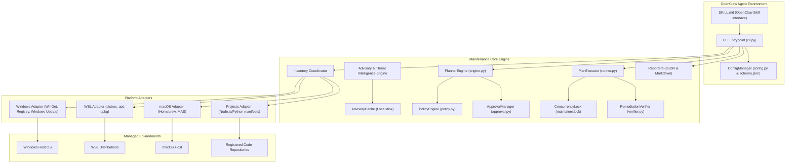
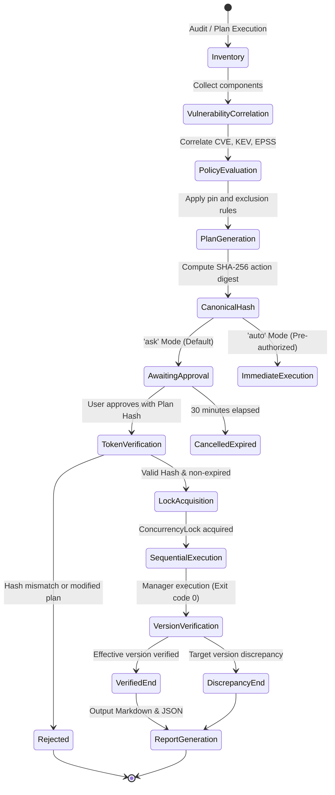

# Technical Architecture of `security-maintainer`

> [!WARNING]
> **Safety Notice and Operating Scope:**
> `security-maintainer` manages operating system components (Windows host, macOS, and Linux/WSL environments) and registered project dependencies. Package update actions modify host binaries and shared libraries. To guarantee system stability, the default mode is strictly `ask` (requiring a numbered plan, immutable SHA-256 fingerprint, and explicit user confirmation). Never enable automated mode without prior audit of installed services.
> 
> *Language note:* This architecture specification is maintained in English as the primary universal standard. Multilingual and Spanish prompts are supported via OpenClaw natural language mapping.

`security-maintainer` is engineered under a decoupled, deterministic architecture designed to operate across hybrid environments where the OpenClaw agent runs inside WSL or directly on the host (Windows, macOS, or Linux).

## 1. High-Level Architecture Diagram

---

## 2. State Machine and Plan Lifecycle

> [!IMPORTANT]
> **Warning Regarding Execution Modes:**
> Modifications to system libraries and binaries carry compatibility risks. Always audit the generated plan before considering any automated execution.

The engine operates under three strict modes: `audit`, `ask` (default), and `auto`.

---

## 3. Security Principles and Blast-Radius Containment

1. **Subprocess Isolation and Strict Argument Allowlist:**
   - Raw shell execution (`shell=True`) is strictly prohibited across all executors.
   - Command arguments are strictly sanitized: metacharacters (`;&|`$><`) are rejected immediately.
   - Only pre-approved package manager binaries (`winget`, `powershell`, `apt-get`, `brew`, `dpkg`) can be invoked.
2. **Untrusted Advisory Data Handling:**
   - Information retrieved from external vulnerability feeds (OSV, CISA KEV, NIST NVD) is treated as untrusted data. Descriptions and metadata are never executed or evaluated as shell syntax.
3. **Privilege Boundary Enforcement:**
   - If a Windows update requires elevated Administrator privileges and the process runs as a standard user, the action is marked as `BLOCKED_PERMISSIONS`. No silent UAC elevation is attempted.
   - In Linux/WSL environments, actions requiring elevated rights verify non-interactive access beforehand. If interactive password prompting is required, the action is immediately blocked with instructions for manual review.
4. **Concurrency Protection:**
   - A lockfile located at `~/.security-maintainer/maintainer.lock` with active PID registration prevents race conditions, simultaneous executions, and package manager database corruption.
5. **Plan Inmutability and Expiration:**
   - Every plan carries a UUIDv4 identifier and an immutable SHA-256 fingerprint generated from the canonical action tuple. Any tampering with plan files invalidates approval.
