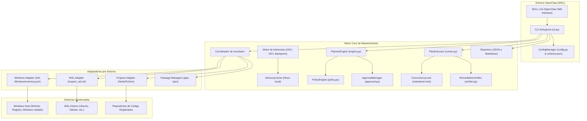
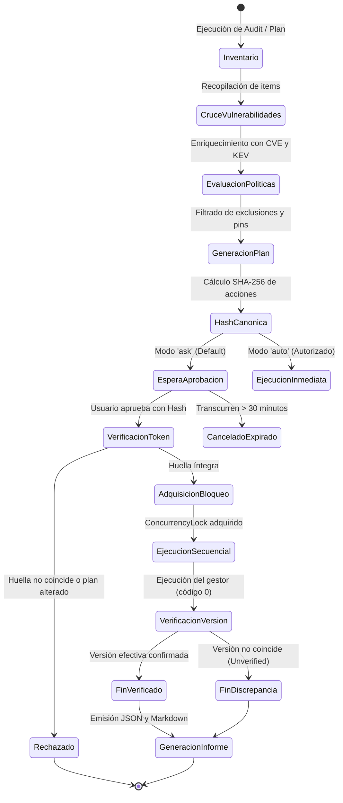

# Arquitectura Técnica de `security-maintainer`
 
> [!WARNING]
> **Aviso de Seguridad y Alcance del Sistema:**
> `security-maintainer` opera sobre componentes de sistema operativo (Windows, macOS, distribuciones Linux/WSL) y dependencias de proyectos. Las operaciones de actualización modifican binarios o librerías del sistema. Para preservar la integridad del entorno, el modo predeterminado es estrictamente `ask` (requiere plan numerado, hash SHA-256 inmutable y confirmación explícita del usuario). Nunca aplique el modo automático (`auto`) sin haber auditado previamente el impacto en los servicios instalados.

`security-maintainer` está diseñado bajo un modelo desacoplado y determinista para operar en entornos híbridos donde el agente OpenClaw se ejecuta dentro de WSL o nativamente en el anfitrión (Windows, macOS, Linux).

## 1. Diagrama de Arquitectura de Alto Nivel

---

## 2. Flujo de Estados y Ciclo de Vida del Plan

> [!IMPORTANT]
> **Advertencia sobre Modos de Ejecución:**
> Los cambios sobre paquetes y librerías del sistema conllevan riesgos de incompatibilidad o reinicio de servicios. Se debe auditar siempre el plan antes de considerar cualquier modo no supervisado.

El motor opera bajo tres modos estrictos: `audit`, `ask` (predeterminado) y `auto`.

---

## 3. Principios de Seguridad y Contención

1. **Aislamiento de Comandos:**
   - No se utiliza `shell=True` en llamadas de subprocess de Python.
   - Los nombres de paquetes e identificadores se validan contra expresiones regulares restrictivas (`^[a-zA-Z0-9_\-\.]+$`) antes de ser transmitidos a ejecutables.
2. **Tratamiento de Datos Externos:**
   - La información obtenida de OSV.dev, GitHub Advisories o catálogos CVE se procesa estrictamente como texto/metadatos no confiables. No se interpreta código ni sintaxis de shell contenida en descripciones.
3. **Control de Privilegios:**
   - Si una acción de Windows requiere permisos de Administrador y el proceso se ejecuta como usuario estándar, la acción se marca como `BLOCKED_PERMISSIONS` y no se intenta invocar `runas` ni scripts ocultos de elevación.
   - En Linux/WSL, las operaciones de paquetes que requieran privilegios delegados verifican de antemano el acceso no interactivo (`sudo -n true`). Si se requiere elevación interactiva no delegada, la acción se bloquea inmediatamente (`BLOCKED_PERMISSIONS`) y se devuelve la instrucción para ejecución manual por el operador.
4. **Bloqueo de Concurrencia:**
   - Se utiliza un archivo de bloqueo en `~/.security-maintainer/maintainer.lock` con PID registrado y verificación de proceso activo para impedir colisiones o corrupciones de gestores de paquetes.
5. **Caducidad e Inmutabilidad de Planes:**
   - Cada plan cuenta con un identificador único y una huella SHA-256 canónica construida sobre la tupla `(action_id, target, product_id, installed_version, target_version, command, privileges)`.
   - Cualquier alteración del archivo JSON del plan invalida la huella y es rechazada inmediatamente por `ApprovalManager`.
