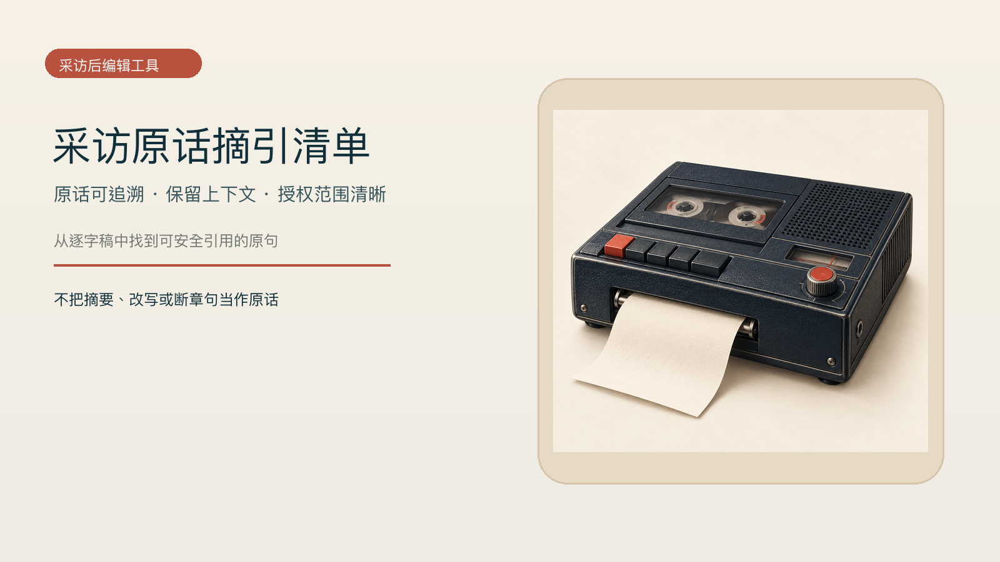

# Interview Quote Index

Turn an authorized interview transcript into safe, traceable pull quotes. Each usable quote includes the original speaker, a timestamp or paragraph location, essential context, and the permitted publication scope.



## Input and output

Provide one transcript of up to 6,000 Chinese characters, speaker and time anchors (paragraph IDs are acceptable when timestamps are absent), a topic, and publication permissions. The result contains at most 15 usable short quotes plus withheld or confirmation-needed items. Every usable quote remains traceable to the source and retains key negations and qualifiers.

If the transcript, identity, or permission scope is missing, the skill asks for the missing material instead of presenting a summary or rewrite as a quote.

## Install

```bash
npx skills add xxjrq/selfmedia-interview-quote-index-cn
```

See [SKILL.md](SKILL.md) for the operating rules. Copyable acceptance examples: [successful input](fixtures/success-input.md), [successful delivery](fixtures/success-output.md), [insufficient-material input](fixtures/failure-input.md), and [withheld delivery](fixtures/failure-output.md).

## Scope

This skill only selects faithful, traceable existing quotes. It does not interview, draft questions, or publish content, and it never removes negations or material qualifications to reverse a speaker's meaning.

## License and source note

The workflow's business purpose was informed by [marketingskills content strategy](https://github.com/coreyhaines31/marketingskills/tree/main/skills/content-strategy); all repository prose, steps, and examples are original. Licensed under [MIT-0](LICENSE).
