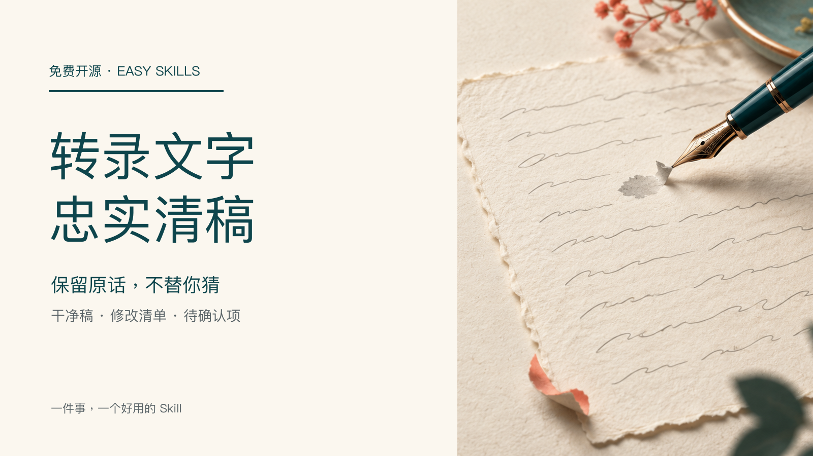

# 转录文字忠实清稿

把用户拥有或获授权的中文转录稿清成可读、可审的文字：保留事实、原话含义、说话人和时间标记，并明确列出改动与不能确认的位置。适合访谈、口述、视频字幕初稿；不转录音频，不把观点改成营销文案，也不假称核对过录音。



## 输入与结果

输入原始转录文字（最多 6000 字或约 20 分钟）、可选说话人/时间标记，以及“轻度、常规或保守”的清稿程度。结果固定包含：干净稿、逐项修改清单、听不清/疑似专名/数字等待确认项。没有文字或说话人无法区分时会请求补充；没有音频证据时不会猜品牌、数字或漏词。

## 安装

```bash
npx skills add xxjrq/selfmedia-transcript-cleanup-cn
```

## 使用

粘贴原始文本并说明清稿程度即可。完整规则见 [SKILL.md](SKILL.md)。可复制的成功与缺料交付分别见 [成功样例](fixtures/success.md) 和 [失败样例](fixtures/failure.md)。

## 验证

```bash
python3 scripts/self_test.py
```

本自检只验证仓库随附的参考交付是否忠实保留关键否定、数量与不确定性；实际清稿仍应以用户提供的原文为准。

## 来源与许可证

业务边界参考 [OpenAI Whisper](https://github.com/openai/whisper) 的公开项目用途说明，未复制其文本或代码。本仓库采用 [MIT License](LICENSE)。
