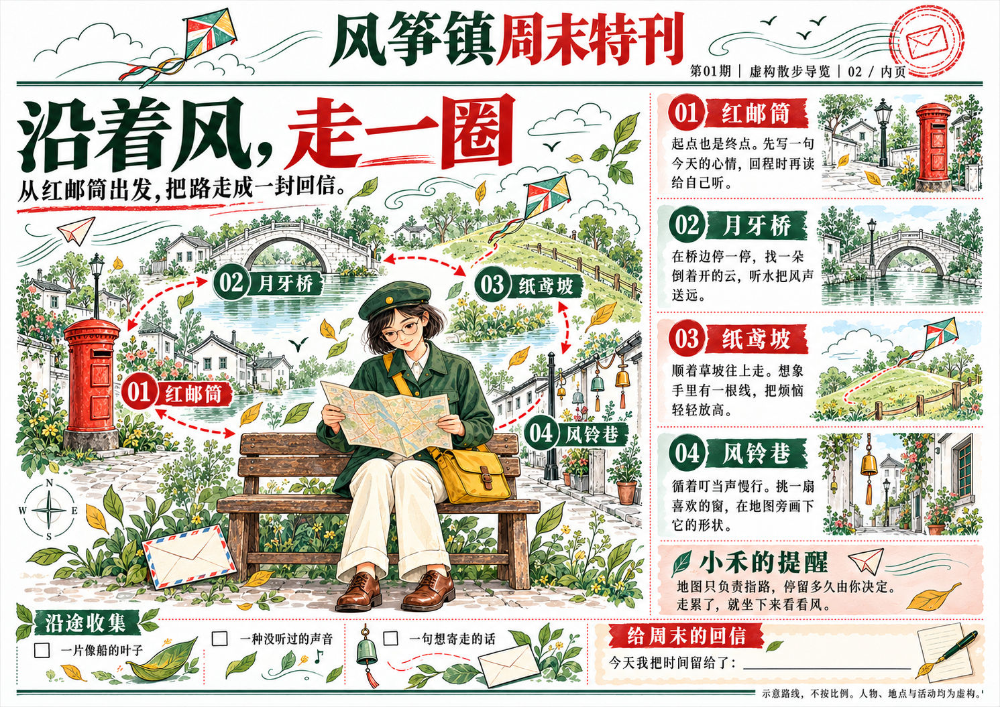

# 风筝镇周末特刊 · 真实制作示例

本期是发布验证用的原创虚构样报。人物小禾、风筝镇、四个散步地点和活动均为虚构，素材由图像生成工具新建，没有使用用户之前的真人照片或私人制作记录。




- [两版打印 PDF](newspaper.pdf)：A4 横版、单面，共两版，逐页渲染检查完成。
- [完整制作工程](project/project.json)：`project/` 目录包含源图、站姿提取、坐姿变体、最终页面、计划、提示和任务记录。
- [验证记录](validation.json)：实际调用与未知用量分开说明，包含缓存和恢复检查。
- [原创输入的制作记录](source-provenance.json)：源图是合成测试输入，不是真人或真实地点照片。

## 这次真实做了什么

独立 Agent 只依据安装包中的 Skill 和一张新建源图，完成整期策划、忠实提取、真实头版、坐姿编辑、协调内页、打印导出和工程恢复。三个确认点由明确授权的测试代理执行，记录为受委托确认，不宣称用户逐页点击过满意。

生产阶段实际执行 4 次图像工具调用：1 次提取、1 次必要姿态变化、2 次整版制作，无生图重试。另有 1 次测试源图创建。Token 与具体模型型号未由工具返回，记录为未知；任务数量不是完整账单，也不包含开发和代理推理消耗。

两版原生图像均为 1491×1055 像素，按 A4 横版等比导出，有效约 127.6 DPI。PDF 仅含成品版面，不嵌入工程。验证采用屏幕逐页检查，未进行物理打印。

内页的部分路线箭头呈双向，按 01–04 编号阅读即可；这是虚构示意图，不是现实导航地图。没有为了这一轻微表现差异再生成整版。

## 继续制作或归档

将整个 `project/` 复制到自己的工作目录，再按 [工程工具](../../references/project-tools.md) 操作；保留示例原稿。以安装包根目录为当前目录，使用已安装依赖的 Python：

```sh
python scripts/newspaper_project.py status --project examples/kite-town/project
python scripts/newspaper_project.py archive --project examples/kite-town/project --output kite-town.newspaper.zip
python scripts/newspaper_project.py restore --archive kite-town.newspaper.zip --project restored-kite-town
```

完整工程以文件夹随包提供，可按需归档为 `.newspaper.zip`。里面的文字是制作计划和提示；最终版面中的文字仍属于整版图片，不是可逐字编辑的排版图层。
