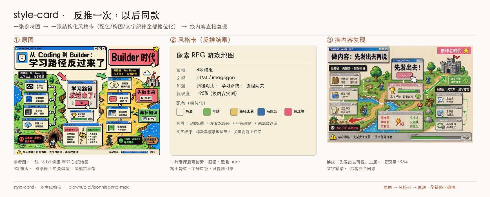

# style-card · 图生风格卡

把任何喜欢的图变成可复用的风格资产：**参考图 → 结构化风格卡 → 填槽生成同风格新图**。

一个 coding-agent skill，兼容任何有「读图 + 生图/文件系统」能力的 agent，零外部依赖。



> 一张参考图（像素 RPG 知识地图）→ 反推出的结构化风格卡（画幅 / 配色 hex / 构图骨架 / 文字纪律，全部槽位化）→ 换成「先发出去再说」主题复现，实测复现度 ~95%、文字零错。

## 它解决什么问题

- 看到好图只能说"哇好看"，说不出怎么做 → **风格卡**把风格拆成配色(hex)/构图线框/字体/槽位
- 市面"反推提示词"工具只输出一坨文本，不可复用 → 这里的卡是**槽位式模板 + 可积累的风格库**，越用越厚
- 反推的 prompt 不可信 → 每张卡必须经过**换内容闭环验证**（生成→对比→差异回写）才算 verified

## 三种引擎

| 引擎 | 适用 | 成本 |
|---|---|---|
| **imagegen** | 插画感强的风格（手绘/像素/拼贴/霓虹） | 生图模型，约 5-10 积分/张 |
| **html** | 文字密集的知识卡（中文排版要求高） | 零积分，文字 100% 准确 |
| **html-anim** | 原理动画、流程演示（CSS 动画） | 零积分，自循环 HTML |

## 目录结构（渐进加载）

```
style-card/
├── SKILL.md                      # 工作流地图：反推→验证→入库→复用
├── README.md                     # 本文件
├── LICENSE                       # MIT
├── gotchas.md                    # 生图实战坑清单（持续回写）
├── library/
│   ├── INDEX.json                # 风格库索引（紧凑元数据，永远先读）
│   └── cards/*.md                # 风格卡正文（含可复制的生成 prompt）
├── references/
│   ├── reverse-meta-prompt.md    # 图→风格卡 的反推模板
│   ├── html-base.css             # HTML 引擎强制底座样式
│   └── html-template.md          # HTML 引擎结构规范（含动画模式）
├── scripts/export-png.sh         # HTML → PNG 截图导出
├── examples/                     # 实际产出样例（验证图 + HTML 成品）
└── assets/                       # 各卡参考原图
```

## 快速开始

给 agent 一句话即可：

- **反推**：「用 style-card 帮这张图做一张风格卡」+ 图片
- **复用**：「用我的风格卡库，把这段内容出成图：……」

内置 11 张已验证风格卡，覆盖：复古印刷信息图、手绘白板涂鸦、像素 RPG 游戏地图、终端风封面、技术原理分步动画、新粗野主义、便当盒 Bento Grid、杂志编辑风、极简大字报、拍立得拼贴、暗色霓虹。

## 致谢

工作流设计借鉴了 [zarazhangrui/frontend-slides](https://github.com/zarazhangrui/frontend-slides) 的 progressive disclosure 与 show-don't-tell 理念。

## License

MIT
