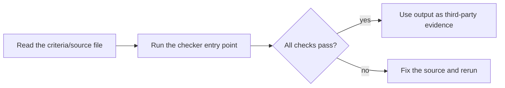

# symbiosis-expert-team

This skill should be used when invoking the expert symbiosis-expert-team (共生专家团) — see the package agents for the full persona. 五人AI共生专家团：内嵌XCGS治理属性，支持AI社交、硬件接入、状态可视与知识灌注，与人类长期共事。 当需要调用专家「共生专家团」（symbiosis-expert-team）时使用。

> 凡自治之物 · LGD 治理学 · 创造术家族

## Usage

- Entry point: `SKILL.md` — read its frontmatter `name` / `description` to decide applicability, then follow the steps.
- 人设文件：`agents/` 下五位能力位人设（expert-social / expert-hardware / expert-visual / expert-knowledge / expert-human-copilot，能力位命名、非真人；原始五人明细未在上游发现，按 description 能力面推导并标注供校准）。
- 执行器：`python scripts/route.py`（路由表）/ `--check`（agents/ 在位性与 frontmatter 校验）/ `--selftest`（包机制自检）。

## 证据与安全声明（Evidence & Security）

- **证据（Evidence）**：源文件 = `SKILL.md` / `README.md` / `AGENTS.md` / `llms.txt` / `agents/`（5 份能力位人设）/ `scripts/route.py`；执行器 = `scripts/route.py --check` 与 `--selftest` 实跑 PASS；来源核验 = 上游 git 历史（origin/master 与本地提交树均无原始 agents/）。
- **版本（Version）**：1.1.0。
- **安全（Security）**：无凭证、无内部路径；不冒充人类身份；讲解不构成专业意见。

## License

MIT — see [LICENSE](LICENSE).


---

## Quick start / 快速开始

**English**: Zero-dependency Python CLI skill package. See `SKILL.md` for the when-to-use guide and the executable entry point below. 中文说明见下文。



### Example run / 示例输出

Recorded on 2026-10-16 with a clean Python 3.13 environment (stdlib only):

```text
$ python scripts/route.py --check
校验 agents/ 人设文件（共 5 份）...
OK：agents/expert-social.md（name=expert-social）
OK：agents/expert-hardware.md（name=expert-hardware）
OK：agents/expert-visual.md（name=expert-visual）
OK：agents/expert-knowledge.md（name=expert-knowledge）
OK：agents/expert-human-copilot.md（name=expert-human-copilot）
OK：SKILL.md frontmatter 九字段齐全。
CHECK PASS：五份能力位人设均在位且 frontmatter 可解析，SKILL.md 字段齐全。
$ echo $?
0
```
