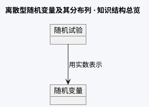

# 数据格式规范

本文档定义三套格式：**知识大纲格式（JSON_OUTLINE）** 是 Agent 与教师确认结构的中间产物；**KV_CONFIG** 是嵌入讲解主页/单文件综合页的渲染配置；**PLOT_CONFIG** 是嵌入交互图像页（B 页）的渲染配置。Agent 工作流为：生成 JSON_OUTLINE → 教师确认 → 按输出形态转化为 KV_CONFIG（+ 需要时 PLOT_CONFIG）→ 写入对应 HTML。技能包不附带 template.html 文件，渲染代码由 Agent 按本文档契约在 HTML 内自行实现。

---

## 第一部分：知识大纲格式（JSON_OUTLINE）

JSON_OUTLINE 是 Agent 在第 2 步（知识结构化）输出的中间产物，用于与教师确认知识结构。**确认后**再转化为 KV_CONFIG。

### 完整结构

```json
{
  "subject": "初中生物",
  "main_topic": "光合作用",
  "graph_type": "concept-map",
  "sub_graph_type": "flowchart",
  "nodes": [
    {
      "id": "n1",
      "label": "光合作用",
      "definition": "绿色植物通过叶绿体，利用光能，把CO₂和水转化成有机物并释放O₂",
      "weight": "high",
      "unconfirmed": false
    },
    {
      "id": "n2",
      "label": "原料",
      "definition": "二氧化碳和水",
      "weight": "mid",
      "unconfirmed": false
    }
  ],
  "edges": [
    { "from": "n1", "to": "n2", "label": "需要" }
  ],
  "teaching_tips": {
    "easy_mistake": "光合作用在叶绿体中进行，呼吸作用在线粒体中进行，不要混淆场所",
    "basic_question": "光合作用的原料和产物分别是什么？",
    "advanced_question": "如果把绿叶比作'绿色工厂'，它的车间、机器、动力分别是什么？"
  }
}
```

### 字段说明

| 字段 | 必填 | 说明 |
| --- | --- | --- |
| `subject` | ✅ | 学科+学段，如"初中生物""高中历史""小学语文" |
| `main_topic` | ✅ | 核心主题，如"光合作用""辛亥革命" |
| `graph_type` | ✅ | 主图型，取值见九种图型枚举 |
| `sub_graph_type` | ❌ | 辅图型（最多 1 个），内容含多种结构时使用 |
| `nodes` | ✅ | 节点数组（数量不设上限，内容完整覆盖为准；节点多时画布坐标自动扩展并保持初始适应全图） |
| `nodes[].id` | ✅ | 唯一标识，格式 n1/n2/... |
| `nodes[].label` | ✅ | 节点名，≤ 8 字 |
| `nodes[].definition` | ✅ | 精简释义，≤ 40 字 |
| `nodes[].explain` | ❌ | 完整释义（含公式与文字说明，供知识结构总览单击展开，见 10.9） |
| `nodes[].weight` | ✅ | 重要程度：`high`/`mid`/`low`，决定视觉大小与颜色饱和度 |
| `nodes[].unconfirmed` | ✅ | 布尔值，事实待核实时为 `true`，页面显示黄色水印 |
| `edges` | ✅ | 关系边数组 |
| `edges[].from` | ✅ | 起始节点 id |
| `edges[].to` | ✅ | 目标节点 id |
| `edges[].label` | ✅ | 关系词（**必须填写**），如"包含""导致""区别于" |
| `teaching_tips` | ✅ | 教学提示 |
| `teaching_tips.easy_mistake` | ✅ | 1 个具体易错概念 |
| `teaching_tips.basic_question` | ✅ | 课堂导入/提问的基础记忆题 |
| `teaching_tips.advanced_question` | ✅ | 小组讨论的分析/评价题 |
| `content` | ❌ | 内容模块：`definition` 正式定义、`formulas[]` 公式（含 `conditions` 适用条件）、`examples[]` 典型示例（`question` 题干 + `steps`/`answer` 默认隐藏答案）、`variations[]` 常见变式（详见第八部分） |
| `quiz` | ❌ | 互动自测题 1-3 道：`type`=choice/judge、`options`、`answer`、`solution`（规范标准答案，必填）、`explain`（补充解析，可选）（详见第八部分） |
| `image_kind` | ❌ | 双文件形态标记：`math-plot`（函数图像）/ `schema-diagram`（示意图）；单文件时省略 |
| `param_drafts` | ❌ | 拟做成滑块的参数草稿列表，如"底数 a ∈ [0.2, 5]"（供交互图像页 params 使用） |
| `knowledge_anchors` | ❌ | 内置知识库锚点：权威节点名/定义/关系词/代码版本，供渲染后自检比对（详见第十部分 10.3） |

### weight 分级规范

- `high`：考试重点或核心概念，整图不超过 3 个。视觉表现：放大 1.2 倍、颜色饱和度最高、加 ⭐ 标记。
- `mid`：重要但非核心的概念。视觉表现：默认大小与颜色。
- `low`：辅助性、拓展性概念。视觉表现：缩小 0.9 倍、颜色降低饱和度。

### unconfirmed 标注规范

当 Agent 对某节点的事实性内容（年代、公式、定义、分类、数据）置信度 < 90% 时：
1. 在 JSON_OUTLINE 中设置 `"unconfirmed": true`
2. 在 `definition` 末尾追加 `[unconfirmed]` 标记
3. 转化为 KV_CONFIG 时，`meta.hasUnconfirmed` 自动设为 `true`
4. 最终 HTML 页面右上角渲染半透明黄色旋转水印"⚠ 教师待核实"

---

## 第二部分：KV_CONFIG 渲染配置

生成页面的内嵌脚本读取 `window.KV_CONFIG` 配置对象进行渲染。JSON_OUTLINE 确认后，Agent 将其转化为以下格式嵌入 HTML。

### 顶层结构

```json
{
  "meta": {
    "subject": "初中生物",
    "topic": "光合作用",
    "stage": "八年级",
    "scenario": "课堂讲授",
    "diagramType": "concept-map",
    "subDiagramType": "flowchart",
    "objectives": ["说出光合作用的原料、产物和条件", "理解光合作用过程中的物质转化和能量转化"],
    "hasUnconfirmed": false,
    "teachingTips": {
      "easyMistake": "光合作用在叶绿体中进行，呼吸作用在线粒体中进行，不要混淆场所",
      "basicQuestion": "光合作用的原料和产物分别是什么？",
      "advancedQuestion": "如果把绿叶比作'绿色工厂'，它的车间、机器、动力分别是什么？"
    }
  },
  "data": { /* 按图型不同，见下方各节 */ }
}
```

### JSON_OUTLINE → KV_CONFIG 映射规则

| JSON_OUTLINE 字段 | KV_CONFIG 字段 | 说明 |
| --- | --- | --- |
| `subject` | `meta.subject` | 直接映射 |
| `main_topic` | `meta.topic` | 直接映射 |
| `graph_type` | `meta.diagramType` | 直接映射 |
| `sub_graph_type` | `meta.subDiagramType` | 无则省略 |
| `nodes[].weight` | `data.nodes[].weight` | 直接映射到各图型的节点数据中 |
| `nodes[].unconfirmed` | `data.nodes[].unconfirmed` | 直接映射，渲染时加黄色虚线边框 |
| `nodes[].explain` | `data.nodes[].explain` | 完整释义（含公式/文字），供总览节点单击展开（见 10.9） |
| `teaching_tips.easy_mistake` | `meta.teachingTips.easyMistake` | 驼峰转换 |
| `teaching_tips.basic_question` | `meta.teachingTips.basicQuestion` | 驼峰转换 |
| `teaching_tips.advanced_question` | `meta.teachingTips.advancedQuestion` | 驼峰转换 |
| （自动计算） | `meta.hasUnconfirmed` | 任一节点 `unconfirmed: true` 则为 `true` |
| （Agent 生成） | `meta.objectives` | 从节点中提取 2-3 条学习目标 |
| （Agent 生成） | `meta.stage` | 从 subject 中拆出学段 |
| `knowledge_anchors` | `meta.knowledgeBase` | 内置知识库锚点，供渲染后自检比对（第十部分 10.3） |

---

## 第三部分：九种图型的 data 格式

### 1. concept-map（概念关系图）

节点 + 带连接词的边。**边必须有关联文字**。

```json
"data": {
  "nodes": [
    { "id": "n1", "label": "光合作用", "tip": "绿色植物通过叶绿体，利用光能，把CO₂和水转化成储存能量的有机物，并释放O₂的过程", "weight": "high", "unconfirmed": false, "level": 0 },
    { "id": "n2", "label": "原料", "tip": "二氧化碳和水", "weight": "mid", "unconfirmed": false, "level": 1 },
    { "id": "n3", "label": "产物", "tip": "有机物（淀粉）和氧气", "weight": "mid", "unconfirmed": false, "level": 1 },
    { "id": "n4", "label": "条件：光能", "tip": "光能是能量来源", "weight": "mid", "unconfirmed": false, "level": 1 },
    { "id": "n5", "label": "场所：叶绿体", "tip": "含叶绿素的绿色部分", "weight": "high", "unconfirmed": false, "level": 1 },
    { "id": "n6", "label": "二氧化碳", "tip": "来自空气，通过气孔进入叶片", "weight": "low", "unconfirmed": false, "level": 2 },
    { "id": "n7", "label": "水", "tip": "根从土壤吸收，导管运输", "weight": "low", "unconfirmed": false, "level": 2 }
  ],
  "edges": [
    { "from": "n1", "to": "n2", "label": "需要" },
    { "from": "n1", "to": "n3", "label": "产生" },
    { "from": "n1", "to": "n4", "label": "利用" },
    { "from": "n1", "to": "n5", "label": "发生于" },
    { "from": "n2", "to": "n6", "label": "包括" },
    { "from": "n2", "to": "n7", "label": "包括" }
  ]
}
```

布局：`level=0` 居中，`level=1` 环绕，`level=2` 向外延展。节点数不设上限（完整覆盖优先）；节点多时画布坐标自动扩展并保持初始适应全图。总览内每个节点都应编写 `explain` 完整释义（含公式/文字，单击节点展开，见 10.9），`tip` 仅作悬浮简述（≤40 字）。

---

### 2. mindmap（思维导图）

中心主题 + 多级分支，树形数据：

```json
"data": {
  "root": {
    "label": "辛亥革命",
    "tip": "1911年爆发的资产阶级民主革命",
    "weight": "high",
    "unconfirmed": false,
    "children": [
      { "label": "背景", "children": [
        { "label": "民族危机加深", "tip": "《辛丑条约》后清政府完全沦为洋人朝廷", "weight": "mid", "unconfirmed": false },
        { "label": "民族资本主义发展", "tip": "资产阶级力量壮大", "weight": "low", "unconfirmed": false }
      ]},
      { "label": "过程", "children": [
        { "label": "武昌起义 1911.10.10", "tip": "湖北新军中的革命党人率先起义", "weight": "high", "unconfirmed": false },
        { "label": "各省响应独立", "tip": "十几个省宣布脱离清政府", "weight": "mid", "unconfirmed": false }
      ]},
      { "label": "成果", "children": [
        { "label": "中华民国成立 1912.1.1", "tip": "孙中山就任临时大总统", "weight": "high", "unconfirmed": false },
        { "label": "清帝退位", "tip": "结束两千多年君主专制制度", "weight": "mid", "unconfirmed": false },
        { "label": "《临时约法》", "tip": "中国第一部资产阶级共和国宪法性质的文件", "weight": "mid", "unconfirmed": false }
      ]},
      { "label": "局限", "children": [
        { "label": "果实被袁世凯窃取", "tip": "未改变半殖民地半封建社会性质", "weight": "low", "unconfirmed": false }
      ]}
    ]
  }
}
```

层级建议 ≤ 4 层，一级分支 3-6 个。

---

### 3. flowchart（流程图）

线性步骤 + 可选判断分支：

```json
"data": {
  "steps": [
    { "id": "s1", "label": "审题", "tip": "明确已知量、未知量，圈出关键词", "type": "start", "weight": "mid", "unconfirmed": false },
    { "id": "s2", "label": "设未知数", "tip": "一般设所求量为 x，注意单位", "type": "process", "weight": "mid", "unconfirmed": false },
    { "id": "s3", "label": "列方程", "tip": "根据等量关系列出一元一次方程", "type": "process", "weight": "high", "unconfirmed": false },
    { "id": "s4", "label": "检验", "tip": "解是否符合实际意义？", "type": "decision", "weight": "high", "unconfirmed": false,
      "branches": [
        { "label": "符合", "to": "s5" },
        { "label": "不符合", "to": "s2" }
      ]
    },
    { "id": "s5", "label": "作答", "tip": "写清单位和答语", "type": "end", "weight": "low", "unconfirmed": false }
  ]
}
```

`type`：`start` / `process` / `decision` / `end`。无分支时 steps 按顺序连线；有 `branches` 时按分支连线（分支 `to` 引用目标 step id）。

---

### 4. timeline（时间轴）

```json
"data": {
  "eras": [
    { "name": "史前时期", "range": "约170万年前—前2070年", "color": "#8d6e63" }
  ],
  "events": [
    { "time": "前221年", "title": "秦统一六国", "desc": "建立中国历史上第一个统一的多民族中央集权国家", "era": 0, "weight": "high", "unconfirmed": false },
    { "time": "前202年", "title": "西汉建立", "desc": "刘邦称帝，定都长安", "era": 0, "weight": "mid", "unconfirmed": false }
  ]
}
```

`eras` 可为空数组（不划分阶段时）；有阶段划分时事件按 `era` 索引着色。事件按时间正序排列。

---

### 5. compare-table（对比矩阵）

```json
"data": {
  "subjects": ["蒸发", "沸腾"],
  "common": ["都属于汽化现象", "都需要吸热"],
  "rows": [
    { "dim": "发生温度", "values": ["任何温度下", "达到沸点时"] },
    { "dim": "发生位置", "values": ["只在液体表面", "表面和内部同时"] },
    { "dim": "剧烈程度", "values": ["缓慢平和", "剧烈"] },
    { "dim": "温度变化", "values": ["吸热降温有致冷作用", "沸腾时温度保持不变"] }
  ],
  "weights": ["high", "high"],
  "unconfirmed": [false, false]
}
```

`common`（相同点）必填至少 1 条；`rows[].values` 顺序与 `subjects` 对应。支持 2-4 个对比对象。`weights` 和 `unconfirmed` 数组顺序与 `subjects` 对应。渲染行为：对比表默认"逐格按需展示"——表头行与类别列显示文字，内容单元格及"相同点/不同点"条目初始空白，单击才逐一呈现、可再点收起（见第十部分 10.4）。

---

### 6. hierarchy（层级分类图）

```json
"data": {
  "root": {
    "label": "生物分类",
    "weight": "high",
    "unconfirmed": false,
    "children": [
      { "label": "植物界", "weight": "high", "unconfirmed": false, "children": [
        { "label": "藻类植物", "tip": "无根茎叶分化", "weight": "low", "unconfirmed": false },
        { "label": "苔藓植物", "tip": "有茎叶，无根", "weight": "mid", "unconfirmed": false },
        { "label": "蕨类植物", "tip": "有根茎叶，孢子繁殖", "weight": "mid", "unconfirmed": false },
        { "label": "种子植物", "weight": "high", "unconfirmed": false, "children": [
          { "label": "裸子植物", "tip": "种子裸露，无果皮包被", "weight": "mid", "unconfirmed": false },
          { "label": "被子植物", "tip": "种子外有果皮包被", "weight": "mid", "unconfirmed": false }
        ]}
      ]},
      { "label": "动物界", "tip": "可继续展开无脊椎/脊椎", "weight": "high", "unconfirmed": false }
    ]
  }
}
```

自上而下树状布局，层级 ≤ 5 层。

---

### 7. cycle（循环过程图）

```json
"data": {
  "nodes": [
    { "id": "c1", "label": "生产者", "tip": "绿色植物，光合作用固定碳", "weight": "high", "unconfirmed": false },
    { "id": "c2", "label": "消费者", "tip": "动物摄食有机物", "weight": "mid", "unconfirmed": false },
    { "id": "c3", "label": "分解者", "tip": "细菌真菌分解遗体", "weight": "mid", "unconfirmed": false },
    { "id": "c4", "label": "大气CO₂", "tip": "呼吸作用、分解释放二氧化碳", "weight": "low", "unconfirmed": false }
  ],
  "edges": [
    { "from": "c4", "to": "c1", "label": "光合作用吸收" },
    { "from": "c1", "to": "c2", "label": "摄食" },
    { "from": "c2", "to": "c3", "label": "遗体" },
    { "from": "c3", "to": "c4", "label": "分解释放" },
    { "from": "c1", "to": "c4", "label": "呼吸作用" }
  ]
}
```

节点沿圆周均匀排布，箭头环形顺时针；边 label 可选。

---

### 8. fishbone（因果鱼骨图）

```json
"data": {
  "problem": "实验测得密度偏小",
  "problemWeight": "high",
  "unconfirmed": false,
  "bones": [
    { "category": "测量仪器", "causes": ["天平未调平", "砝码磨损"] },
    { "category": "操作方法", "causes": ["物体沾水导致质量测大", "量筒读数仰视"] },
    { "category": "实验对象", "causes": ["物体有空隙吸水"] },
    { "category": "环境因素", "causes": ["温度影响体积"] }
  ]
}
```

主骨 4-6 根，每根 1-4 个原因。

---

### 9. knowledge-map（知识地图）

子主题卡片网格 + 卡片间关联箭头，用于单元总览：

```json
"data": {
  "cards": [
    { "id": "k1", "title": "声的产生", "summary": "物体振动产生声音", "tag": "基础概念", "weight": "high", "unconfirmed": false, "x": 0, "y": 0 },
    { "id": "k2", "title": "声的传播", "summary": "需要介质，真空不能传声；声速340m/s", "tag": "基础概念", "weight": "high", "unconfirmed": false, "x": 1, "y": 0 },
    { "id": "k3", "title": "声音的特性", "summary": "音调、响度、音色", "tag": "核心规律", "weight": "high", "unconfirmed": false, "x": 2, "y": 0 },
    { "id": "k4", "title": "噪声控制", "summary": "声源处、传播中、人耳处", "tag": "应用", "weight": "mid", "unconfirmed": false, "x": 1, "y": 1 }
  ],
  "links": [
    { "from": "k1", "to": "k2", "label": "前提" },
    { "from": "k2", "to": "k3", "label": "决定" },
    { "from": "k3", "to": "k4", "label": "应用于" }
  ]
}
```

`x/y` 为网格坐标（从 0 开始），模板按网格自动布局；`tag` 用于卡片着色（基础概念/核心规律/应用/拓展）。

---

## 第四部分：多图组合

一个页面最多 3 个图，使用数组：

```json
{
  "meta": { ... , "diagramType": "multi" },
  "diagrams": [
    { "type": "flowchart", "title": "实验流程", "data": { ... } },
    { "type": "compare-table", "title": "现象对比", "data": { ... } }
  ]
}
```

---

## 第五部分：通用约定

- 所有 `tip` 字段：节点释义，≤ 40 字，点击/悬停节点时展示。
- 所有 `label`：节点/连线文字，节点名 ≤ 8 字。
- 所有节点必须包含 `weight`（`high`/`mid`/`low`）和 `unconfirmed`（布尔值）字段。
- `weight: "high"` 的节点整图不超过 3 个。
- `unconfirmed: true` 的节点在页面中显示黄色虚线边框，并触发右上角"⚠ 教师待核实"水印。
- 文本中不得出现 HTML 标签；需要强调用 emoji（⭐重点、⚠易错、📌要点）。
- 配置必须是合法 JSON（无注释、无尾逗号），写入页面前自行校验。
- 所有来自教师输入/网页检索的文本在写入 HTML 或 JSON 前必须转义：`&`→`&amp;`、`<`→`&lt;`、`>`→`&gt;`、`"`→`&quot;`、`'`→`&#39;`。
- KV_CONFIG 以 `<script>` 内嵌时，序列化后必须将 `<` 写作 `\u003c`（或转义 `</script`、`<!--`、`<script`），防止 `</script>` 提前闭合被注入脚本。
- 任何字段值不得携带可执行代码或外部资源 URL（无 `javascript:`、无 `<iframe>`、无外链图片/脚本）。默认零外部依赖（CSS/JS 全内联）；确需 CDN（MathJax/Chart.js）时须在文件头注释注明库名、版本、来源与用途，且页面主体不得依赖其加载成功（离线降级仍完整可读），详见 SKILL.md 安全规范与核心原则 6。

---

## 第六部分：教师待核实水印规范

当 `meta.hasUnconfirmed = true` 时，页面内嵌脚本在右上角渲染水印：

- **屏幕显示**：半透明黄色（`rgba(255, 193, 7, 0.15)`）旋转 -15° 水印，文字"⚠ 教师待核实"，`position: fixed; top: 20px; right: 20px; z-index: 9999`，不遮挡正文。
- **打印输出**：水印变为灰色文字"[待核实]"，位于页眉右侧。
- **未确认节点**：`unconfirmed: true` 的节点额外显示黄色虚线边框（`border: 2px dashed #ffc107`）。

## 第七部分：双文件输出与页面关联（输出形态=双文件时）

输出形态判定规则见 SKILL.md"五、输出形态判定"：知识含数学函数图像或地理/物理示意图（参数影响形状、过程可演示）时，必须输出**两个独立 HTML**，本部分规定两者的职责分工与互链方式。

### A 图文讲解主页（KV_CONFIG）

- 职责：知识点深度讲解——学习目标、主结构图（九种图型之一）、内容模块（定义/公式/示例/易错/变式）、互动自测、课堂互动问题。
- 顶部必须有一个醒目的跳转按钮（高 ≥ 48px、字号 ≥ 20px）：`<a class="btn-plot" href="同目录B页净化文件名" target="_blank" rel="noopener">🎯 打开交互图像页</a>`；同文件被双击以 file:// 打开时，相对链接仍可用。

### B 交互图像页（PLOT_CONFIG）

- 职责：只放图像与参数操作——坐标系画布、参数滑块/输入框、多子图标签页。不放冗长文字讲解（避免信息拥挤）。
- 顶部提供返回链接：`<a href="同目录A页净化文件名">📖 返回图文讲解</a>`。
- 两页文件名必须成对：`{学段}_{学科}_{主题}_图文讲解.html` 与 `{学段}_{学科}_{主题}_交互图像.html`（净化规则见 SKILL.md 安全规范第 4 条）。

## 第八部分：内容模块与互动自测数据格式（讲解主页）

JSON_OUTLINE 经教师确认后，`content` 与 `quiz` 映射进 KV_CONFIG：

```json
{
  "meta": {
    "...原有字段...",
    "content": {
      "definition": "定义正文（可长于节点释义）",
      "formulas": [
        { "name": "公式/原理名称", "body": "公式内容（MathML 或 LaTeX 源码，经公式引擎渲染）", "format": "mathml", "conditions": "适用条件（如：a>0 且 a≠1）" }
      ],
      "examples": [
        { "title": "例1｜求定义域", "question": "题干", "steps": ["步骤1", "步骤2"], "answer": "答案" }
      ],
      "variations": [
        { "title": "变式1｜底数含参", "body": "变式内容与提示" }
      ]
    },
    "quiz": [
      {
        "type": "choice | judge",
        "question": "题干",
        "options": ["选项A", "选项B", "选项C"],
        "answer": 1,
        "solution": "规范标准答案：完整数值 + 单位 + 必要公式推导或关键步骤（必填，禁止只给最终数字）",
        "explain": "补充解析（可选，答后展示）"
      }
    ]
  }
}
```

字段说明：

| 字段 | 说明 |
| --- | --- |
| `content.definition` | 正式定义；无独立定义时可省略，改用图节点释义 |
| `content.formulas[]` | 核心公式/原理，`conditions` 必须写适用条件（分母、定义域、前提等）；公式书写遵循学术符号规范（第十一部分：变量斜体、上下标、无 ^ 写法）；`body` 写 MathML 或 LaTeX 源码（可加 `format: "mathml"|"latex"`），渲染经公式引擎 |
| `content.examples[]` | 典型示例：`question` 为题干，`steps`/`answer` 为解题步骤与答案（默认隐藏，需点击展开，见"第十部分 10.2"）；示例含代码时加 `code`（含 lang 标注，见"第十部分 10.3"版本自检） |
| `content.variations[]` | 常见变式：考试变式、参数变式、易混变形 |
| `quiz[]` | 互动自测题 1-3 道；`type=choice` 时 `options` ≥ 2 项、`answer` 为正确项下标；`type=judge` 时 `options` 省略、`answer` 为 true/false；每题必须含 `solution`（规范标准答案：完整数值、单位、必要公式推导或关键步骤，禁止只给最终数字）；`explain` 为补充解析（可选） |

渲染要求：
- 内容模块按"定义 → 公式/原理 → 典型示例 → 常见变式"顺序渲染为卡片；无公式的知识点省略公式卡。
- 典型示例卡：**初始只显示题干**，答案区（`steps`/`answer`/`code`）默认隐藏；点击题干或"显示答案"按钮才展开，再次点击或点击卡片外区域收起（详见第十部分 10.2）。
- 定义/公式若以表格或一览表呈现（如"概念 | 定义"表、"公式名 | 表达式 | 适用条件"表），与对比表一样默认"逐格按需展示"：表头行与类别列显示文字，内容单元格初始空白、单击呈现、可再单击收起（详见第十部分 10.4）。
- 自测题作答反馈按第十部分 10.10 执行：点击选项/对错同步即时判定（≤100ms、同一帧或下一帧呈现）、正确绿✔/错误红✘ 双标识 + 醒目文字"回答正确！/回答错误！"，答错时正确选项同步标绿；无论对错，题卡下方必显规范标准答案 `solution`（完整数值/单位/公式推导或关键步骤，禁止只给最终数字），`explain` 补充解析紧随；反馈紧贴选项不遮挡题干；全键盘可达（Tab + Enter/Space）；全部答完显示得分与"再练一次"按钮。全程 DOM 操作，禁止 alert()。
- 易错提醒（`teaching_tips.easyMistake`）以"⚠ 易错点"角标或卡片呈现，位置紧跟对应内容模块。

## 第九部分：交互图像页契约（PLOT_CONFIG，B 页）

B 页内嵌脚本读取 `window.PLOT_CONFIG` 渲染。技能包不附带该模板，渲染引擎须由 Agent 在 B 页内实现并满足以下契约。

### 顶层结构

```json
{
  "meta": {
    "subject": "高中数学",
    "topic": "对数函数 y = log_a(x) 的图像与性质",
    "backFile": "高中_数学_对数函数_图文讲解.html"
  },
  "params": [
    { "key": "a", "label": "底数 a", "min": 0.2, "max": 5, "step": 0.1, "value": 2 },
    { "key": "c", "label": "平移量 c", "min": -3, "max": 3, "step": 0.5, "value": 0 }
  ],
  "panels": [
    {
      "id": "p1",
      "title": "y = log_a(x) + c 的图像",
      "type": "math",
      "axes": { "xMin": -1, "xMax": 9, "yMin": -4, "yMax": 4, "xLabel": "x", "yLabel": "y" },
      "curves": [
        { "expr": "Math.log(x)/Math.log(a) + c", "label": "y = log_a(x)+c", "color": "#2563eb", "width": 3 }
      ],
      "annotations": [
        { "kind": "asymptote", "at": 0, "axis": "y", "label": "x=0（渐近线）" },
        { "kind": "point", "x": 1, "y": "c", "label": "恒过点 (1,c)" }
      ]
    },
    {
      "id": "p2",
      "title": "底数变化对比",
      "type": "math",
      "axes": { "xMin": -1, "xMax": 9, "yMin": -4, "yMax": 4, "xLabel": "x", "yLabel": "y" },
      "curves": [
        { "expr": "Math.log(x)/Math.log(2)", "label": "a=2", "color": "#16a34a", "width": 2 },
        { "expr": "Math.log(x)/Math.log(0.5)", "label": "a=0.5", "color": "#f59e0b", "width": 2 }
      ]
    }
  ]
}
```

### 参数（params）

- `key`：参数标识，供 `expr` 引用；`label` 显示名；`min/max/step/value` 构成滑块范围与默认值。
- 滑块与数字输入框双向绑定：拖动滑块或键入数值即时更新，`requestAnimationFrame` 节流重绘。
- 参数取值范围须避开数学无意义区（如 log 底数 a 的 min 从 0.2 起、且不等于 1——若 step 会跨过 1，用分段滑块或把 a≠1 写进注释并提示）。

### 面板类型

**`type: "math"`（函数图像）**：
- `curves[].expr`：以 `x` 与各 `params[].key` 为变量的 JS 表达式（引擎用 `new Function` 求值时须先做字符白名单校验：仅允许 `[0-9a-zA-Z_+\-*/(). ,Math]`，杜绝注入）；采样绘制，定义域外不连线。
- `annotations[]`：渐近线（`asymptote` + `at`/`axis`）、特征点（`point` + `x/y`，y 可为参数表达式或字符串 "c"）、可再加区间填充。
- 鼠标悬停画布显示十字准线与坐标值。

**`type: "schema"`（示意图，如海陆风环流、三圈环流、力的分解）**：
- 引擎提供 `drawSchema(ctx, state)` 钩子（Canvas 2D 上下文），Agent 按知识点绘制示意（箭头、气流、力矢量、标注），读取 `state.params` 决定形态（如温差 ΔT 决定箭头长度/颜色与"海风/陆风"标注；角度 θ 决定分力 F·cosθ、F·sinθ 长度）；动态矢量箭头按"最大模长"统一比例尺绘制并防截断（见第十部分 10.7）。
- 图中文字、标注、图例与坐标类面板同规格（≥ 18px、不重叠）。

### 画布引擎行为（硬性要求）

1. **清晰锐利**：静态函数图像/坐标类面板用 SVG（矢量）渲染保证清晰；含大量箭头/标签/轨迹的动态矢量场景优先用 Canvas 2D（单一画布避免 DOM 重排，按第 9 条 DPR 放大保证高清）；坐标轴/刻度/曲线/标注不模糊、不重叠；刻度步长取 nice-number（1/2/5×10ⁿ），标签字号 ≥ 18px，屏幕不足时自动隔格标注；标签与刻度线不重叠。
2. **平移**：鼠标拖拽平移画布（记录视口 xMin/xMax 偏移），光标 grab/grabbing。
3. **缩放**：滚轮以指针位置为中心缩放（`viewBox` 或视口变换），另提供 ＋/−/复位按钮；缩放范围设上下限（如 0.1×~10×）。
4. **触摸**：单指拖拽平移、双指捏合缩放（`touch-action: none`），便于平板/触屏。
5. **参数联动**：任一参数变化 → 全部面板重绘；示意图随参数即时改变箭头/标注。
6. **多子图**：面板 ≥ 2 时用标签页（Tab）切换或并排网格，单页最多 3 面板，避免拥挤。
7. **画布状态栏**：底部固定条显示当前参数值与视口范围（如 "a=2, c=0 ｜ x∈[-1,9] y∈[-4,4]"）。
8. **打印适配**：`@media print` 下以当前参数打印当前面板，背景保留。
9. **高清渲染（≥2× Retina）**：SVG 使用矢量坐标（viewBox 或 1:1 映射），不得对位图做非整数倍拉伸；若用 `<canvas>` 绘制，画布物理尺寸必须 = CSS 尺寸 × `max(2, devicePixelRatio)` 并 `ctx.scale(dpr, dpr)`，保证 2× 屏清晰无模糊。
10. **制图规范（学科绘图标准）**：坐标轴必须带箭头、刻度线与刻度值、轴名含单位（如 x / t/s）；≥ 2 条曲线/序列必须有图例（线型+颜色+名称）；地理示意图给出比例尺与方向标注（指北针/风向），物理示意图给出力的标度与角度标注；标注、图例、刻度不得互相重叠，字号 ≥ 18px；图像上标注的数字/公式/文字颜色必须与图形及背景明确区分——数值/公式/标签默认用与柱体/曲线/矢量**不同**的深中性墨色（#1f2937/#334155/#475569），**禁止用图形同色**（如柱顶数值标签不得填柱色）；确需同色呼应时须加浅色描边/底纹或白底，保证任意背景上清晰可辨；多条曲线/序列/矢量的颜色必须高区分（推荐红 #dc2626、蓝 #2563eb、绿 #16a34a、橙 #f59e0b、紫 #7c3aed，避免邻近色/同明度混淆），并叠加线型（实/虚/点）或图标/图例双编码区分。
11. **图像自检（内嵌，静默）**：渲染后自动运行（见第十部分 10.3）：校验 axes 范围有效（xMin<xMax 等）、params 值在 [min,max] 内、expr 可解析且采样无 NaN、图例/比例尺/单位齐全；任一失败 → 该面板不绘制错误图形、以中性占位替代，明细写入 console.error 与 window.__SELFCHECK__，前端不显示"自检通过/未通过"等字样。另执行**零重叠零越界几何扫描**：面板内全部图例/标注/标签/箭头/刻度值包围盒两两不相交、且全部落在面板可视区内，任一越界或重叠即判失败并后台记录（与 10.5 碰撞自检同源）。
12. **动画流畅（≥60fps 性能）**：滑块联动实时重绘、播放/复位等连续动画与面板切换过渡必须流畅无卡顿——连续动画仅用 CSS `transform`/`opacity` 合成或 `requestAnimationFrame` 按时间差 Δt 推进，禁止 `setInterval` 驱动连续动画，禁止每帧整块重建 DOM/`innerHTML`；每次重绘只更新发生变化的曲线点/箭头/标注等最小属性集，样式读写分离，避免强制同步布局（layout thrash）；页面隐藏或画布离开视口（`visibilitychange`/`IntersectionObserver`）时暂停动画与采样，恢复可见后继续；尊重 `prefers-reduced-motion`。验收：肉眼无掉帧/卡顿/延迟，DevTools Performance 录制无长任务与布局抖动；与第 9 条配合保证"高清 + 流畅"（详见第十部分 10.6）。
13. **动态比例尺与防截断**：动态矢量以"最大模长"为基准计算统一比例尺，任何箭头绘制长度 ≤ min(W,H)/4；超限截断并在末端旁以醒目数值标签显示真实模长；画布随窗口自适应、比例尺随 resize 重算，无溢出/裁剪（详见第十部分 10.7）。
14. **数值自检（物理/数学）**：公式推导正确、单位量纲一致，关键步骤写注释；典型场景（匀速直线/匀加速/简谐运动）关键时间点采样与理论闭式解比对，误差 <0.5% 才通过（详见第十部分 10.8）。
15. **总览节点完整释义**：知识结构总览单击节点展开完整释义（含公式与文字，取自节点 `explain`），准确完整、与节点图/主画布布局协调不遮挡（详见第十部分 10.9）。

### 安全要求

- `expr` 与标注文本等一切来自教师/检索的内容，按 SKILL.md 安全规范转义后再写入；`expr` 额外做字符白名单校验，仅允许安全数学表达式。
- B 页仅与 A 页同目录互链，不引用任何外部资源。

## 第十部分：页面行为与内容自检规范（A/B 页通用）

本文档为满足课堂交互与质量保障需求补充的行为契约，讲解主页（A）与交互图像页（B）均须遵守。

### 10.1 核心知识点区：随页面滚动自然移动（文档流定位）

学生需掌握的核心知识点区域（如"本课你将掌握……"学习目标条、知识点速查对照卡）**不得固定悬浮**（禁止 `position: fixed` 钉在页面某处遮挡正文），也**不得粘性吸附**（禁止 `position: sticky`）；必须置于文档流中，采用相对定位（`position: relative`）或流式布局（`position: static`），随页面滚动自然上下移动、与正文同步位移，使学生浏览长内容时始终能对照知识点。唯一合规实现：

**文档流定位**：知识点区作为页面正文的一部分置于文档流中（`position: relative` 或 `static`），随页面滚动自然上下移动，不悬浮、不吸附。

```css
/* 文档流定位：知识点区随页面滚动自然移动，不悬浮、不吸附 */
.kp-card  { position: relative; /* 或 static */
           background: var(--card-bg); border-radius: 12px; box-shadow: 0 2px 8px rgba(0,0,0,.08); }
```

行为验收：滚动页面时知识点卡随正文同步上下位移、不悬浮钉死、不吸附、不遮挡任何按钮/文本；触屏/窄屏与桌面行为一致（均为文档流）。

### 10.2 典型示例：先题后答（点击展开/收起）

每个典型示例（含代码示例）初始**只渲染题干**，答案（解析步骤或代码）默认隐藏；点击题目区域（按钮或题干文本）后答案以展开或弹层出现；再次点击同一题目或点击其他位置可收起。

实现约定：

- 结构：题干 = `<button>` 或带 `role="button"` 的可点击卡片头，答案区为相邻可折叠区块（`hidden` 属性或 max-height 过渡，不用 `alert()` 弹窗）。

```html
<article class="example-card">
  <button type="button" class="example-head" aria-expanded="false" aria-controls="ans-1">
    <span class="example-q">例1｜题干文本（默认可见）</span>
    <span class="example-arrow">▸</span>
  </button>
  <div class="example-body" id="ans-1" hidden><!-- 解析/代码，默认隐藏 --></div>
</article>
```

- 交互：点击题干头展开（`aria-expanded=true`、移除 hidden、箭头转 ▾）；再次点击或点击页面其他区域（document 级 click 判断 target 是否在卡内）收起。
- 代码示例的答案内嵌 `<pre><code class="lang-xxx">`，语言与版本随 `code` 字段声明（见 10.3）。
- 打印：`@media print` 下强制展开所有答案，便于讲义输出。

### 10.3 内容自检机制（渲染前/后自动校验 + 高亮阻断）

所有知识图谱/概念图/流程图/图像页**必须内嵌自检引擎**，实现"零错误"防线：渲染前校验结构与代码，渲染后对照内置知识库锚点比对节点名、层级关系、定义、示例代码的拼写/语法/语义/版本兼容性；发现矛盾或过时信息 → 自动高亮提示并**阻断错误展示**（以占位替代，不把错误内容呈现给学生）。

#### 数据契约：`knowledge_anchors`（内置知识库）

JSON_OUTLINE 的 `knowledge_anchors` 映射为 KV_CONFIG/PLOT_CONFIG 顶层 `meta.knowledgeBase`：

```json
"meta": {
  "...原有字段...",
  "knowledgeBase": [
    { "kind": "node",     "id": "n1", "expect": { "label": "对数函数", "definition": "形如 y=log_a(x) (a>0 且 a≠1)" } },
    { "kind": "edge",     "from": "n1", "to": "n2", "expectRelation": "定义域为" },
    { "kind": "example",  "id": "ex1", "expectAnswer": "x>1", "lang": "none" },
    { "kind": "code",     "id": "c1", "lang": "html", "version": "HTML5", "expect": "<h1>标题</h1>" }
  ]
}
```

#### 校验项（按类型自动执行）

1. **渲染前结构校验**：JSON 合法；节点 id 唯一；边端点存在；quiz 答案下标在 options 范围内、`quiz[].solution` 非空且长度足够（必显标准答案缺失或过短即阻断）；expr 通过字符白名单且可解析；公式 conditions 非空；代码示例声明了 `lang`+`version`。

2. **渲染后语义校验（对照 knowledgeBase）**：

   - 节点：渲染出的 label/definition 与 `expect` 比对（去除首尾空白、统一全半角与大小写后须一致）——不一致视为拼写/语义错误；
   - 连线：渲染出的连线关系词与 `expectRelation` 比对；
   - 层级：思维导图/层级图中子节点必须存在于 `children` 链、无孤儿节点、无循环引用；
   - 定义描述：节点释义 ≤ 40 字、无 HTML 标签残留、无未转义注入内容；
   - 公式排版：定义/公式/释义/标准答案等数学容器渲染后不得出现可见的脱字符裸幂文本（如 "x^2"、"x^α"）、裸下标（如 "v_0"）或斜线文本分数（如 "3/5"，单位 m/s 等除外）——发现即高亮提示分别改用 <sup>/<sub>/<var> 与 MathML <mfrac>/LaTeX \frac 排版；数学变量必须以斜体呈现（<var>/<i> 或 Canvas italic），常量/单位/函数名保持正体（规范见第十一部分）；
   - 示例/代码：示例答案与 `expectAnswer` 比对；代码按 `lang`/`version` 做轻量语法检查（HTML 标签配对、JS 括号配对/关键字拼写、CSS 规则完整性）与**版本兼容性检查**（如声明 HTML5 则不用 HTML6 语法；声明 ES2020 则不使用 ES2022 特性），并把渲染代码与 `expect` 原文比对。

3. **运行时机**：页面加载渲染完成后自动运行；滑块/参数交互重绘后对受影响面板复检一次；教师点击"重新自检"按钮可手动复跑。

#### 失败处理（高亮 + 阻断，绝不展示错误内容）

- **静默记录（前端零提示）**：自检结果不渲染任何徽章/汇总条/提示文字——通过或失败都只写入 `console`（通过 `console.info`、失败 `console.error`）与后台记录对象 `window.__SELFCHECK__ = { ranAt, results[], passed }`；交付版 HTML 中不得出现"自检通过/未通过/发现 N 处不一致"等任何提示字样。

- **阻断策略（静默）**：校验失败时该节点/卡片不渲染错误正文，以中性占位替代（如"内容待核实"），细节写入 console.error/后台记录，页面不呈现任何"自检"相关信息；错误项须按质量闭环立即修正并复检（SKILL.md 原则 25），交付版默认无失败项。教师排查时打开浏览器控制台查看记录；页面不提供自检状态 UI。

- 与"教师待核实水印"的关系：`unconfirmed` 用于 Agent 不确定的事实（黄色水印、内容仍显示）；`selfcheck-fail` 用于与内置知识库锚点冲突或语法/版本错误（高亮 + 阻断展示）。两者独立，可同时存在。

- 图像页（B）在第十部分基础上执行图像专项自检（见第九部分第 11 条）：axes 范围、params 值域、expr 采样 NaN、图例/比例尺齐全、DPR ≥ 2 生效；失败面板不绘制错误图形，显示占位与原因。

### 10.4 表格按需展示（逐格揭示：单击呈现）

适用对象：讲解页内一切表格类内容——对比辨析表（compare-table）的内容单元格、"相同点/不同点"条目，以及以表格/一览表呈现的定义、公式（含适用条件）。

1. **初始空白**：渲染时表头行（对比对象/字段名）与第一列（类别标签/维度）照常显示文字；其余单元格一律空白——不显示内容、不显示占位符，无任何提示文字（表头与类别列文字本身就是引导学生先回忆的提示）。
2. **单击呈现（逐格揭示）**：单击任一空白单元格 → 该格对应内容淡入呈现（150~250ms，只做 opacity/transform 过渡）；再次单击已呈现的单元格可收起还原为空白，便于课堂反复提问与自学自测。单元格为可聚焦控件（`<button>` 或 `tabindex="0"`，Enter/Space 均可触发），悬停有高亮与手型光标，命中区 ≥ 44px，键盘可达，并带 `aria-label="点击查看/收起 第i行第j列"` 供读屏朗读。
3. **可逐格累积**：同一张表允许逐个单击点亮任意多个单元格，内容常驻后的样式与"整表可见"一致（同字号、同对齐），无残留遮罩或闪烁。
4. **打印适配**：`@media print` 下所有单元格强制展开（与典型示例答案、自测解析一致），保证讲义/学案打印内容完整、无空白格。
5. **实现骨架（示意）**：

```html
<table class="reveal-table">
  <tr><th>对比维度</th><th>蒸发</th><th>沸腾</th></tr>
  <tr><th scope="row">发生位置</th>
      <td><button type="button" class="cell-reveal" data-row="1" data-col="1" aria-expanded="false" aria-label="点击查看 蒸发·发生位置"></button></td>
      <td><button type="button" class="cell-reveal" data-row="1" data-col="2" aria-expanded="false" aria-label="点击查看 沸腾·发生位置"></button></td></tr>
</table>
<script>
/* 单击空白格：从 KV_CONFIG 对应数据取该格内容，用 textContent 写入（严禁拼 innerHTML）；再次点击清空复原。 */
</script>
```

验收：页面打开时除表头行/类别列外无任何可见文字；逐个单击单元格，内容逐一出现；打印输出表格完整无空白。

### 10.5 知识结构总览：完整同屏 + 缩放平移 + 无重叠

适用对象：讲解主页（A 页）的主结构图——总览类图型（概念关系图/知识地图/层级分类图/思维导图等）；知识点含函数图像/示意图的双文件形态中，主结构图仍在 A 页，本规范同样适用。

1. **同一画布完整呈现（一图全收）**：全部知识点节点与连线渲染在同一个画布内；初始视图（载入完成后）自动"适应全图"——每个节点完整可见，无需任何操作即可总览；任何节点不得越出画布可视区、不得相互重叠，连线标签不得压住节点或其他标签。
2. **滚轮以指针为中心缩放**：鼠标悬停画布时滚轮 = 缩放（以指针位置为缩放中心，设上下限如 0.5×~3×）；指针移出画布后滚轮恢复页面滚动，二者互不干扰。缩放用 CSS `transform: scale` 作用于整个图容器（`transform-origin` 跟随指针），不逐节点改坐标。
3. **拖拽平移（勿拦截节点点击）**：按住鼠标拖动画布平移（`cursor: grab/grabbing`），配合缩放自由查看整体结构或局部细节。**关键：画布 `pointerdown` 时若命中节点/工具按钮等可交互子元素，不得 `setPointerCapture`/接管——否则 click 会被重定向到画布，节点点不动、释义弹不出（历史 Bug，已修复并在交互验收中列入真鼠点击检查）**。
4. **辅助控件与触屏**：画布角落提供 ＋/−/适应全图（fit）按钮，双击画布可复位；触屏单指平移、双指捏合缩放（`touch-action: none`）。
5. **布局碰撞自检（渲染后自动，并入 10.3 自检机制）**：
   - 节点矩形（含内边距）两两相交 → "节点重叠"；
   - 连线标签与节点矩形或其他连线标签相交 → "标签重叠"；成对反向边（n1→n2 与 n2→n1）的关系词标签必须沿连线法线方向 ± 错开；
   - 初始视图无法容纳全部节点（部分节点在画布外需滚动/缩放才可见）→ "未适应全图"。
   任一项失败：静默阻断（中性占位 + console.error/__SELFCHECK__ 记录），修复前不得视为交付，页面不显示自检提示字样。
6. **与页面滚动的关系**：缩放平移只作用于画布容器内的图；正文、内容卡与表格仍按页面正常滚动，禁止把整页设成可缩放画布而破坏阅读与打印。
7. **节点数量不设上限（完整优先）**：总览以完整覆盖知识点为准，不因版面限制删减节点；节点多时画布坐标系自动扩展（更大虚拟画布 + 分层/分区布局），初始仍"适应全图"保证全部节点同屏可见、无重叠，细节用缩放/平移查看。
8. **美观与可读字号**：节点视觉精修——圆角、柔和阴影、层级配色（深→浅）、连线平滑带箭头、标签浅色半透明底；节点字号分级 high ≥26px / mid ≥24px / low ≥22px（画布像素），连线标签 ≥20px；某视口 fit 后等效字号 <16px 时应提高画布基字号或引导放大局部，保证学生能看清。
9. **每节点完整释义（必配）**：总览内每个节点必须配置 `explain`（完整释义，含公式与文字说明），单击任一节点均可展开查看；缺少 `explain` 视为渲染前结构错误（10.3），不允许"点击无内容"。
10. **均匀排布与对齐**：所有分支均匀展开、不拥挤——同层节点按基准线水平/垂直对齐、间距均匀（布局时留最小间距并在碰撞自检中验证）；连线为直线或平滑曲线（二次贝塞尔，用于绕开节点/减少交叉）且带统一箭头，不与节点、文字重叠；视觉为扁平化现代风格：浅色背景、深色文字、圆角矩形节点、按层级深浅着色，同页配色 ≤3 主色。
11. **文字规范与等宽数字**：节点/连线/释义文本统一字体栈（正文 ≥20px、节点 ≥22px 等见第 8 条），标题/主节点加粗（≥600）、子项常规（400/500）；需要逐位对齐的英文与数字（刻度值、编号、并列数据）使用等宽字体栈（"Consolas","Menlo","Courier New",monospace），正文与公式中的数字仍用 Times New Roman（原则 24，二者按"是否需对齐"分工，不冲突）。
12. **大图可扩展（多级折叠/分层钻取）**：节点多/分支深时：默认渲染宏观骨架层（一级主干，一目了然），带折叠标记的父节点单击展开下一级并自适应重排（仍无重叠、可 fit），提供"展开全部/适应全图"按钮一键还原完整总览；超大内容亦可提供分层分页（顶部层级导航）。任何折叠层级都不得隐藏或丢失知识点——展开全部后仍等于完整节点集；折叠状态下的"待展开"数量应醒目可见（如"+N 子节点"）。

### 10.6 动画流畅性能规范（60fps）

适用：交互图像页（B 页）的动态演示、滑块实时重绘、播放/复位动画，以及 A/B 页所有过渡动画（展开收起、淡入淡出、Tab 切换、数值跳变）。

1. **连续动画只走合成器或 rAF**：位移/缩放/透明度优先用 CSS `transform`/`opacity`（GPU 合成）；JS 驱动的连续动画一律 `requestAnimationFrame` 并按时间差 Δt 推进状态（禁止按帧计数累积位移——不同刷新率下会变速），禁止 `setInterval`/`setTimeout` 递归做逐帧动画。
2. **最小化每帧工作量**：每次重绘只更新发生变化的属性（曲线路径点、箭头、标注、数值读数），禁止每帧整块重建 DOM/`innerHTML`/整张 SVG；样式读取与写入分批处理（读写分离），避免强制同步布局（layout thrash）；多曲线/高采样率场景采用步长优化或降采样。
3. **不可见即暂停**：页面 `visibilitychange` 隐藏或画布滚出视口（`IntersectionObserver`）时暂停动画与高频采样，回到可见再恢复——省电且避免后台任务积压造成恢复瞬间卡顿。
4. **过渡动画有界、可降级**：UI 状态过渡（展开/收起/面板切换/淡入揭示）控制在 150~300ms；尊重 `prefers-reduced-motion`，用户要求减少动效时退化为瞬时切换（内容仍完整）。
5. **验收标准**：肉眼无卡顿/延迟/掉帧；DevTools Performance 录制接近 60fps，无 >50ms 长任务，无 forced reflow 警告；动画速度不随设备刷新率变化。
6. **Canvas 2D 优先（动态矢量）**：含大量箭头、标签、轨迹、粒子的动态场景优先用 Canvas 2D 单一画布绘制，避免大量 DOM 元素与频繁重排；Canvas 上绘制的文字标签加浅色描边/底纹保证可读；静态函数图像仍可用 SVG 保持矢量清晰（见第九部分第 1 条）。
7. **插值平滑**：运动轨迹更新采用线性插值或三次样条（Catmull-Rom）平滑补点，禁止采样点不足造成的折线突变抖动。
8. **控制面板（紧凑不遮挡）**：提供暂停/继续、速度倍率滑块（如 0.25×~2×）与复位；面板紧凑、半透明、置于画布边角或可折叠，不遮挡主视觉与数值标签；点击/拖滑块到画面更新的响应延迟 <50ms。
9. **降采样保帧率**：高采样/多曲线重绘开销过大时降采样，目标 60fps，任何情况下不得低于 30fps；帧率过低时自动降低采样密度并提示。

### 10.7 动态比例尺与防截断（核心视觉规则）

适用：交互图像页（B 页）含矢量箭头的动态示意图（受力分析、运动学、简谐运动等）。

1. **实时比例尺**：以当前所有矢量的"最大模长"为基准计算统一比例尺：`maxMag = max(|v₁|, |v₂|, …, |vₙ|)`，`scale = (min(W,H) / 4) / maxMag`（W、H 为画布 CSS 尺寸，`maxMag>0`）。所有箭头按同一 `scale` 缩放绘制，保证方向与相对大小关系真实（单位物理量对应固定像素）。
2. **强制截断约束**：任何箭头绘制长度 `|v|·scale` 不得超过 `min(W,H)/4`。若某矢量远超其余（比值极端），其箭头在 `min(W,H)/4` 处**截断**（末端画截断标记），并在箭头末端旁以**醒目数值标签**（高对比描边/底纹）显示真实模长与单位（如 "F = 120 N"），确保数值始终可见、不因截断而误导。
3. **画布自适应**：画布尺寸随窗口变化自适应（`resize` 监听 + `requestAnimationFrame` 防抖重算 W/H 与 scale）；重算后重新布局所有箭头与标签，始终保持画面完整、无元素溢出或被裁剪；`maxMag=0`（全零矢量）时退化为固定最小比例尺并提示"当前矢量为零"。
4. **联动**：比例尺重算与截断在每帧重绘前完成；Canvas 按 DPR 放大保证数值标签清晰（第九部分第 9 条）；与 10.6 动画性能协同。

### 10.8 数值与公式自检（物理/数学，误差 < 0.5%）

适用：含物理/数学公式与数值计算的交互页（运动学、力学、简谐运动、函数求值等）。

1. **推导正确**：所有公式必须推导正确、量纲一致、单位标注；关键计算步骤写中文注释（说明物理意义与代入值），便于教师核对。
2. **典型场景数值校验（隐式自检，不打扰教学）**：渲染脚本内嵌自检函数，对典型场景在关键时间点采样并与理论闭式解比对：
   - 匀速直线：`s = v·t`（t∈{0, t₁, 2t₁}），验证 s/v/t 一致性；
   - 匀加速：`v = v₀ + a·t`、`s = v₀·t + ½a·t²`、`v² = v₀² + 2a·s` 三者交叉验证；
   - 简谐运动：`x = A·cos(ωt+φ)`、`v = −Aω·sin(ωt+φ)`、`a = −ω²·x`，在 t∈{0, T/4, T/2, 3T/4} 采样比对。
3. **阈值与失败处理（静默）**：采样点相对误差 `|数值 − 理论| / max(|理论|, ε)` > 0.5% 即判失败 → 阻断展示错误结果（以中性占位替代），明细写入 console.error/__SELFCHECK__，前端不显示"自检通过/未通过"字样；修复前不得交付，通过仅作后台记录。
4. **可复跑**：校验代码与渲染逻辑分离、纯函数；每次参数变化后对受影响场景复检一次。
5. **图像-公式对应校验**：坐标轴刻度范围必须覆盖公式的定义域/值域；曲线特征点（与轴交点、极值、渐近线位置）与解析解一致；矢量方向与公式/物理符号一致（如匀减速时 a 与 v 反向、简谐回复力/加速度指向平衡位置）；不一致即判失败并记录差异（并入 10.3 后台记录）。

### 10.9 知识结构总览节点完整释义

适用：讲解主页（A 页）"知识结构总览"区域节点的单击交互。

1. **数据契约**：节点在 `tip`（≤40 字精简）之外可选 `explain`（完整释义：可含公式、推导、文字说明，长度不限，写入前转义）。`explain` 存在时单击节点展示 `explain`，否则回退 `tip`/`definition`。
2. **交互**：单击节点 → 展开区（容器内定位，非 `position: fixed`）呈现完整释义（含公式与文字）；再次单击同一节点或点击其他节点/区域收起；键盘可达（Enter/Space）。展开区不得遮挡节点图本身与页面其他模块；节点图与主画布（若同页）分区布局、留白协调、互不遮挡。
3. **公式渲染**：释义中的公式用 HTML 上下标/Unicode（零外部依赖）；重要公式加浅色底纹。
4. **自检**：`explain` 文本并入 10.3 内容自检（无 HTML 注入、拼写/语义锚点比对）；含数值公式的释义并入 10.8 数值自检。

### 10.10 互动自测反馈规范（即时 · 双标识 · 必显标准答案）

适用：讲解主页（A 页）/单文件综合页的互动自测区（`quiz`）。

1. **即时响应（≤100ms、同帧或下一帧呈现）**：点击选项或对/错按钮后，判定与反馈**同步执行**（纯 DOM 类名/文本更新；无网络请求、无 `setTimeout`/异步等待、无 `alert()`），保证延迟 ≤100ms 并在同一帧或下一帧呈现结果。任何过渡/动效只允许叠加在已呈现的反馈之上，禁止"先播放动画后判分"。
2. **明确判定（双重标识）**：作答后所选选项即刻着色——正确绿（如 `#16a34a`）+ ✔，错误红（如 `#dc2626`）+ ✘；同时显示醒目文字"回答正确！"或"回答错误！"。**答错时正确选项同步以绿色标出**，学生一眼看到正确选择。
3. **必显标准答案**：无论对错，作答后必须在**本题卡片内、题目下方**展示规范标准答案 `quiz[].solution`——含完整数值与单位、必要公式推导或关键步骤（示例："由 v=v₀+at，代入 v₀=0、a=2 m/s²、t=3 s，得 v=6 m/s"），**禁止只给最终数字或简写**；补充解析 `explain`（讲解依据/易错点）紧随其后。
4. **反馈贴选项、不遮挡**：判定标识紧贴被点击选项（选项行内徽标或紧邻气泡），不覆盖题干、不遮挡其他选项；标准答案与解析以文档流呈现在题卡内下方，不影响其他题目阅读与操作。
5. **键盘与读屏**：选项用真实 `<button>`（Tab 聚焦，Enter/Space 原生提交，勿自定义拦截）；作答后焦点保留在选项上、题目锁定；反馈与标准答案容器加 `role="status"`/`aria-live="polite"` 供读屏即时朗读；命中区 ≥ 44px；"再练一次"复位后焦点回到第一题。
6. **得分、重练与打印**：全部答完显示得分（如 "3/4"）与"再练一次"；重练清空全部判定与标准答案、恢复初始可作答状态；`@media print` 下展开全部题目的答案与标准答案（与 10.2 打印约定一致）。

实现骨架（示意，判定同步执行、同一帧呈现）：

```html
<article class="quiz-card" id="q1" data-answer="1">
  <h4 class="quiz-q">题干（含完整数值与单位）</h4>
  <div class="quiz-opts">
    <button type="button" class="opt" data-i="0">A. 选项文本</button>
    <button type="button" class="opt" data-i="1">B. 选项文本</button>
  </div>
  <p class="quiz-fb" role="status" aria-live="polite"></p>
  <div class="quiz-solution"></div>  <!-- 标准答案容器 -->
</article>
<script>
/* 点击/Enter 触发同一同步判定函数：
   ① 立刻给所选 .opt 加 .correct(绿✔) 或 .wrong(红✘)，答错同时给正确项加 .correct；
   ② 同帧写入 .quiz-fb 文本“回答正确！/回答错误！”；
   ③ 随后把 solution（含数值/单位/步骤）写入 .quiz-solution（textContent，严禁拼 innerHTML）。 */
</script>
```

## 第十一部分：数学/物理符号学术排版规范（ISO 80000 / 教材惯例）

适用：A/B 页全部公式、变量、单位与上下标的书写与渲染，目标是与课本/论文呈现一致。

**公式引擎（强制）**：HTML 页面内一切完整数学/物理公式必须由公式排版引擎生成——默认直接书写原生 MathML（`<math>`，Chrome/Edge 109+、Firefox、Safari 14.1+ 原生渲染，零外部依赖、离线可用）；需要高级排版时可引入 MathJax/KaTeX 渲染 LaTeX/MathML 源码（须按 SKILL.md 核心原则 6 注明库名/版本/来源/用途，加载失败自动降级为原生 MathML）；禁止以纯文本/手工拼接字符充当完整公式（简单行内符号如 v₀、x² 仍可按第 4/5 条用 <sub>/<sup>/<var> 书写）。

1. **符号选用统一**：物理量符号以教材/课标/ISO 80000 为准（位移 s、速度 v、加速度 a、力 F、周期 T、角频率 ω 等），同一概念全页符号统一、不混用。
2. **禁止脱字符文本幂**：任何公式不得以 "x^2、x^α" 这类脱字符 + 裸字符的文本形式书写（包括标签、答案、解析与注释中的可见文本）；一律用 `<sup>`/`<sub>`、Unicode 上下标或 Canvas 分块排版呈现。例：x 的 α 次幂在 HTML 中写 `<var>x</var><sup><i>α</i></sup>`（x 斜体、右上角小 α 斜体）。
3. **字体约定（斜体/正体）**：
   - 数学变量（x、y、v、a、F、t、α、β…）一律**斜体**，使用 Times New Roman 或同等衬线数学字体（HTML 用 `<var>`/`<i>`；Canvas 用 `ctx.font = 'italic … "Times New Roman", serif'`）；
   - 常量（π、e）、单位（m/s、kg、N、s）与函数名（sin、cos、tan、log、ln）及**数字**一律**正体**；
   - 下标中属文字说明的（如 a_max 的 max）用正体罗马字，属物理量/序数的（v₀、x₁）下标值用正体数字。
4. **HTML/CSS 实现**：全局字体栈把 "Times New Roman" 置首（`font-family: "Times New Roman","PingFang SC","Microsoft YaHei","Noto Sans CJK SC",sans-serif`），保证页面全部数字（正文数据、页码、编号、刻度值）以 Times New Roman 正体渲染、中文自动回退不受影响；数学区 font-family 用衬线数学字体栈（"Times New Roman","STIXGeneral","Latin Modern Roman",serif）；上下标 `font-size ≈ 0.72em` 且行高不塌陷，禁止多层堆叠模糊；分数用内联上下结构或清晰斜杠；根号用 "√" + 上方覆盖线（内层 span 的 border-top），被开方内容界限明确；积分/求和限以 <sub>/<sup> 置于符号右侧上下。
5. **Canvas 2D 实现**：数值标签、刻度、公式等文字分段设置字体（变量段 italic、单位/数字/函数名段 normal），上下标用小字号 + 基线偏移绘制；分数/根号/积分大符号按比例分块绘制并自检不重叠。
6. **行距与大符号**：公式行距适中（≥1.4 倍行高），上下标字号清晰易读；分数线、根号上横线、积分限不与相邻行/其他元素重叠（渲染后并入 10.3/10.8 自检）。
7. **MathJax（可选）**：若引入 MathJax CDN，必须按 SKILL.md 核心原则 6 注明库名/版本/来源/用途，且离线（加载失败）时自动降级为原生 MathML/本部分规范 HTML 排版，页面主体仍完整可读；Canvas 绘制不依赖 MathJax。
8. **验收**：公式区域内无 "^" 裸幂文本（10.3 公式排版检查）；变量斜体、常量/单位正体肉眼可辨；上下标与大符号无重叠模糊。
9. **分式（竖式分式，禁斜线文本）**：所有分数（概率、比例、系数、步骤结果）必须排印为竖式分式——MathML `<mfrac>`（或 LaTeX `\frac` 经公式引擎渲染；MathType/Word 内置公式导出同构）。禁止以斜线文本表示分数（如把 \frac{2}{15} 写作 "2/15"；单位写法 m/s、坐标记号等非分数用法除外）。示例：\frac{2}{15}+\frac{3}{15}+\frac{4}{15}=\frac{9}{15}=\frac{3}{5}。10.3 公式排版检查同步扩展（见 10.3）。
10. **分式同号同重与行距**：分式内部的数字与运算符号必须与正文非分式部分同字体（Times New Roman 正体）、同字号、同字重——CSS 用 `mfrac > * { math-depth: 0; }` 与 `math { font-size: 1em; }` 抵消浏览器对分式内容的脚本级缩小（默认约缩至 0.75×，导致分式内容偏小）；分式内加号等运算符与正文同号、垂直居中于分数条。含分式的行/段落应适当增大行距（line-height ≥ 2.0，推荐 2.05~2.1），防止分子/分母与上下行文字重叠，保证版面清晰协调。

## 第十二部分：标准格式图谱输出（Mermaid / PlantUML / Markdown）——仅按需

默认**不生成**本节所述图谱源码文件。仅当教师明确要求（如"生成图谱""导出结构图"）时，才在交付双文件/单文件的同时，同目录额外输出三份**与总览同源**的纯文本图谱文件，便于教师粘贴到 mermaid.live、Typora、PlantUML 等工具渲染或二次编辑。

### 同源规则
- 三份文件与 HTML 总览读取同一份已确认数据（KV_CONFIG.data 的 nodes/edges/tips/explain、meta.topic）；内容任何修改都须同步重新生成三份，保持与 HTML 一致。
- 文件名（净化后）：`{学段}_{学科}_{主题}_结构图.mmd` / `.puml` / `.md`。
- 文本一律转义（SKILL.md 安全规范）：写入前对标签/关系词/释义做转义；文件内不做任何网络请求。

### Mermaid（.mmd）
- 概念关系图/知识地图：`flowchart LR/TD`，节点 `n1["节点名"]`，连线 `n1 -->|关系词| n2`；每节点可用 `click n1 "tip/释义摘要"` 提供悬浮说明（过长释义截断至 60 字并提示）。
- 思维导图/层级图：优先 `mindmap` 语法（root 缩进子项）或 `flowchart` 树形。
- 文件首行注释：`%% 与 {图文讲解.html} 知识结构总览同源（{N} 节点 / {M} 连线）`。

```mermaid
title 示例
flowchart LR
    n1["随机试验"] -->|"用实数表示"| n2["随机变量"]
    n2 -->|"取值可列"| n3["离散型随机变量"]
```

### PlantUML（.puml）
- 通用（含概念图/知识地图）：`object` 图 + 带标签箭头：



- 思维导图/层级图：可用 `@startmindmap` 语法或按层级 `object` 布局。节点释义（tip）以 `note right of 节点名 : 释义` 附加，超长截断。

### Markdown（.md）
- 大纲式文本图谱：以多级列表呈现节点树（无入边节点为根，沿有向边展开，已访问节点不再重复以免环）；每个节点行内附 `definition`/tip 一句话释义；随后列出“关系连线”清单（from → to：关系词）与节点完整释义（取自 explain）附录，供打印与二次编辑。

### 验收
- 三份文件均可被对应社区工具解析（无明显语法错误）；内容（节点数、连线数与关系词）与 HTML 总览一致；编码 UTF-8 无 BOM。


