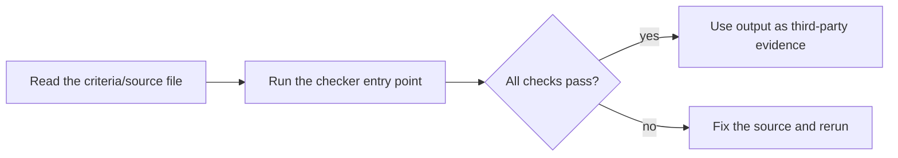

# UIBC 低空队

UIBC（国际自治之物挑战赛）低空经济域参赛队技能包。

- **判据底座**：`TH-UAS-001`
- **执行器 / 工具**：uas-ops-checker
- **绑定大使**：诺卫
- **赛题**：「迁移的判定与问责」

> 凡自治之物 · LGD 治理学 · 创造术家族 ｜ UIBC 赛事包 · 同类参赛队交叉评审

## 包内容

| 文件 | 说明 |
|---|---|
| `SKILL.md` | 队伍说明书与参赛纪律（AI 调用入口） |
| `判据_UAS.md` | 本域 L1 判据摘要（作答真源） |
| `scripts/check_judge_UAS.py` | 判据检查器：校验判据 5 节结构，输出 PASS/FAIL（`--selftest` 自检） |
| `README.md` | 本文件 |
| `cover.png` | 队伍封面 |

## 赛题三层交付

- L1 有籍 —— 判定规则（可形式化，声明 L0–L4）
- L2 有证 —— 证据包（第三方可独立复现）
- L3 有门禁 —— 失败处置 + 责任归属声明

## 证据与安全声明

- **证据（Evidence）**：判据真源 = `判据_UAS.md`；执行器 = `scripts/check_judge_UAS.py`（`--selftest` 实跑 PASS）。
- **版本（Version）**：1.1.0。
- **安全（Security）**：无凭证、无内部路径；不泄露盲测集与评分细节。

---

© SynomosAI ｜ 赛事 UIBC ｜ v1.1.0


---

## Quick start / 快速开始

**English**: UIBC domain judging-team package — executable criteria checker (`--selftest`) that validates the L1 judging-criteria file and emits PASS/FAIL evidence. Zero Python dependencies, CLI only. 中文说明见下文。



### Example run / 示例输出

Recorded on 2026-10-16 with a clean Python 3.13 environment (stdlib only):

```text
$ python scripts/check_judge_UAS.py --selftest
PASS | 判据编号引用 TH-UAS-001 | TH-UAS-001
PASS | 判据节 判据核心 | （作答须引用，不得改写口径）
PASS | 判据节 迁移判定映射 | （本域视角）
PASS | 判据节 可形式化等级上限与原因 | L3（口径有效性需语义仲裁）
PASS | 判据节 作答纪律 | - 本文件为判据真源；作品 §5「域适配说明」须给出引用痕迹与与通用做法的差异点。
SUMMARY | 5/5 PASS
$ echo $?
0
```
