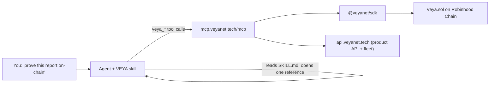

<div align="center">

# VEYA Agent Skill

**Give any AI agent verifiable, post-quantum execution on Robinhood Chain: proofs, attestations, sealed execution and consensus, through one skill and one MCP URL.**

[](LICENSE)
[](https://agentskills.io)
[](https://mcp.veyanet.tech/mcp)
[](references/tools.md)
[](https://robinhoodchain.blockscout.com/address/0x87dC582eEA544A434a5C1e30Ca3d12c1e548a674)

**[Website](https://veyanet.tech)** • **[Docs](https://veyanet.tech/docs)** • **[App](https://app.veyanet.tech)** • **[X](https://x.com/withveya)** • **[MCP server](https://github.com/veyanet/veya-mcp)** • **[SDK](https://github.com/veyanet/veya-sdk)** • **[Tool reference](references/tools.md)**

</div>

---

## What is VEYA?

**VEYA** is a cryptographically shielded execution layer for autonomous agent fleets on
**Robinhood Chain**. Agents need private context to work: API credentials, system prompts,
treasury authority, policy rules. VEYA keeps that context protected and makes every result
provable:

| Primitive | Role |
|---|---|
| **ML-DSA-44** (FIPS 204) | Post-quantum identity and signatures |
| **Kyber-768** (FIPS 203) | Post-quantum session for agent-to-agent messages |
| **BLAKE3-256** | Commitments and fingerprints |
| **AES-256-GCM** | Sealed (protected) execution |
| **2-of-3 consensus** | Validator quorum on matching hashes |
| **Veya.sol** | Protocol contract for environments, agents, commitments and attestations |

### Why a skill?

The VEYA MCP server exposes 51 tools. This skill teaches an agent **when** to use each one,
**which arguments** it needs, and **how** to chain them into complete workflows: prove, verify,
attest, route and audit. The result is correct calls on the first try, clear explanations to the
user, and safe defaults (read-only first, explicit confirmation before wallet writes).

## How it works



1. Your agent loads only the skill's name and description at startup.
2. When a request matches (VEYA, Veya.sol, proofs, post-quantum signing, Robinhood Chain…), it reads `SKILL.md`: concept, decision flow, workflows, rules, errors.
3. For details it opens one file in `references/`, such as the arg table for a tool or a step-by-step guide.
4. It calls the `veya_*` tools on the MCP server and reports results with explorer links.

## Install

### Option 1: skills CLI (any supported agent)

```bash
npx skills add veyanet/veya-skills
```

The CLI detects your agents and installs the skill. Pick a target with `-a`, for example
`-a cursor`, `-a claude-code`, `-a codex`. Add `-g` for a global install.

### Option 2: manual

```bash
git clone https://github.com/veyanet/veya-skills.git veya
```

Copy the folder to your agent's skills directory:

| Agent | Project scope | Global scope |
|---|---|---|
| **Claude Code** | `.claude/skills/veya/` | `~/.claude/skills/veya/` |
| **Cursor** | `.cursor/skills/veya/` or `.agents/skills/veya/` | `~/.cursor/skills/veya/` |
| **Codex** | `.agents/skills/veya/` | `~/.agents/skills/veya/` |
| **GitHub Copilot** | `.agents/skills/veya/` | `~/.copilot/skills/veya/` |
| **OpenCode** | `.agents/skills/veya/` | `~/.config/opencode/skills/veya/` |
| **Windsurf** | `.windsurf/skills/veya/` | `~/.codeium/windsurf/skills/veya/` |

```bash
# example: Claude Code, global
cp -r veya ~/.claude/skills/veya
```

`SKILL.md` must sit directly inside the `veya/` folder.

## Connect the MCP server

The skill uses the hosted VEYA MCP server. Add it once:

**Cursor**: `.cursor/mcp.json` or `~/.cursor/mcp.json`

```json
{
  "mcpServers": {
    "veya": { "url": "https://mcp.veyanet.tech/mcp" }
  }
}
```

**Claude Code**

```bash
claude mcp add veya --transport http https://mcp.veyanet.tech/mcp
```

**Codex**: `~/.codex/config.toml`

```toml
[mcp_servers.veya]
url = "https://mcp.veyanet.tech/mcp"
```

**Claude Desktop / claude.ai**: Settings → Connectors → Add custom connector → `https://mcp.veyanet.tech/mcp`.

Ready files: [`assets/mcp.json`](assets/mcp.json) (hosted) and
[`assets/mcp.self-hosted.json`](assets/mcp.self-hosted.json) (your own server with an operator key).

## Try it

| Ask your agent | What the agent does |
|---|---|
| "What network is VEYA on right now?" | `veya_describe` → `veya_ping_chain`; reports the network, contract and latest block |
| "Prove the text `hello` with VEYA." | `veya_prove { text: "hello" }` → BLAKE3 digest `ea8f…200f`, nothing sent |
| "Is tx `0x…` a real VEYA proof?" | `veya_verify_transaction` → `veya_verify_commitment_onchain`; event, digest, explorer link |
| "Create a treasury workspace with an agent that may only prove and store memory." | `veya_account` → `veya_create_environment { type: "treasury" }` → `veya_deploy_agent { permissionConfig.allowedTools }` |
| "Run consensus on this agent action and attest it on-chain." | `veya_api_health` → `veya_run_consensus` → `veya_pq_sign` → `veya_attest_execution` (after you confirm) → `veya_verify_transaction` |
| "Make me a post-quantum keypair and sign this message." | `veya_pq_keygen` → `veya_pq_sign` → `veya_pq_verify` |
| "Seal this approval decision for ticket 1042." | `veya_seal_decision { evidenceId, decision, apiKey }` |

## Capabilities

| Capability | Tools | Access | Guide |
|---|---|---|---|
| Service and chain status | 4 | Public | [service-and-chain.md](references/service-and-chain.md) |
| Proofs and sealed decisions | 6 | Public / key / key + wallet | [proofs.md](references/proofs.md) |
| On-chain verification | 5 | Public | [verification.md](references/verification.md) |
| Post-quantum identity | 4 | Public | [identity.md](references/identity.md) |
| Accounts, environments, agents | 7 | Key (guest: listing) | [workspaces.md](references/workspaces.md) |
| Tool policy and secure routing | 5 | Key | [policy-and-routing.md](references/policy-and-routing.md) |
| Consensus and protected execution | 5 | Key | [execution.md](references/execution.md) |
| Agent memory | 4 | Key | [memory.md](references/memory.md) |
| Public registry | 6 | Public | [registry.md](references/registry.md) |
| On-chain writes | 5 | Key + wallet | [onchain-writes.md](references/onchain-writes.md) |
| **Total** | **51** | | [tools.md](references/tools.md) |

## Network

| | Mainnet (default) | Testnet (optional) |
|---|---|---|
| RPC | `https://rpc.mainnet.chain.robinhood.com` | `https://rpc.testnet.chain.robinhood.com` |
| Explorer | https://robinhoodchain.blockscout.com | https://explorer.testnet.chain.robinhood.com |
| Veya.sol | [`0x87dC582eEA544A434a5C1e30Ca3d12c1e548a674`](https://robinhoodchain.blockscout.com/address/0x87dC582eEA544A434a5C1e30Ca3d12c1e548a674) | [`0x1a1Dc3c55550FCE9F70ef6cDEeF967c0b72a5d84`](https://explorer.testnet.chain.robinhood.com/address/0x1a1Dc3c55550FCE9F70ef6cDEeF967c0b72a5d84) |
| Faucet | – | https://faucet.testnet.chain.robinhood.com/ |

The agent reads the active network from `veya_describe` and uses the matching explorer.

## Access and limits

| Level | Needs | Examples |
|---|---|---|
| Public | nothing | describe, ping, `veya_prove`, verify, PQ helpers, public registry |
| API key | product key `veya_dev_…` / `veya_live_…` as the `apiKey` argument | environments, agents, policy, routing, memory, consensus, sealed execution |
| API key + wallet | the key plus its funded wallet | `veya_store_commitment`, `veya_attest_execution`, `veya_register_environment`, anchored proofs |

Create a key at [app.veyanet.tech](https://app.veyanet.tech): connect your wallet, open **System → API Keys**, and create a Dev (`veya_dev_…`) or Live (`veya_live_…`) key. The key is shown once.

| Limit (server default) | Value |
|---|---|
| `/mcp` requests per IP | 120 / minute |
| Consensus, sealed execution, `veya_seal_decision` per key | 30 / minute |
| host-sent seals per key | 20 / UTC day |
| host-sent seals per host | 100 / UTC day |

More: [references/auth-and-limits.md](references/auth-and-limits.md).

## Repository structure

```
veya-skills/
├── SKILL.md                        # the skill: concept, decision flow, workflows, rules, errors
├── references/
│   ├── setup.md                    # connect every client, API key, funding, self-hosting
│   ├── auth-and-limits.md          # access levels, endpoint auth, rate limits, daily caps
│   ├── service-and-chain.md        # describe, ping, health, writes status
│   ├── proofs.md                   # veya_prove, anchoring, labeled proofs, sealed decisions
│   ├── verification.md             # tx, commitment, environment and agent checks
│   ├── identity.md                 # ML-DSA-44 keys, signing, fingerprints
│   ├── workspaces.md               # account, environments, agents
│   ├── policy-and-routing.md       # tool rules, routing, Kyber-768 secure messages
│   ├── execution.md                # 2-of-3 consensus, sealed and protected execution
│   ├── memory.md                   # agent memory
│   ├── registry.md                 # public agents, certificates, executions
│   ├── onchain-writes.md           # Veya.sol writes, pre-flight, funding
│   ├── tools.md                    # all 51 tools: args, types, returns, examples
│   ├── troubleshooting.md          # every server error message and its fix
│   └── sdk.md                      # @veyanet/sdk for custom logic
├── assets/
│   ├── mcp.json                    # hosted MCP config
│   └── mcp.self-hosted.json        # self-hosted config with Bearer auth
├── llms.txt
├── LICENSE
└── README.md
```

## Custom logic: the SDK

The MCP covers standard flows. For custom pipelines, your own validators, or VEYA inside a
backend, use the TypeScript SDK: same capabilities, full control.

```bash
npm install @veyanet/sdk
```

See [references/sdk.md](references/sdk.md) and [veyanet/veya-sdk](https://github.com/veyanet/veya-sdk).

## Links

| Resource | URL |
|---|---|
| Website | https://veyanet.tech |
| MCP endpoint | https://mcp.veyanet.tech/mcp |
| MCP health | https://mcp.veyanet.tech/health |
| Product API | https://api.veyanet.tech |
| VEYA docs | https://veyanet.tech/docs |
| App (console, API keys) | https://app.veyanet.tech |
| MCP server source and docs | https://github.com/veyanet/veya-mcp |
| SDK source and docs | https://github.com/veyanet/veya-sdk |
| Agent Skills spec | https://agentskills.io |

## Security

- The skill tells the agent to start read-only, state the network, and get your confirmation before any wallet write.
- API keys are used only inside tool arguments; the agent does not repeat or store them.
- Every write is checked by the server: key → matching wallet → balance → chain id.
- Report vulnerabilities privately to **security@veyanet.tech**. Please do not open public issues for security reports.

## License

[MIT](LICENSE) © veyanet
