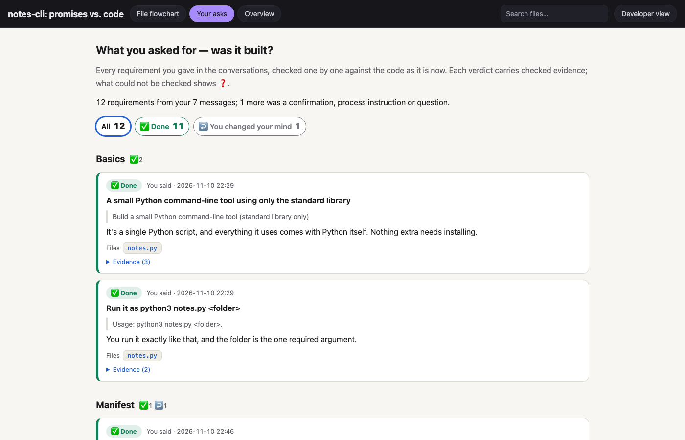
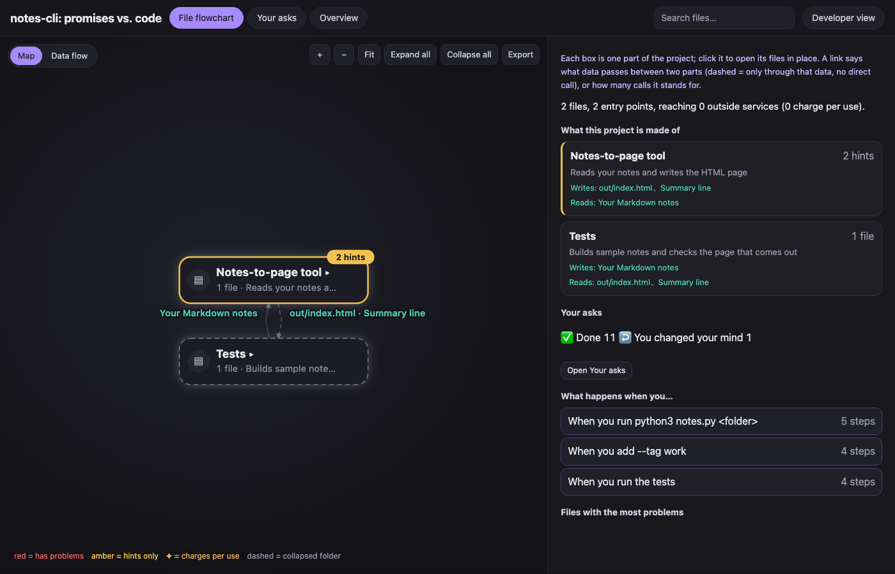
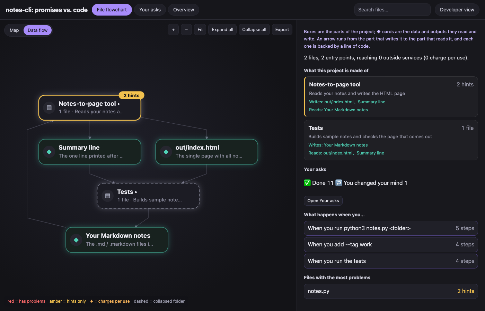

# vibe-ledger

<p align="center"><strong>English</strong> · <a href="README_CN.md">简体中文</a></p>

<p align="center">
  <a href="LICENSE"></a>
  
  
  
</p>

You built an app by talking to an AI. vibe-ledger reads those conversations (Claude Code and Codex) and the code they produced, and gives you one offline page that answers three things: **what your app is made of, whether the AI built what you asked for, and where it could hurt you.** Every conclusion carries evidence a script has checked; anything it cannot check shows as ❓, never as fact.

<p align="center"></p>

## What you get

**Your asks.** Every request you typed, checked against the code as it is now: ✅ done, ⚠️ partly, ❌ not done, 🔀 done differently (and whether you agreed), ↩️ you changed your mind later, ❓ can't tell. Grouped by feature, with the line of code behind each verdict and a fix instruction you can paste back to your AI. A "not done" is backed by searches the tool re-runs over your project. Every message you sent is accounted for: a requirement, or skipped as a confirmation, a process instruction or a question — anything left over is listed, because a requirement may hide there.

**The map.** Your project's parts — "Voice-over", "Delivery checks", "Trip page" — each with one line on what it does, top to bottom in the order data moves, each link saying what passes ("storyboard.json"). Click a part to open its files; click a file for what it does, its main functions, who calls it, its risks and how it came to be. Routes ("what happens when you press Export") step through the files, with a sequence diagram.

**Data flow.** The parts, the data and outputs between them (◆) and the paid services they call. Click a data card to see the exact lines that write and read it.

<p align="center"> </p>

**Overview.** The safety ledger: where your data lives, what costs money, who can see it (a matrix of strangers / other users / you), where it is most likely to break, and what was put off "for later" — each promise checked against the code, workarounds made just to get past an error called out, and what the report could not see.

Also: compare with the last run (new and changed files, links, promises and risks), export the map as PNG or SVG, a plain view and a developer view, Chinese and English pages.

## Install

Python 3.10+ and Google Chrome (for the screenshots; without it the agent reads the page instead). No other dependencies.

As a Claude Code plugin:

```
/plugin marketplace add dong845/vibe-ledger
/plugin install vibe-ledger@vibe-ledger
```

Or as a plain skill folder:

```bash
git clone --depth 1 https://github.com/dong845/vibe-ledger.git ~/.claude/skills/vibe-ledger
```

## Use

In Claude Code, open your project and ask: *"explain my app and check it — did the AI build what I asked for?"* The skill runs the steps itself and puts the report on your Desktop (or Downloads):

```
python3 scripts/vl.py start  --project <your app folder>    # finds the conversations, writes reading packs
# the agent writes ledger.json, requirements.json and explain.json from them
python3 scripts/vl.py check  --project <your app folder>    # verifies every quote, line and search
python3 scripts/vl.py render --project <your app folder>
python3 scripts/vl.py shot   --project <your app folder>    # screenshots for the agent to look at
```

Language follows your messages; `start --lang en` or `--lang zh` sets it (the agent then writes in that language too).

**What a run costs.** On two small apps (one or two code files, a six-message conversation), a fresh Claude Code session took 7–8 minutes and reported $2.30 and $2.59 of usage. A big project with months of conversations is split into many reading packs that subagents read in parallel: expect it to take much longer and use much more.

## Privacy

Everything runs on your machine; nothing is sent anywhere. Secrets found in conversations or code are masked (`sk-proj-…wXyZ`) everywhere the tool writes, and the report refuses to be written if one slipped through. Working files live in `~/.vibe-ledger`, never inside your project.

**The report quotes your conversations.** Secrets are masked, but your words are there — think before you post a report publicly.

Claude Code deletes conversations older than 30 days by default. vibe-ledger keeps a masked copy of each project's conversations and will offer — only with your agreement — to raise that limit.

## Limits

- Conversations: Claude Code and Codex logs on this machine. Requests made somewhere else (a chat app, a call) are not seen.
- The flowchart covers JS/TS, Python and HTML pages with their own script, and static imports plus the API paths a page calls; it does not trace what runs at runtime.
- The safety checks that need no model (probes) cover web stacks: Next.js, Vite + React, Express, Supabase, Firebase, CORS, secrets, paid APIs without a login check. Other stacks are named in the report as not covered.
- It reads code; it does not run your app.

## Development

```
python3 -m pytest
python3 tests/e2e/prepare.py --out /tmp/vl-e2e   # fixture apps with planted problems
```

License: MIT.
