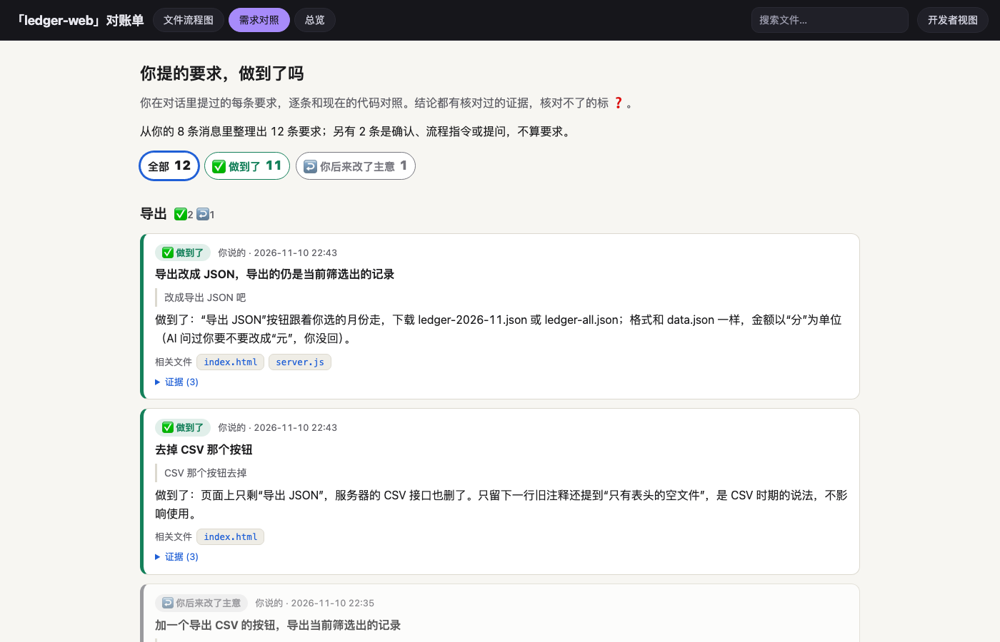
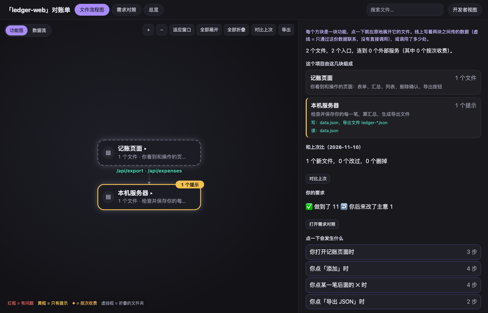
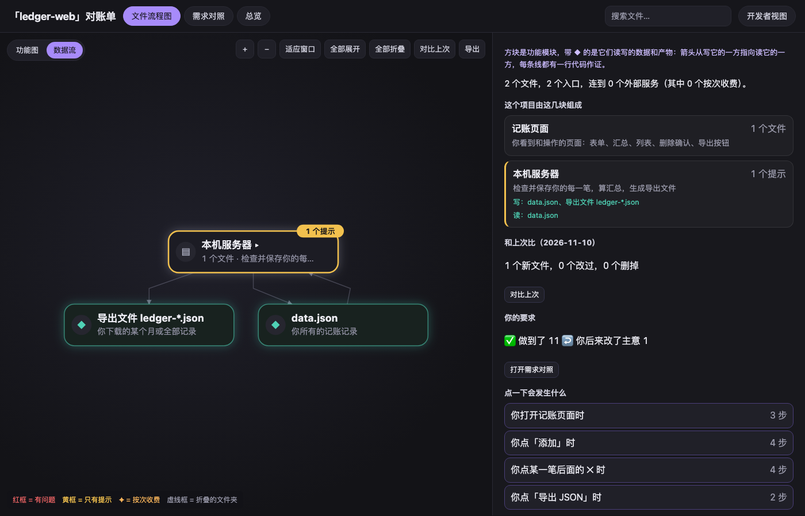

# vibe-ledger

<p align="center"><a href="README.md">English</a> · <strong>简体中文</strong></p>

<p align="center">
  <a href="LICENSE"></a>
  
  
  
</p>

你靠和 AI 对话做出了一个应用，却看不懂它，也说不准 AI 有没有按你的要求做。vibe-ledger 读取你和 AI 的对话（Claude Code、Codex）以及现在的代码，生成一份离线网页，回答三件事：**这个应用由什么组成，AI 有没有做成你要的样子，哪里可能坑到你。** 每个结论都带着脚本核对过的证据；核对不了的标 ❓，不会当成事实。

<p align="center"></p>

## 你会得到什么

**需求对照。** 你提过的每条要求，逐条和现在的代码对照：✅ 做到了、⚠️ 部分做到、❌ 没做、🔀 换了做法（以及你是否同意过）、↩️ 你后来改了主意、❓ 判断不了。按功能分组，每条附上作为依据的那行代码，以及一段可以直接贴回给 AI 的修复指令。「没做」由工具在你的项目里重新搜索来证明。你发过的每条消息都有交代：要么整理成要求，要么注明跳过的原因（确认、流程指令、提问）；剩下没交代的会单独列出，因为里面可能藏着漏掉的要求。

**功能图。** 项目由哪几块组成，比如「配音」「交付检查」「行程页面」，每块一句话说明它做什么。按数据流动的顺序从上往下排，每条连线写明传的是什么（如「storyboard.json」）。点一块就地展开它的文件；点一个文件，看它做什么、主要函数、谁调用它、有什么风险、是怎么来的。「点一下会发生什么」把一次操作（比如按下「导出」）拆成经过的文件，附时序图。

**数据流。** 各个功能块、它们之间传递的数据和产物（◆），以及它们调用的收费服务。点一张数据卡片，能看到写它和读它的具体代码行。

<p align="center"> </p>

**总览。** 安全对账单：数据存在哪、什么会花钱、谁能看到（陌生人 / 其他用户 / 你自己的矩阵）、哪里最容易出事、还有哪些说了「以后再做」。每条承诺都和代码核对过；只是为了让报错消失而放松保护的改动会被单独指出；报告看不到的地方也会写明。

另外还有：和上一次对比（新增、改动的文件、连线、承诺和风险）、把功能图导出为 PNG 或 SVG、大白话视图和开发者视图、中英文页面。

## 安装

需要 Python 3.10+ 和 Google Chrome（用来截图；没有 Chrome 时，AI 会改为直接读网页）。没有其他依赖。

作为 Claude Code 插件安装：

```
/plugin marketplace add dong845/vibe-ledger
/plugin install vibe-ledger@vibe-ledger
```

或者作为普通 skill 文件夹：

```bash
git clone --depth 1 https://github.com/dong845/vibe-ledger.git ~/.claude/skills/vibe-ledger
```

## 使用

在 Claude Code 里打开你的项目，说：*「帮我看懂这个 AI 写的项目，检查它有没有按我的要求做」*。skill 会自己跑完下面这些步骤，把报告放到桌面（或「下载」文件夹）：

```
python3 scripts/vl.py start  --project <你的应用文件夹>    # 找到相关对话，生成阅读材料
# AI 读完后写出 ledger.json、requirements.json 和 explain.json
python3 scripts/vl.py check  --project <你的应用文件夹>    # 核对每条引用、每行代码、每次搜索
python3 scripts/vl.py render --project <你的应用文件夹>
python3 scripts/vl.py shot   --project <你的应用文件夹>    # 截图，供 AI 检查页面
```

报告语言跟随你在对话里用的语言；也可以用 `start --lang zh` 或 `--lang en` 指定（AI 也会改用这种语言来写）。

**跑一次的花费。** 在两个小应用上（一两个代码文件，六轮对话），一个全新的 Claude Code 会话用了 7–8 分钟，显示的用量分别是 $2.30 和 $2.59。大项目、几个月的对话会拆成很多份阅读材料，由子代理并行阅读：耗时和用量都会多得多。

## 隐私

一切都在你的电脑上运行，不向任何地方发送数据。对话或代码里发现的密钥，在工具写出的所有文件里都会打码（如 `sk-proj-…wXyZ`）；如果有漏网的，报告会拒绝生成。工作文件放在 `~/.vibe-ledger`，不会写进你的项目。

**报告会引用你的对话原文。** 密钥会打码，但你说过的话都在里面。公开分享报告前请先想一想。

Claude Code 默认删除 30 天前的对话。vibe-ledger 会为每个项目保留一份打过码的对话副本，并会提议延长这个期限，但只有你同意才会改。

## 局限

- 对话只读这台电脑上的 Claude Code 和 Codex 记录。在别处提的要求（聊天软件、电话）看不到。
- 流程图覆盖 JS/TS、Python 以及自带脚本的 HTML 页面，依据静态 import 和页面调用的 API 路径；不追踪运行时实际发生的调用。
- 不需要模型的安全检查（探针）覆盖 Web 技术栈：Next.js、Vite + React、Express、Supabase、Firebase、CORS、密钥泄露、没有登录检查的收费 API。其他技术栈会在报告里注明「未覆盖」。
- 它只读代码，不运行你的应用。

## 开发

```
python3 -m pytest
python3 tests/e2e/prepare.py --out /tmp/vl-e2e   # 带有预埋问题的测试应用
```

许可证：MIT。
