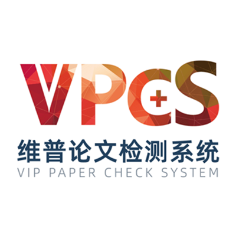

# FAQ 2：维普查重、AIGC 检测与斟知智评报告说明

来源：<https://vpcs.cqccjy.cn/faq/vip/2>  
页面标题：维普论文查重、AIGC 检测与斟知智评报告说明  
发布时间：2026-07-31 09:36  
页面更新时间：2026-09-27 16:22  
抓取快照：2026-09-27

## 文章要点

文章把维普公共用户端描述为“24 小时全程自助检测”，给出的旧版操作顺序是：

1. 使用国内电脑浏览器，把 `https://vpcs.cqccjy.cn/` 直接复制到地址栏打开，不要先去搜索。
2. 选择检测/查重版本，填写论文标题和作者，上传已经排版、标注正确的文档。
3. 系统自动统计字符数，按页面提示购买对应版本和件数。旧文章写的是在淘宝购买，付款后使用淘宝订单编号提交检测。
4. 文章提醒一次付款对应一次检测，检测范围不包含学校自建库，报告编号不能同步到学校或定制版系统。
5. 文章给出的 `3-30 分钟` 是一般体验时间，人工无法干预异步检测。
6. 从“我的报告”或 <https://vpcs.cqccjy.cn/reports> 输入订单号查询和下载；微信内无法下载时换普通浏览器。
7. 下载结果可能是压缩包，需要解压软件和 PDF 阅读器。

FAQ 2 把查重、AIGC 和斟知智评放在同一篇教程里，但它们不是同一指标：

| 产品 | 检查目标 | 不能替代 |
|---|---|---|
| 查重 | 文字与数据库来源的相似性、相似片段和来源 | 学校私有库结果、学校最终学术不端认定 |
| AIGC | 文本呈现疑似 AI 生成的语言特征 | 文字复制比、作者身份或违规事实认定 |
| 斟知智评 | 选题、结构、论证、表达和综合质量提示 | 导师意见、盲审、答辩或录用决定 |

## 当前 `/pwp` 对照

FAQ 2 是旧的人工/淘宝交接教程。当前用户端应按以下链路操作：

```text
create-draft
  -> presign
  -> OSS 上传
  -> complete upload
  -> 查询 orderNo
  -> 用户在浏览器支付
  -> 查询支付状态
  -> 页面自动提交检测，特殊状态由用户在进度页点击“立即检测”
  -> REPORT_READY
  -> /reports 查看和下载
```

旧文章中的“淘宝订单号”不能直接替换脚本的 `orderNo`、支付订单号、检测卡号或报告编码。脚本的提交、查询和报告命令都只接收 `/pwp` 返回的 `orderNo`。

文章中的 `3-30 分钟` 不属于服务承诺。出现等待时使用原 `orderNo` 调 `status`，看 `status`、`statusLabel`、`failReason`、`canDownloadReport`，不要创建第二单或重复提交。

## 这篇 FAQ 真正要教会用户什么

面对“我应该买哪个”“AI 率是不是查重率”“为什么学校结果不同”这类问题，先把问题拆成三层：

1. **检测目标**：查重看文字相似性，AIGC 看疑似生成特征，智评看综合质量；
2. **检测入口**：公共 `/pwp`、学校自建系统和其他平台不是同一个数据库或订单空间；
3. **结果用途**：报告用于自查、修改和留存证据，不能自动变成学校终检、答辩或录用结论。

因此，不能看到报告上都有百分比，就把三个产品放进同一张“高低排行榜”。先确认用户要解决的具体问题，再选择产品和解释指标。

## Agent 回答口径

- 用户说“AI 率”时，先确认是否要 `aigc`；不要把 AIGC 百分比回答成查重率。
- 用户说“报告怎么下”时，先给 `browser_urls.reports` 或 `/reports`，再说明压缩包和 PDF 阅读器。
- 用户说“淘宝订单号怎么填”时，说明这是旧文章流程；当前自动化用 `orderNo`，支付仍由用户在页面完成。
- 用户说“学校能不能直接认”时，读取 [03-institution-code.md](03-institution-code.md) 和 [47-self-built-database.md](47-self-built-database.md)。

## 图片

文章封面/站点配图：



图片只作文章识别和流程定位，不承载当前订单、价格或报告结果。
