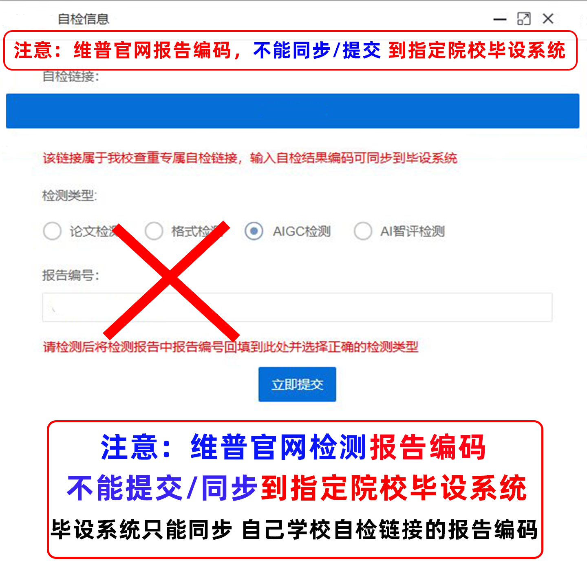
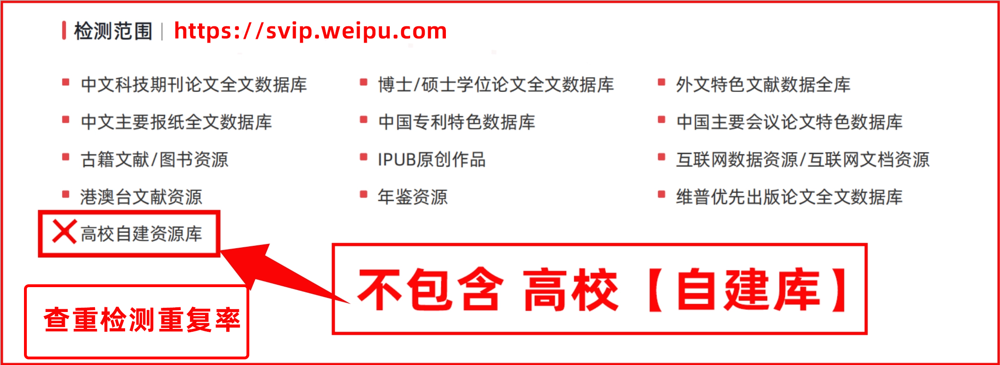

# FAQ 3：报告编码不能同步到院校系统

来源：<https://vpcs.cqccjy.cn/faq/vip/3>  
页面标题：维普检测报告编码为何不能同步到院校系统？  
发布时间：2026-07-31 10:42  
页面更新时间：2026-09-27 16:22  
抓取快照：2026-09-27

## 文章结论

文章的核心说法是：维普公共用户端生成的报告编码，不能直接同步或提交到某些机构、院校、毕设或定制版系统；这些系统只能识别**由自身自检链接生成的报告编码**。

这不是“报告一定是假”或“维普验真无效”，而是两个系统的编码空间、数据库、业务入口和接收规则不同：

| 场景 | 结果 |
|---|---|
| 在 VPCS 公共验真页面输入公共报告编码 | 由 VPCS 验真页面判断是否存在和信息是否匹配 |
| 把公共报告编码粘贴到学校私有毕设系统 | 可能无法识别、无法同步或直接提示编码无效 |
| 使用学校指定自检链接生成报告 | 通常由学校系统自己的编码和数据库承接 |

## 当前操作

1. 如果用户只是要确认报告来源，打开 <https://vpcs.cqccjy.cn/pwp/verify>，选择匹配的检测类型，输入报告首页的报告编码。
2. 如果用户要向学校提交，先确认学校是否指定了自检链接、版本、数据库或学校账号。
3. 学校系统不接受时，不要修改报告编码、替换前缀、截取数字或反复生成公共订单。
4. 记录学校系统的错误提示，向答辩秘书、学院、研究生院或平台客服确认指定入口。

## 与学校自建库的关系

公共验真通过只证明报告能在 VPCS 的官方验真页面被识别，不证明学校系统会接受，也不证明报告覆盖学校私有库。校外自查和学校终检可能因数据库、版本、更新时间、解析规则和校内自建库不同而产生差异。详见 [47-self-built-database.md](47-self-built-database.md)。

## Agent 禁止做的事

- 不承诺“通过 VPCS 验真就能交学校”；
- 不把公共报告编码改造成学校编码；
- 不根据截图里的旧域名推导当前入口；
- 不把学校指定系统的标准猜成全国统一标准。

## 图片

图片是 FAQ 文章的教学示例，包含演示界面和被遮挡的字段；只用于解释“系统之间不互认”的概念。
