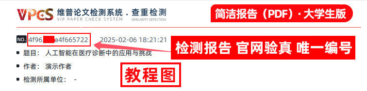
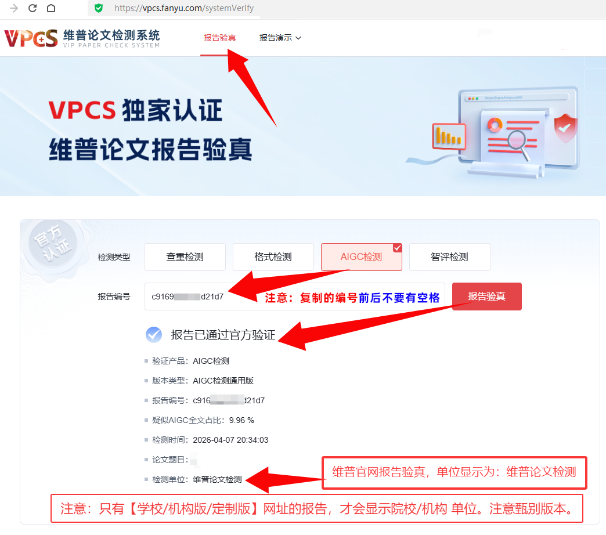

# FAQ 4：维普论文检测报告如何验真

来源：<https://vpcs.cqccjy.cn/faq/vip/4>  
页面标题：维普论文检测报告如何验真？  
发布时间：2026-07-31 10:44  
页面更新时间：2026-09-27 16:22  
抓取快照：2026-09-27

## 文章原始规则

FAQ 4 只有两个硬要求：

1. 使用检测报告中的**报告编码**去验真；
2. 输入报告编号时，前后不能有空格。

## 完整验真流程

1. 打开 <https://vpcs.cqccjy.cn/pwp/verify>。
2. 根据报告首页选择正确的检测类型：查重、格式、AIGC 或智评等。
3. 从报告首页复制报告编码，不要复制订单号、支付订单号、检测卡号或文件名。
4. 清除首尾空格、换行、全角空格和不可见字符。
5. 完成页面验证码并提交。
6. 对照返回的报告类型、版本、题目、作者、时间、指标和单位。
7. 任何字段不一致时，保存报告和验真页面截图，联系平台或学校，不要修改 PDF 后再次验真。

## 三个编号的区别

| 名称 | 来源 | 用途 |
|---|---|---|
| `orderNo` | `/pwp` 创建草稿返回 | 查询订单、支付页、进度页、报告页 |
| 支付订单号/检测卡号 | 支付渠道或页面 | 付款交接、客服定位 |
| 报告编码 | 报告生成后的首页 | 官方验真 |

## 验真通过到底说明什么

验真流程的核心不是“输入一个号码”，而是核对一组身份字段：

```text
原 orderNo 找到报告
  -> 报告首页取得报告编码
  -> 官方页面选择匹配检测类型
  -> 返回题目、作者、版本、时间和指标
  -> 与报告首页逐项比对
```

通过且字段一致，可以说明报告编码能被 VPCS 官方页面识别，返回内容与该报告相符；不能进一步推出学校一定接受、报告覆盖学校私有库、结果等于学校终检，或用户一定通过答辩。

验真失败时，先检查检测类型、编码两端空格、是否拿错报告和当前固定域名，再联系平台。不要把订单号替换成报告编码，也不要修改 PDF 后重试。

## 验真证据层级

官方验真页面返回的字段最可靠，其次是报告编码与返回数据一致、报告内部题目/作者/版本/时间相互一致；水印、二维码、文件名和版式只能作为辅助线索。只看一张截图或一个二维码，不能直接宣称报告为真。

## 常见失败

| 现象 | 先检查 |
|---|---|
| 找不到报告 | 是否输入了报告编码，而不是 `orderNo` |
| 提示编码无效 | 检测类型是否选错、编码两端是否有空格 |
| 返回信息不一致 | 报告版本、作者、题目和时间是否匹配，是否拿错文件 |
| 页面无法打开 | 域名是否为 `https://vpcs.cqccjy.cn`，换普通浏览器重试 |

## 图片





文章图片可能展示历史演示域名和 AIGC 示例，不能覆盖当前 Skill 固定的验真地址。
