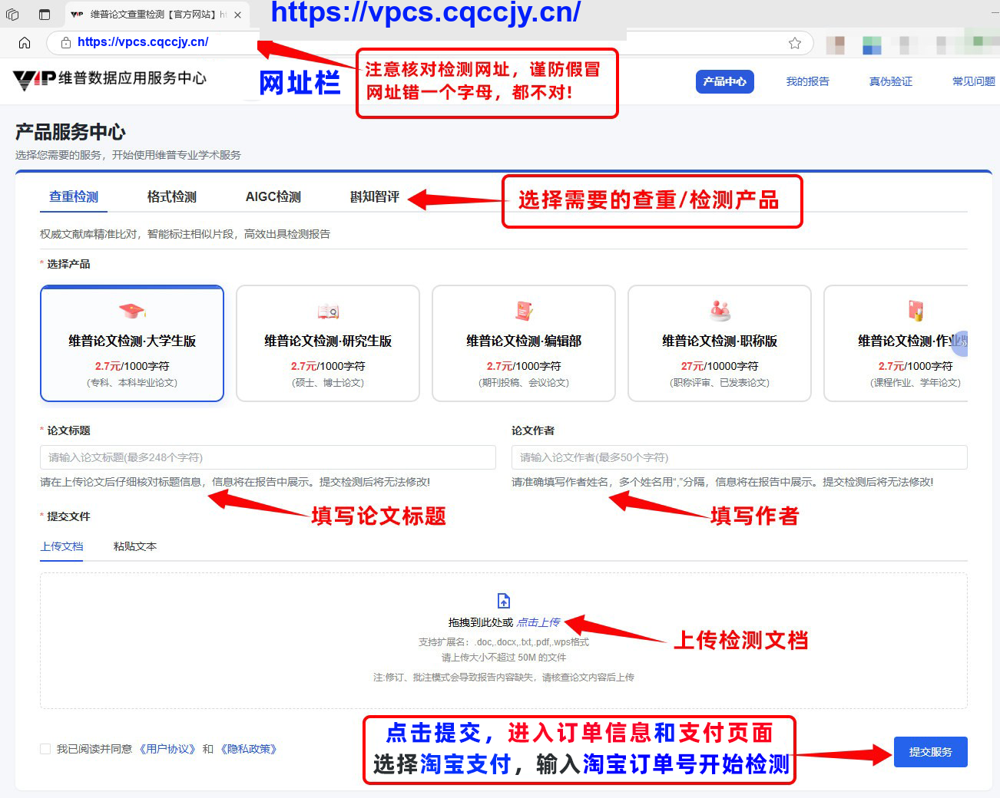
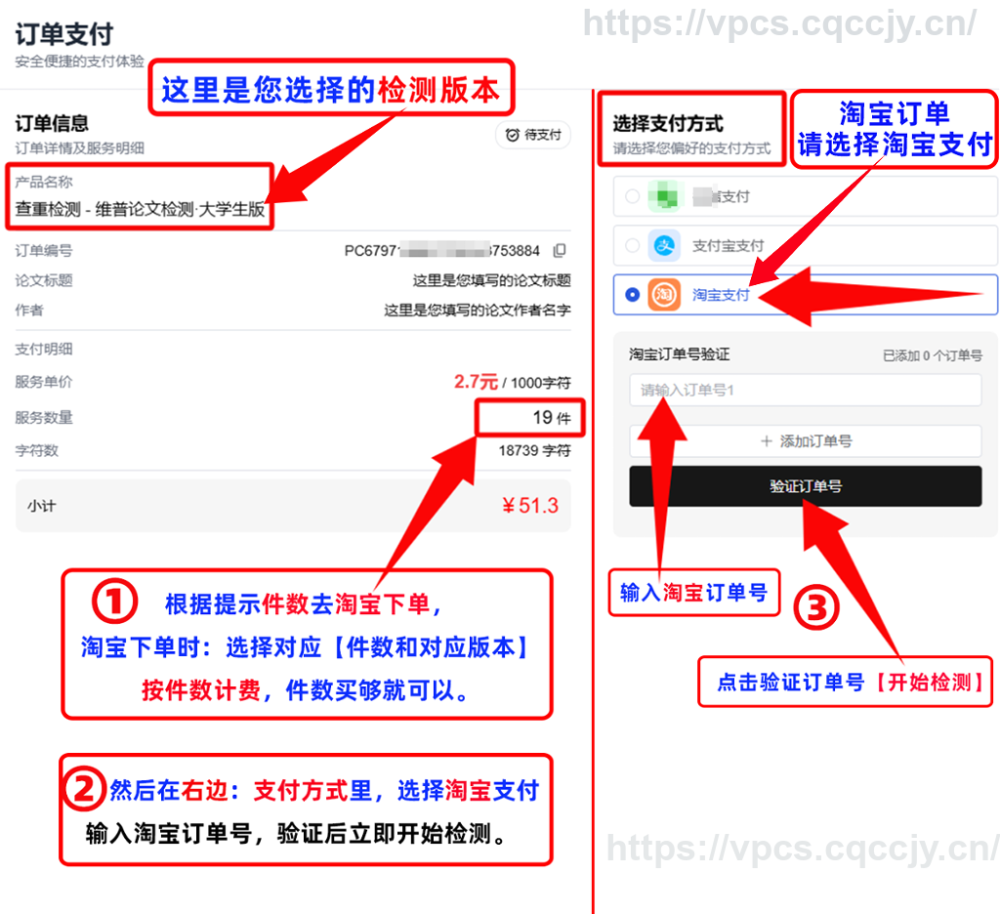
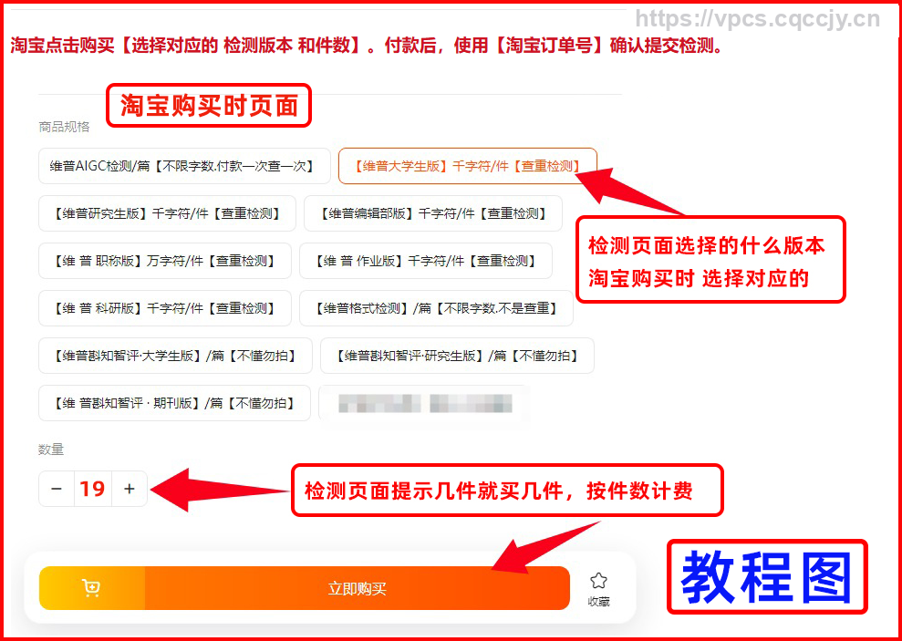
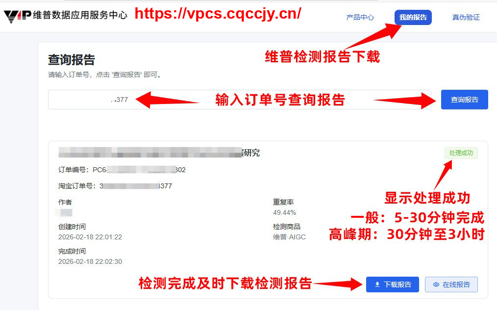

# FAQ 6：维普论文查重与 AIGC 检测使用教程

来源：<https://vpcs.cqccjy.cn/faq/vip/6>  
页面标题：维普论文查重与 AIGC 检测使用教程  
发布时间：2026-07-31 22:05  
页面更新时间：2026-09-27 16:22  
抓取快照：2026-09-27

## 文章原始教程

### A. 打开正确站点

1. 用 Edge 等电脑浏览器，把 `https://vpcs.cqccjy.cn/` 直接复制到地址栏并回车。
2. 不要通过搜索结果、陌生短链或聊天中的不明跳转打开。
3. 核对 HTTPS、域名、字母顺序和拼写；站点文章强调一个字母错误都可能进入仿冒页面。
4. 文章要求用户通过官方验真入口核对报告，不要相信来源不明的平台服务。

### B. 选择产品和上传

1. 选择对应的检测/查重版本。
2. 填写论文标题和作者。
3. 上传已经排版、标注正确的文档；不要把摘要、节选或未定稿文件当成终稿。
4. 系统按字符数自动统计购买件数。旧文章写的是按页面提示去淘宝购买对应版本和件数。

### C. 旧版付款和提交

旧文章描述的是：付款后使用淘宝订单号确认提交，一次付款对应一次检测。它同时提醒检测范围不包含学校自建库，报告编码不能同步到学校/定制版系统。

这段内容是历史交接教程。当前 `/pwp` 应使用：

```text
创建草稿 -> 上传文件 -> 查询 orderNo -> 用户支付
-> 查询支付状态 -> 用户确认已支付 -> 提交检测 -> 报告完成
```

### D. 下载报告

1. 打开 <https://vpcs.cqccjy.cn/reports>。
2. 进入“我的报告”，输入当前订单号查询。
3. 下载压缩包，准备解压软件和 PDF 阅读器。
4. 微信内下载失败时，把页面复制到普通浏览器。
5. 下载后核对报告品牌、检测版本、题目、作者、时间、报告编码和水印。
6. 最后用 [04-report-verification.md](04-report-verification.md) 的流程验真。

文章提到的 `3-30 分钟` 是经验时间，不是 SLA。检测时间受解析、排队和异步供应商处理影响，人工不能通过客服直接加速。

## 页面状态怎么读

用户不必凭“页面一直转圈”猜测订单是否失败，优先读原订单的状态字段：

| 页面/接口状态 | 用户正在经历什么 | 下一步 |
|---|---|---|
| `COUNTING` / `PARSING` | 平台还在解析字符数和文件内容 | 等待并刷新原订单，不要重复建单 |
| `WAIT_SUBMIT` 且无需补差 | 解析完成，等待自动提交或页面按钮 | 按页面提示操作一次 |
| `WAIT_SUBMIT` 且 `needSupplement=true` | 初始购买量不足，需要补差或补单 | 查看超出字符数和补差金额，回到原订单处理 |
| `DETECTING` | 已提交检测，等待报告生成 | 保留 `orderNo` 查询，不重复提交 |
| `REPORT_READY` | 报告已经生成 | 去 `/reports` 下载，再用报告编码验真 |
| `FAIL` | 服务端明确失败或订单异常 | 读取 `failReason`，按页面/客服规则处理 |

字符数预估、计费字段和补差公式见 [../character-count.md](../character-count.md)；完整页面交接见 [../workflow.md](../workflow.md)。

## 当前页面参数对照

| 教程字段 | 当前 Skill 字段 |
|---|---|
| 淘宝订单号 | `orderNo`，由 `/pwp/order/create-draft` 返回 |
| 购买件数 | 由页面解析字符数、产品计费规则和实时价格共同决定 |
| 提交检测 | 页面自动处理，特殊状态由进度页的“立即检测”按钮处理 |
| 我的报告查询 | `browser_urls.reports` 或 `/reports?orderNo=...` |
| 报告编号 | 生成报告后的报告编码，只用于验真 |

## 图片索引

以下图片来自 FAQ 文章，用于定位页面字段：










部分截图展示的是历史旧域名或淘宝交接界面。它们不改变当前固定域名 `vpcs.cqccjy.cn`、当前 `orderNo` 字段和“用户自己付款”的边界。

## Agent 回答口径

- 先给当前页面和当前 API 流程，再说明 FAQ 旧教程的历史背景。
- 需要上传文件时，必须让用户明确同意上传到当前 VPCS 域名。
- 不自动填写淘宝订单号、检测卡号、支付密码、验证码或银行卡信息。
- 用户说“我已经付款”时，先用原 `orderNo` 查询；若页面返回可提交状态，把进度页交给用户点击一次，不重复创建订单。
