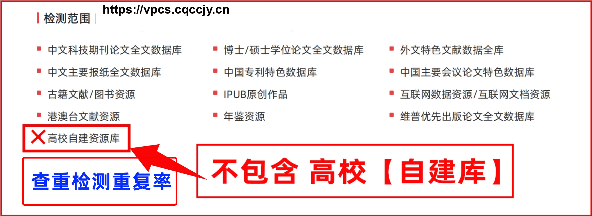
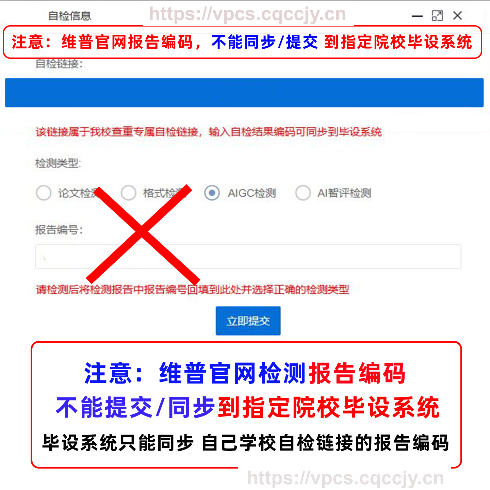

# FAQ 7：维普论文检测提交与退款须知

来源：<https://vpcs.cqccjy.cn/faq/vip/7>  
页面标题：维普论文检测提交与退款须知  
发布时间：2026-08-01 18:25  
页面更新时间：2026-09-27 16:22  
抓取快照：2026-09-27

## 文章原始规则

FAQ 7 把维普检测描述为“虚拟产品，且是检测产品，产品性质特殊”，并说明检测报告支持在线真伪验真。页面列出的退款规则：

1. 只要提交成功、开始检测或已经出报告，通常不支持退款。
2. 只有系统明确提示“检测失败”时，才进入退款咨询范围。
3. 重复率高或低、和学校结果不一样、不满意结果、误下单、等不及、不想用了，都不等于可以退款。
4. 页面没有给出自动退款接口或“等待多久必退”的承诺。

## Agent 处理规则

| 用户情况 | 回答 |
|---|---|
| 订单还未支付、草稿或上传失败 | 先查询原订单和页面能力，不承诺退款，避免重复建单 |
| 支付成功但尚未提交检测 | 只能依据页面/客服的订单处理规则，不把“未提交”直接说成必退 |
| 已提交、检测中或已有报告 | 按 FAQ 说明通常不支持退款 |
| 系统明确显示检测失败 | 保存订单状态、错误信息和支付凭证，联系平台客服咨询 |
| 结果高/低、学校不一致、不满意 | 不能据此承诺退款，先解释数据库和版本差异 |
| 误下单、等待时间长、不想继续 | 不能据此承诺退款，先查询状态并联系平台 |

Skill 不代平台作退款决定，也不提供虚构的“退款 API”。支付订单号、订单状态和错误截图只按平台客服要求提供；不要公开支付密码、验证码、银行卡信息或 OSS 临时凭证。

## 退款判断树

先问订单处于哪一个状态，再谈退款：

```text
未支付/支付状态未知
  -> 先查原订单，不创建新单，不直接承诺退款
已支付但仍在解析或等待补差
  -> 先处理原订单页面提示，不能把等待当成“检测失败”
系统明确 FAIL/检测失败
  -> 保存 failReason、订单号和支付凭证，向平台客服咨询
已经提交、检测中或已有报告
  -> 按 FAQ 规则通常不支持退款
只是结果不满意、学校结果不同或不想使用
  -> 不能据此推导退款资格
```

“接口超时”“页面打不开”和“重复率高”都不是服务端明确的“检测失败”。只有订单状态和页面明确给出失败原因时，才进入客服处理路径。

## 与自动化脚本的关系

脚本只做创建草稿、文件上传、订单查询和报告地址查询：

- 不自动支付；
- 不填写检测卡号；
- 不取消订单；
- 不提交退款申请；
- 不把“接口超时”解释成“检测失败”；
- 不因为用户不满意结果而重复建单。

## 图片





图片是站点文章的提示图，具体退款仍以订单页面和客服处理结果为准。
