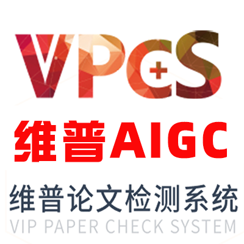
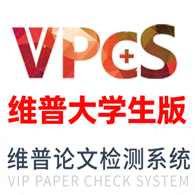
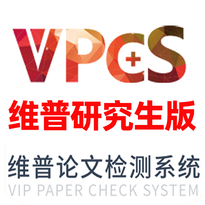
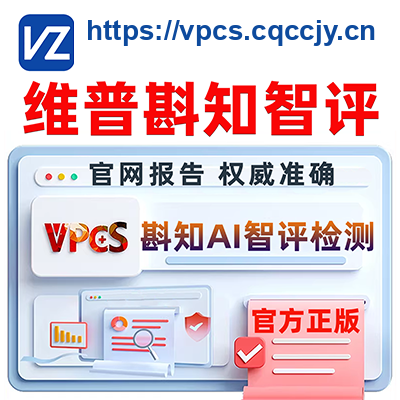

# FAQ 8：维普产品介绍与计费说明

来源：<https://vpcs.cqccjy.cn/faq/vip/8>  
页面标题：维普论文检测产品介绍与计费说明  
发布时间：2026-08-02 23:14  
页面更新时间：2026-09-27 16:23  
抓取快照：2026-09-27

## 产品分类

### 当前 15 个独立商品和价格快照

FAQ 文章按产品族说明，Skill 已把 `2026-09-27` 的 15 个独立 SKU、价格、支付方式和限制固化为本地快照。一般选型直接读取本文件；只有用户明确询问当前动态价格或启用状态时，才查看 `/pwp` 页面：

| 商品全名 | 编码 | 实时价格快照 | 计价 |
|---|---|---:|---|
| 维普查重大学生版 | `dxs` | ¥2.70/1000字符 | 字符档位 |
| 维普查重研究生版 | `yjs` | ¥2.70/1000字符 | 字符档位 |
| 维普查重编辑部版 | `bjb` | ¥2.70/1000字符 | 字符档位 |
| 维普查重职称版 | `zc` | ¥27.00/10000字符 | 万字符档位 |
| 维普查重作业版 | `zy` | ¥2.70/1000字符 | 字符档位 |
| 维普查重科研版 | `ky` | ¥2.70/1000字符 | 字符档位 |
| 维普AIGC检测 | `aigc` | ¥17.99/篇 | 按篇 |
| 维普格式检测·大学生版 | `format_dxs` | ¥30.00/篇 | 按篇 |
| 维普斟知智评·大学生版 | `zzzp_dxs` | ¥32.00/篇 | 按篇 |
| 维普斟知智评·研究生版 | `zzzp_yjs` | ¥75.00/篇 | 按篇 |
| 维普斟知智评·期刊版 | `zzzp_qkb` | ¥32.00/篇 | 按篇 |
| 维普参考文献质量检测 | `special_ref_quality` | ¥18.00/篇 | 按篇 |
| 维普斟校对 | `special_proofread` | ¥2.00/篇 | 按篇 |
| 维普数据与图像可信度检测·专业版 | `special_data_image_pro` | ¥180.00/篇 | 按篇 |
| 维普数据与图像可信度检测·标准版 | `special_data_image_standard` | ¥120.00/篇 | 按篇 |

`pricingItems.productLabel` 的接口短名称可能只有“大学生版”“AIGC”“格式检测大学生版”。回答用户时使用上表的完整商品名，并保留编码以便下单。

### 1. AIGC 检测

文章列出“维普 AIGC 检测（AI 率检测）”通用版，目前只列一个 AIGC 版本，用来检测文章疑似 AI 写作占比。提交前应排版、标注正确。

### 2. 论文查重

文章列出六个重复率检测版本：

| 版本 | 典型场景 |
|---|---|
| 大学生版 | 大中专、本科毕业论文 |
| 研究生版 | 硕士、博士、研究生学位论文 |
| 编辑部版 | 期刊、图书、会议或科技成果投稿 |
| 职称版 | 职称评审、成果申报等 |
| 作业版 | 课程作业、平时作业、结课作业 |
| 科研版 | 科研论文、项目和成果材料 |

文章把查重解释为“检测文章疑似抄袭数据占比”，同时提醒排版和标注必须正确。具体版本仍以学校、期刊或单位指定规则优先。

### 3. 格式检测

文章列出“维普论文格式检测·大学生版”，用于检查文章排版和标注是否正确。文章说明它基于 GB/T 7713-2025，并注明结合 GB/T 7713.1-2025 设定，同时明确提示：

> 该模板与学校自定义格式检测模板可能有差异，不懂时不要把它当作学校终检。

### 4. 斟知 AI 智评和专项

文章列出：

- 斟知 AI 智评大学生版；
- 斟知 AI 智评研究生版；
- 斟知 AI 智评期刊版；
- 斟知 AI 智评参考文献质量检测；
- 斟知智评·斟校对，检查错别字、用词、语法等。

文章将它们概括为选题、质量、方向等评级或辅助检测。当前配置还可能提供数据与图像可信度专业版、标准版，应以 `/pwp` 页面或 `GET /api/paper/check/public/pwp/config` 返回的产品编码为准。

## 文章计费口径

文章写出的计费规则如下，全部属于文章快照：

| 产品族 | 文章口径 | 当前处理 |
|---|---|---|
| AIGC | 按篇，文章写“不限字数” | 先看实时配置和页面校验 |
| 格式检测 | 按篇，文章写“不限字数” | 先看实时配置和文件限制 |
| 斟知智评 | 按篇，文章写“不限字数” | 先看实时配置和具体版本 |
| 普通查重 | 千字符/件，不计空格；不满千字符按千字符计费 | 以平台解析的 `billingWordCount` 为准 |
| 职称版 | 万字符/件，不满万字符按万字符计费 | 以当前页面和配置为准 |

文章还提醒：

- 中英文混排的计费以平台解析为准；
- Word 的“不计空格字符数”和 WPS 统计可能不同；
- 文章写检测上限为 50 万字符，超过时建议拆分；
- 当前 Skill 不硬编码上限，使用配置返回的 `maxWordCount`。

## 计费学习重点

用户要估算费用时，先让其在最终稿中查看 Word/WPS 的“字符数（不计空格）”，但要明确这是 `C_pre`，不是维普最终计费值。上传后应按以下顺序解释：

```text
C_pre（本地预估）
  -> wordCount（平台解析）
  -> billingWordCount / 购买量
  -> payAmount（应付金额）
  -> needSupplement + supplementAmount（如需补差）
```

普通查重可用 `ceil(C_pre / 1000)` 估算千字符档位，职称版可用 `ceil(C_pre / 10000)` 估算万字符档位；实际金额以当前页面和订单字段为准。AIGC、格式、智评和专项是按篇产品时，不能套用字符档位公式。

完整公式、字段含义和状态处理见 [../character-count.md](../character-count.md)。

## 页面和报告

- 入口：<https://vpcs.cqccjy.cn/>
- 当前检测工作区：<https://vpcs.cqccjy.cn/pwp>
- 报告入口：<https://vpcs.cqccjy.cn/reports>
- 报告验真：<https://vpcs.cqccjy.cn/pwp/verify>

文章提醒报告可能以压缩包提供，需要解压软件和 PDF 阅读器，并要求核对 `vpcs.cqccjy.cn` 的域名、字母和顺序，防止仿冒网站。

## 当前实时配置

文章价格是本地快照。一般报价和选型直接使用本表；只有用户明确要求最新值时，才在 `/pwp` 页面同时确认产品、支付渠道、字数上限、保留期和启用状态。最终支付金额仍以订单页面为准。

## 图片

FAQ 8 的产品卡片：









图片只说明产品分类，不承载价格。回答中默认使用本 Skill 的完整商品名、编码和价格快照；仅当用户要求最新状态时查看 `/pwp` 页面。

## Agent 选型规则

1. 先问材料是本科、硕博、期刊、职称/科研还是作业。
2. 再问用户要查文字相似、AI 特征、格式、综合评阅还是专项风险。
3. 学校/期刊/单位指定版本优先。
4. 只说“维普”时先读本地 15 产品目录，不能依据价格猜版本；只有用户要求最新状态时才刷新一次。
5. 查重、AIGC、格式、智评和专项可以组合，但每个订单的目标和报告要分别解释。
