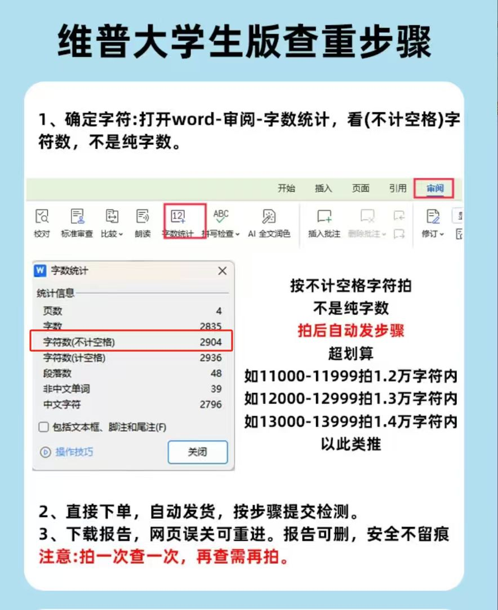
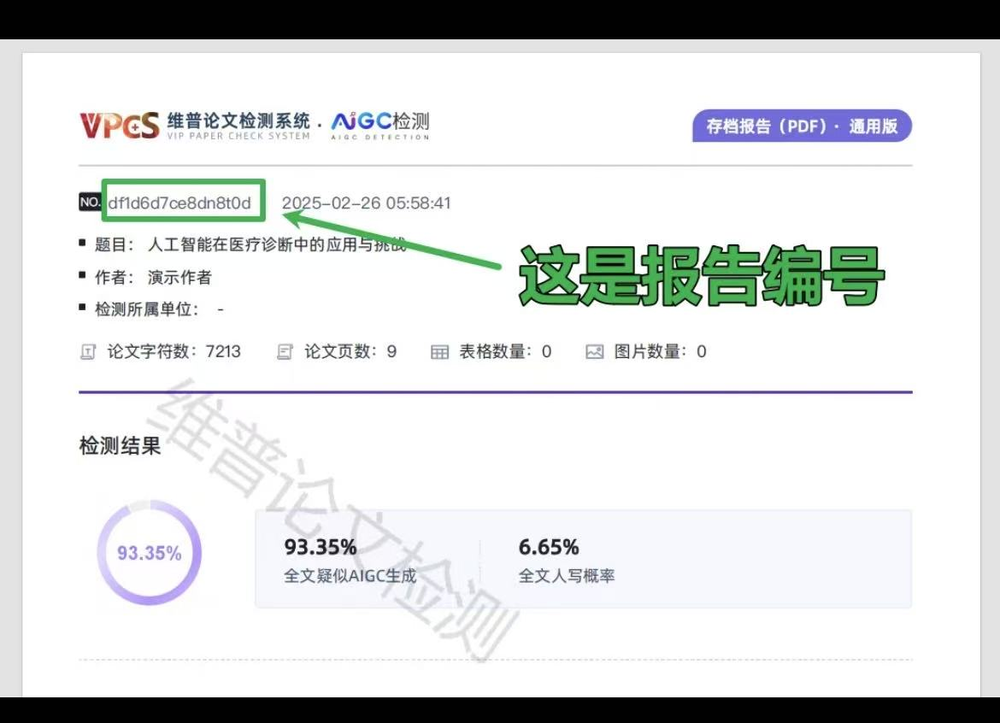
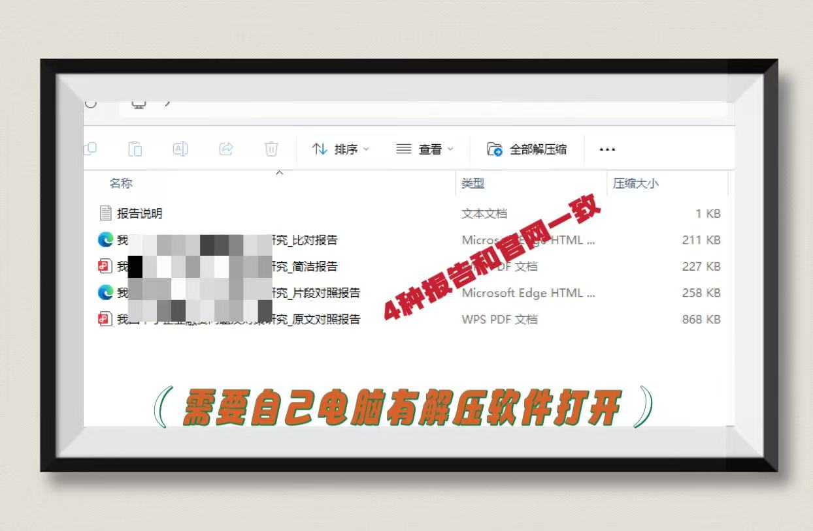
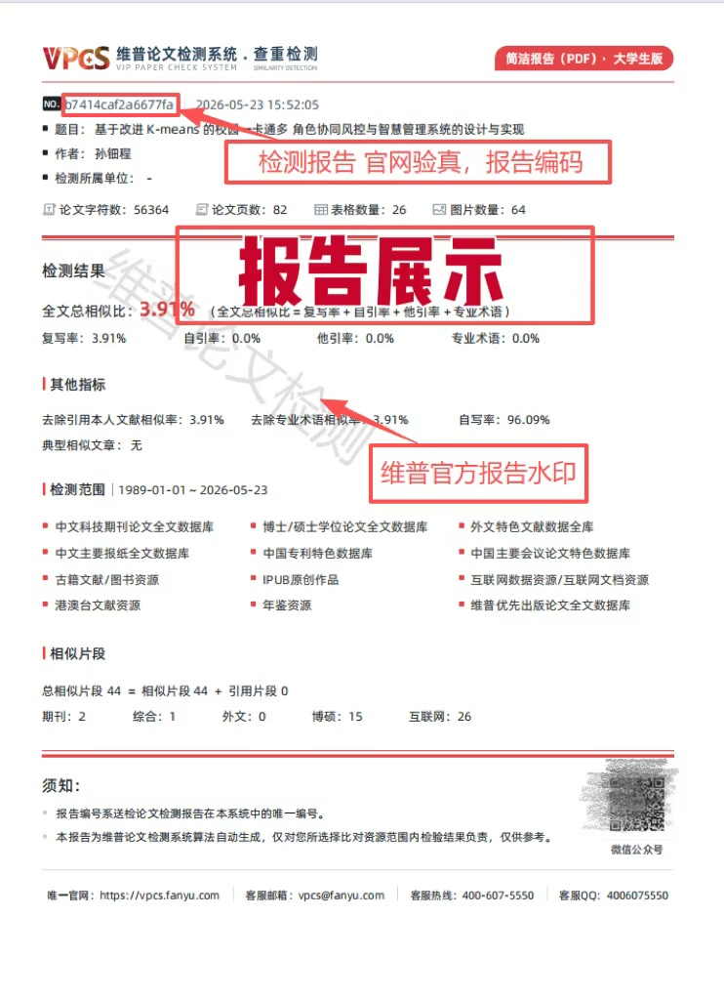
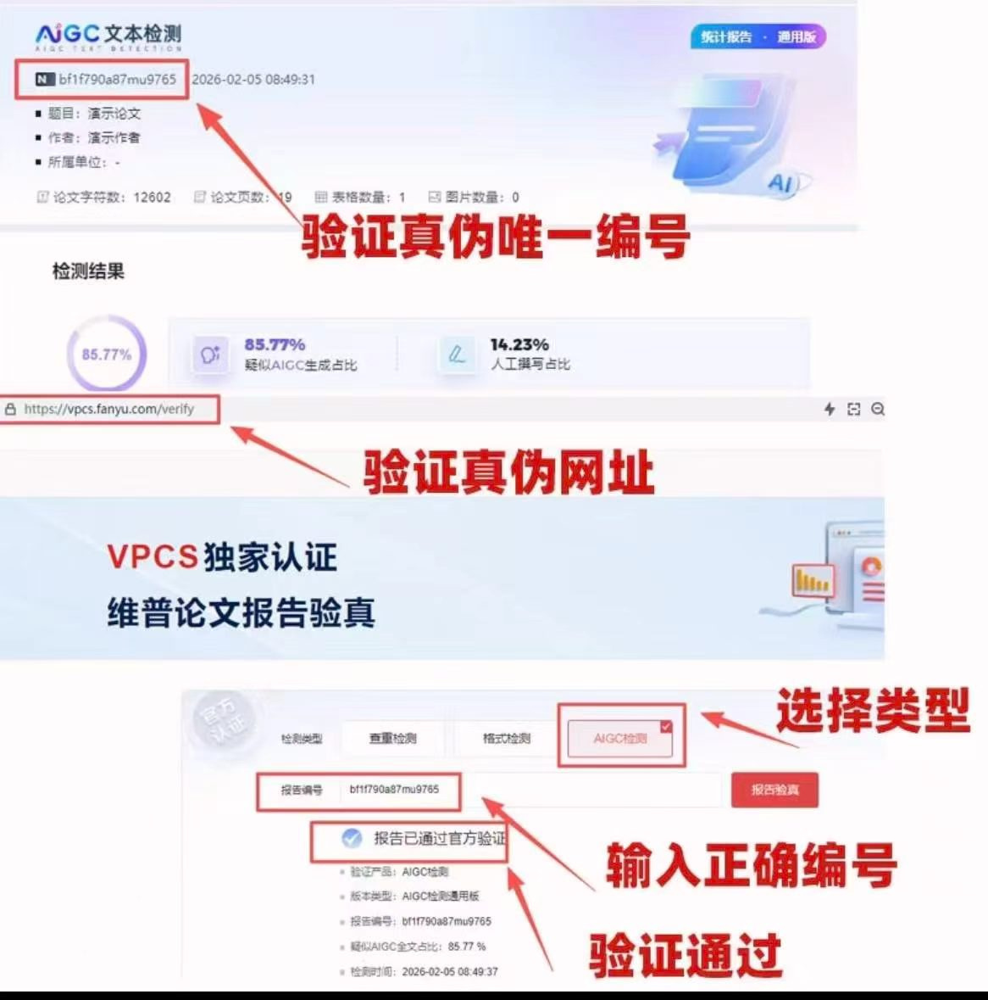
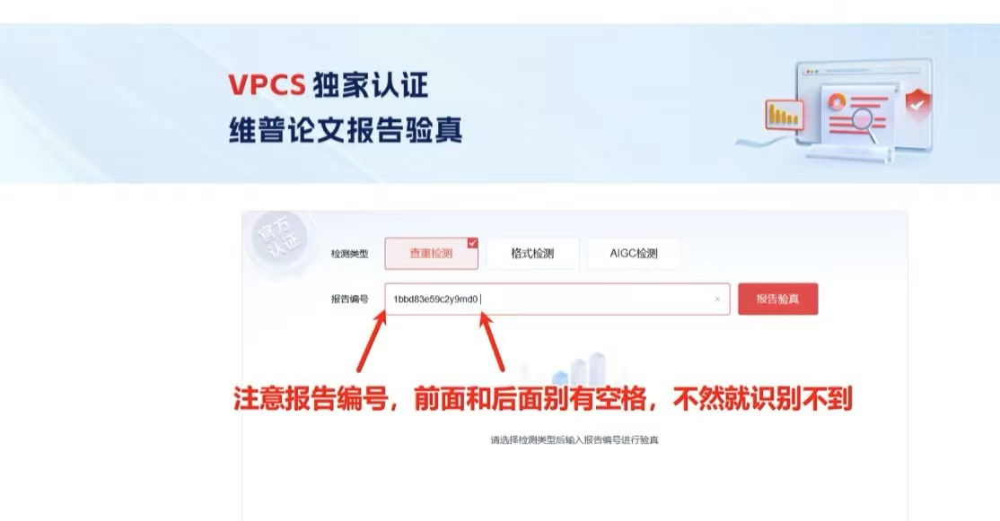

# 报告查看与验真图文指引

## 先区分三个编号

1. **内部订单号**：用于 `/pwp` 进度页、支付页和 `/reports` 查询；脚本输出 `order_no`。
2. **支付订单号/检测卡号**：只用于页面的支付或检测卡结算，不能代替报告编码。
3. **报告编码**：报告生成后出现在报告首页，用于官方验真；复制时去掉首尾空格。

不要看到一个长数字就把它当成报告编码。报告编号的位置以实际报告首页为准，示例图中的编号已经是教学数据。

## 查看和下载

1. 打开 `browser_urls.reports` 或 <https://vpcs.cqccjy.cn/reports>。
2. 输入订单号查询，确认题目、作者、检测版本和完成时间。
3. 下载报告文件；若是压缩包，先保存到本地并解压，再用 PDF 阅读器查看。
4. 检查报告首页的品牌、版本、检测时间、报告编号和水印；这些是人工核对线索，不是单凭外观判真的依据。

## 官方验真

1. 打开 <https://vpcs.cqccjy.cn/pwp/verify>。
2. 选择与报告匹配的检测类型。
3. 粘贴报告编码，检查首尾没有空格或换行。
4. 完成验证码并提交。
5. 对照页面返回的题目、作者、检测类型、时间和指标；不一致时保存页面截图并联系平台/学校，不要修改报告文件后再次验真。

验真结果的解释必须分成两层：

- **能证明的**：报告编码能在 VPCS 官方页面被识别，且页面返回字段与报告首页一致；
- **不能证明的**：学校一定接收、覆盖学校私有库、与学校终检完全一致，或用户一定通过答辩/盲审/投稿。

验真失败时先检查报告类型、编码首尾空白、是否拿错报告和固定域名，不要直接下“假报告”结论。完整判断树见 [verification-logic.md](verification-logic.md)。

## 图片索引

图片只用于定位按钮和字段，不能作为当前站点价格、报告结果、订单号或真伪结论的来源。
