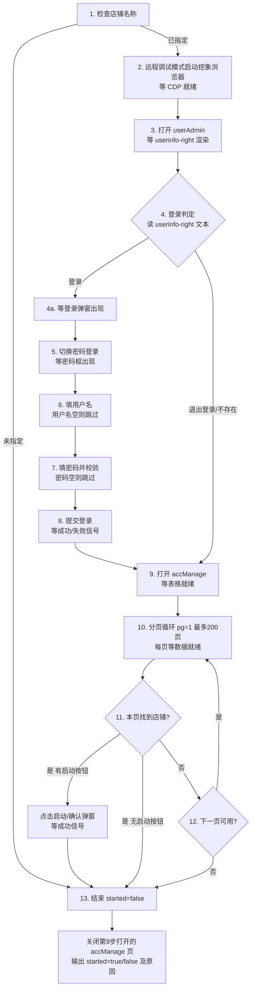

# 挖象浏览器启动店铺

本技能封装“在挖象浏览器中远程启动某个店铺”的完整可执行流程。按给定步骤执行，登录环节为幂等分支，店铺可能分布在不同分页中，需要分页遍历。

## 适用场景

- “启动店铺 Tiktok商家后台”
- “把 XXX 店铺打开/跑起来”
- “远程启动挖象店铺 <店铺名>”

## 前置参数

| 参数 | 必填 | 说明 |
| --- | --- | --- |
| 挖象浏览器路径 | 可选 | 默认 `C:\Users\admin\AppData\Local\WaXiangBrowser\waxiang.exe` |
| 挖象用户名 | 可选 | 手机号，登录用（无内置默认值，运行时由调用方提供） |
| 挖象密码 | 可选 | 登录用（无内置默认值，运行时由调用方提供） |
| 待启动店铺名称 | **必填** | 未指定则直接结束 |
| 监听端口 | 可选 | 选用空闲端口（如 `9222`） |
| 用户数据目录 | 可选 | 按账号隔离，建议使用独立目录（如 `C:\Users\admin\.waxiang-<账号>-profile`），避免登录态串号 |

> 若用户名/密码未给出，按“已登录”前提执行：启动后先做登录判定（第 4 步），已登录则跳过登录分支。

## 流程总览



## 执行步骤

> **统一约定：条件等待 + 超时兜底（不使用固定停顿）**
> - `等待(条件, 超时, 轮询间隔=300ms)`：在目标页面用 JS 每 300ms 轮询一次条件，成立立即继续；超时仍未成立则执行该步“兜底”分支（记录原因并结束或补救）。
> - 条件一旦满足马上继续：正常网络下多数步骤 1~2s 内完成；超时上限仅用于防卡死/防误判。
> - 判定类步骤（登录成功、表格就绪、翻页完成）改为“监测成功/失败信号”，而非空等固定时长。

### 1. 检查待启动店铺名称

若待启动店铺名称未指定，直接跳到第 13 步结束（`started=false`，原因=`未指定店铺名`）。

### 2. 启动浏览器

选用空闲端口（如 `9222`），以远程调试模式启动挖象浏览器：

```
waxiang.exe --remote-debugging-port=9222 --user-data-dir=<独立目录> --remote-allow-origins=* --no-first-run --no-default-browser-check about:blank
```

等待：轮询探测 `http://127.0.0.1:9222/json/version` 可访问（每 500ms，超时 30s）。兜底：超时未就绪 → 结束（原因=`浏览器未就绪`）。

### 3. 打开 userAdmin 并等待登录控件渲染

在当前标签页打开 `https://hao.waxiang.com/account/userAdmin`。

等待条件：`userinfo-right` 元素已渲染（首选 XPath `//div[contains(@class,'userinfo-right')]`，失败用备选绝对路径）；轮询 300ms，超时 20s。

兜底：超时仍未出现 → 追加一次判定：
- 若页面已出现登录弹窗（`.el-dialog` 内含手机号输入框 `input[@placeholder='请输入手机号']`）或已跳转登录页 → 说明已处于登录入口，直接进入第 5 步；
- 否则 → 结束（原因=`登录控件未渲染`）。

> 先确认控件渲染完成再做判定，避免把“页面还没加载出来”误判成“已登录”。

### 4. 登录判定（幂等分支）

读取第 3 步已确认存在的 `userinfo-right` 文本：
- 为 `登录`：点击该元素 → 执行 4a；
- 为 `退出登录`：已登录，跳过第 5~8 步，直接到第 9 步。

说明：该元素是登录/登出切换控件，未登录显示“登录”，已登录显示“退出登录”。

#### 4a.（点“登录”后）等待登录弹窗

等待条件：弹窗内出现 `input[@placeholder='请输入手机号']`；轮询 300ms，超时 10s。兜底：超时未出现 → 结束（原因=`登录弹窗未出现`）。

### 5. 切换密码登录（仅登录分支执行）

密码图标 XPath：`//img[contains(@class,'icon-img') and contains(@src,'pwd')]`

- 未命中：点击“其他登录方式”，等待密码图标出现（轮询 300ms，超时 5s）；仍无 → 结束（原因=`无其他登录方式入口`）。
- 点击密码图标后：等待弹窗内出现 `input[@type='password']`（轮询 300ms，超时 8s）。兜底：未出现 → 结束（原因=`密码登录表单未出现`）。

### 6. 填入用户名

前置条件：仅当挖象用户名非空时才定位并输入；为空则跳过本步（不定位、不输入），继续第 7 步。

定位 `input[@placeholder='请输入手机号']`，用 value setter 清空并写入、触发 `input`/`change` 事件。

校验（替代停顿）：立即回读 `value` 应等于用户名；未即时生效则轮询至多 3 次（300ms 间隔）；仍不一致 → 重填 1 次 → 再失败则结束（原因=`用户名填写失败`）。

### 7. 填入密码

前置条件：仅当挖象密码非空时才定位并输入；为空则跳过本步（不定位、不输入），继续第 8 步。

定位 `input[@type='password']`，同上写入并回读校验；失败重填 1 次，仍失败 → 结束（原因=`密码填写失败`）。
附加：填完后检测一次验证码/滑块（`img[src*='captcha'|'verify']`、`canvas` 或“滑块/验证”文案），仅作第 8 步失败预判提示，不需停顿。

### 8. 提交登录（按成功/失败信号等待）

点击“登录”按钮：首选 XPath（锚定手机号输入框所在表单）`//form[.//input[@placeholder='请输入手机号']]//div[contains(@class,'btn') and contains(.,'登录')]`；兜底 1 为绝对路径 `/html/body/div[1]/div/div[2]/div/div/div/div/div[2]/form/div[4]/div/div`；兜底 2 为弹窗内可见且文本为“登录”的叶子元素。

等待（轮询 400ms，超时 20s）：
- 成功信号：`userinfo-right` 变为 `退出登录`，或 URL 离开登录态进入账号相关页面 → 继续第 9 步；
- 失败信号（同步监测）：`.el-message` 错误提示（含 密码/账号/验证 等）或滑块/验证码出现 → 结束（原因=`登录失败:<错误文本>`）。
- 兜底：20s 内无任何信号 → 结束（原因=`登录结果未知`）。

### 9. 进入账号管理（等待表格就绪）

在当前标签页打开 `https://hao.waxiang.com/account/accManage`。

等待条件：出现店铺表格（`//div[contains(@class,'table-loading')]//table[contains(@class,'el-table__body')]`）且 `tbody` 已有数据行；轮询 400ms，超时 15s。

兜底：超时未就绪 → 若已退回登录页（未登录）则回第 4a~8 步登录后重试；否则结束（原因=`账号列表未加载`）。

### 10. 分页循环（第 11~12 步）

初始化页码 `pg=1`，最多循环 200 页。每页（首页与每次翻页后）统一执行“本页数据就绪”等待：
- 表格存在且 `tbody` 有行；
- 无加载中状态（加载遮罩/loading class 不可见或已移除）；
- 内容已稳定：连续 2 次采样（间隔约 400ms）“名称”列内容与行数一致。

轮询 300ms，整体超时 12s；兜底 → 结束（原因=`表格数据未就绪`）。避免把“数据还没加载完”误判成“本页没有该店铺”或“已到尾页”。

### 11. 查表并启动店铺

表格 XPath：`//div[contains(@class,'table-loading')]//table[contains(@class,'el-table__body')]`

- 通过配套表头（`.el-table__header` 的 `th`）按列名动态定位“名称”“操作”两列，**不要写死列序号**；
- 遍历 `tbody tr`，若某行“名称”列文本 == 待启动店铺名：
  - 点击该行“操作”单元格内文本为“启动”的元素；
  - 点击后等待（轮询 300ms，超时 6s）信号二选一：a) 出现确认弹窗（`el-message-box` / `el-dialog`）→ 点“确定/确认”；b) 该行“操作”列文本已从“启动”变为其它（前往/打开/进入等）→ 判定已启动；
  - 信号满足 → 跳第 13 步（`started=true`）；
  - 无弹窗且文本 6s 未变化 → 记录告警（原因=`已点击启动、状态待确认`）；
  - 行存在但无“启动”按钮（已是“前往”等，可能已启动）→ 结束（原因=`行存在但无启动按钮`）；
- 本页无该店铺 → 第 12 步。

### 12. 翻页判断

- 下一页按钮 XPath（首选，属性定位）：`//button[contains(@class,'btn-next')]`
- 备选（绝对路径）：`/html/body/div[1]/div/div[1]/div[3]/div[1]/div/section/div/div[2]/div[1]/div[2]/div[1]/div[2]/div[2]/div/button[2]`

判断：按钮存在、可见且未禁用（无 `disabled` 属性且 class 不含 `disabled`）→ 点击后回到第 10 步的“本页数据就绪”等待；按钮不存在或已禁用 → 结束（原因=`已到尾页`）。

### 13. 结束

1. 若已执行第 9 步（已打开账号管理页 `accManage`），先关闭该页面（所在标签页/窗口）。
2. 输出结论：`started=true/false` 及原因（已启动 / 已到尾页 / 超过最大页数 / 未找到表格 / 表格数据未就绪 / 行存在但无启动按钮 / 登录失败:<错误> / 登录结果未知 / 登录弹窗未出现 / 登录控件未渲染 / 浏览器未就绪 / 未指定店铺名等）。

## 注意事项

- 店铺名称是唯一必填参数；浏览器路径有内置默认值；用户名/密码**无内置默认值**（运行时由调用方提供，未提供时按“已登录”前提处理，第 6/7 步会自动跳过填入）。
- 用户数据目录务必按账号隔离（独立 `--user-data-dir`），防止登录态串号。
- 分页上限 200 页，防止死循环；到达上限按“超过最大页数”结束。
- 一律用“条件等待 + 超时兜底”，不要写死停顿：等待对象是**元素出现 / 数据就绪 / 成功或失败信号**，而非固定秒数。
- 定位优先使用属性 XPath（更抗页面结构调整），绝对路径仅在首选失效时作为兜底。
- 登录是幂等分支：已登录的浏览器应跳过登录步骤，直接进入账号管理。
