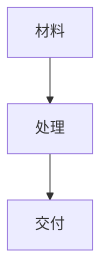

# Markdown 主题与扩展

要求服务端 PingAI API 0.8.0+。CLI 只上传用户提供的内容，扩展由服务器渲染。新能力不改变原有草稿/发布授权方式；切换主题不等于要求 AI 改写文章。

## 主题

运行 `node scripts/run.js themes` 查看当前技能支持的 12 个主题。顺序前四项为暖纸叙事、墨黑、蓝图笔记、青禾医学。

`--theme astranotes` 或中文名可用。旧 `warmeditorial` / 暖调手记映射为 `astranotes`。所有主题共用 16px/350 正文、26/21/18px 标题、苹方优先字体、统一间距和直角引用，保留各自配色。

## 基础语法

支持六级标题、段落、换行、粗体、斜体、删除线、行内/围栏/缩进代码、语法高亮、有序与无序及嵌套列表、静态任务清单、引用与嵌套引用、分隔线、表格对齐、链接、图片、数学公式、标题/封面 front matter。

可嵌入 `<mark>`、`<kbd>`、`<sup>`、`<sub>`、`<u>`、`<span class="tag">`、`<figure>` 与 `<figcaption>`。这些是 HTML 扩展，不等于支持任意网页脚本或应用。

## 可选组件

顶层容器以独立行 `:::` 结束，内部写普通 Markdown。暂不支持容器嵌套。

```markdown
:::intro
开篇导语。
:::

:::callout
**需要强调的一句话。**
:::

:::summary
### 小结
- 作者提供的第一点
- 作者提供的第二点
:::

:::references
### 参考资料
1. [资料标题](https://example.com)
:::
```

提示类使用 `:::note` / `:::tip` / `:::important` / `:::warning` / `:::caution`，对应提示、建议、重要、注意、警告。也支持 `> [!NOTE]`、`> [!TIP]`、`> [!IMPORTANT]`、`> [!WARNING]`、`> [!CAUTION]`。它们会添加中文类型标签；不会生成事实、参考来源或结论。

## 图注、目录、脚注

```markdown


[TOC]

## 标题

正文中的说明[^scope]。

[^scope]: 原作者提供的说明，可带链接和强调。
```

独立图片的 title 自动作为图注；行内或链接内图片不自动改结构。`[TOC]` 必须独立成行，生成标题目录。脚注支持顶层定义、缩进续行及重复引用；未引用的定义也保留。代码示例中的扩展语法不会执行。

## 折叠内容与图表

`<details><summary>补充阅读</summary><p>内容</p></details>` 转成展开的静态段落，发布后不依赖点击。



mermaid 围栏生成随主题配色的 SVG，支持所安装 beautiful-mermaid 的流程、状态、时序、类、ER、XY 图。每图最多 12000 字符，不等于支持全部 Mermaid；错误时提示并保留源码。

## 转换边界

- 仅给 Markdown 加主题，不会把截图或 PDF/PPTX 页图重新排成可编辑文字。
- 公式/图表 SVG、页内目录/脚注跳转、HTML 元素在微信各客户端的表现需要草稿实测。
- 不支持定义列表、`==高亮==`、上下标简写、其他网站的 hero/variant/items 容器配置。
- 不要为了“美化”凭空补写医学结论、作者信息或资料来源；用户没有提供的内容不自动生成。
