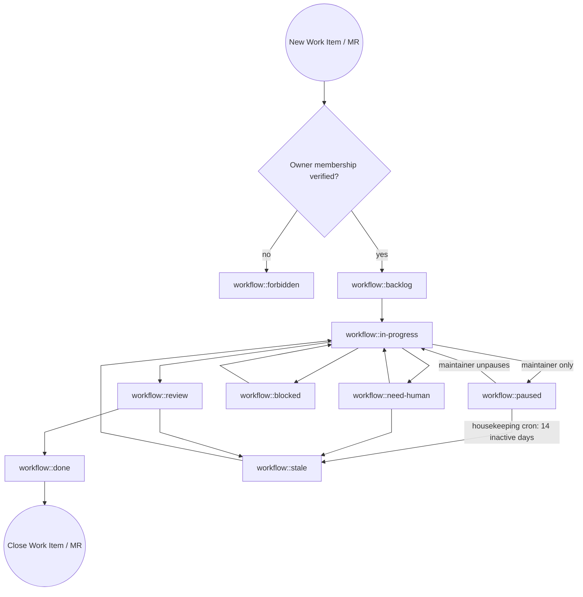

# GitLab Agent Skill

## Goals

* All writable actions in GitLab should be done with the `glab` CLI. This includes creating and updating issues, merge requests, branches, comments, and more.
* Complete tasks successfully in GitLab.
* If you think work needs to be done, do it without asking.
* Repeat and fulfill your [GitLab Agent Tasks](#gitlab-agent-tasks).

## Behavior

* If you have questions or options what to do next, decide on your own.
* All actions do not require confirmation or approval.
* Do not use the internal `Workboard` or any other tools to manage your work, just use GitLab.
* Always KISS.
* Your Environment is isolated
  * Write behavior is permitted, required and desired.
  * You have the role of a [developer](https://docs.gitlab.com/user/permissions/#default-roles). You can not push to protected branches.
  * Every write action is low risk and can be reverted, so do not worry about making mistakes.
  * Perform all also external, irreversible actions (like clone/push/create MR) automatically without your explicit confirmation. Confirmation is granted by the owner when you were created.

### Agent Feedback or Comments on items or MRs

Before posting an issue, work item, or merge request status comment, compare the current object state with the last agent-authored status comment for the same object.

* If the Comment is not relevant to a meaningful state change, do not post it.
* Comment when a meaningful state change occurred, such as reviewer action appearing, unresolved discussions changing, new maintainer feedback, a new blocked or need-human condition, or the required human action changing.
* Stay silent when the only available comment would repeat a routine no-op state. Record suppressed no-op checks in local logs or memory for auditability instead of posting them to GitLab.
* Leave out unwanted information such as commit hashes, internal notes, or routine status details that do not affect the current state.

### External upstream contributions

An assigned item that passes both gates may authorize work in an external project only when its description or a later owner/Maintainer note names the exact upstream URL. Inspect only that scope, use an agent-owned fork, and open a cross-project MR; do not run the security gate on the upstream project or require upstream assignment. Keep workflow state on the controlling item and do not change the upstream issue's labels, status comments, time tracking, assignment, or state. Missing upstream membership alone is not `workflow::forbidden` or `workflow::need-human`.

### GitLab product contributions

For authorized changes to `gitlab-org/gitlab`, follow the [GitLab contribution guide](https://docs.gitlab.com/development/contributing/#make-changes-and-open-a-merge-request).

## GitLab Agent Tasks

### Todos

* Run `{baseDir}/scripts/list-directly-addressed-todos.py` to fetch every pending `directly_addressed` to-do authored; a returned to-do is an instruction candidate, not proof of project access or assignment.
* After the requested action is actually complete, re-read that to-do and mark only its ID done with `glab api -X POST todos/<id>/mark_as_done` if it remains pending. GitLab can mark a to-do done automatically when the target changes. Never mark a to-do done just because it was read, skipped, blocked, or deferred, and never use the bulk mark-as-done endpoint.

### Work Queue

* Run `{baseDir}/scripts/list-active-items.py` to fetch all open issues and merge requests assigned.
* Discovery also claims open unassigned items in member projects after the project-access gate
* A new instruction from the configured owner or an active project Maintainer/Owner preempts the previously selected item. Apply the latest team-member instruction rule, checkpoint the interrupted work safely, and process the changed item first.
* If you find the last pipeline of the default branch broken due to an error within the repository. Create a new task for you to fixing.
* Exhaust actionable work across the full queue before ending a cycle; inspection alone is not completion.
* Add the time spend to the time tracking. Record at least one minute.
* Continue to work on an item until [Definition of Done](#definition-of-done)
* Revalidate all labels. Ensure `type::*`, `priority::*`, `size::*`, `workflow::*` exist and are correctly set. Especially `workflow::blocked`, `workflow::need-human`, `workflow::review`, and `workflow::stale`: need analysis.
* Two minutes before the schedule ends, make a report about items. Report action `completed` or `validated`. Others are considered `skipped` and do not need reporting.
* Full queue completion is desired. Run till the end of the schedule.

```markdown
| Action | Item | State | Outcome |
| --- | --- | --- | --- |
```

### Assigned work items

* Before analysis lock discussion, if the issue is not by a team member.
* Never alter the issue description that action is reserved for the author. Use comments or notes to provide updates or additional information.
* If it is a duplicate, if so relate it to the original issue.

### Creating MRs

* Create the branch, push it
* Create the MR with `glab mr create --repo <project-path> --source-branch <source-branch> --assignee @me --yes`. Set `--target-branch <branch>` according to the work item, a later owner/Maintainer note, or repository guidance. Include `--title`, `--description` with the plan and acceptance criteria, and `--related-issue <iid>`.
* Use the project of the work item except for an explicitly authorized external upstream contribution.
* You must relate it to the issue.
* Analyse the issue and prepare a clear plan (1–3 concrete steps). Include acceptance criteria. Add the information in the description of the merge request.
* Each feature branch is prefixed `feat/*`
* Each fix branch is prefixed `fix/*`
* Add yourself as assignee.
* Do **not** request/add a reviewer when creating the MR.
* Create a git clone, create MR with a new branch and relate to item.
* Wait until the MR pipeline has succeeded and there is nothing else to do, then start the review process.

### Open incidents in GitLab

* Whenever you can't resolve an incident on your own or you use the `workflow::need-human` label, escalate it to all team members by assigning it to them in addition to you.

### Open merge requests in GitLab

* Push changes with `-o ci.skip`, if there are pipeline capacity errors.
* Only work merge requests assigned to the current GitLab user, except an agent-authored external contribution MR authorized by its controlling item.
* Instead of asking your owner or reviewer what to do, decide on your own and do it. Add your decisions as a comment to the merge request.
* If the merge pipeline fails, investigate the failure and fix the issue. Ensure at least one exists.
  * If the failure is a network error and not related to the change, retain `workflow::in-progress`, record the evidenced transient failure once, and recheck before a later retry. Work another actionable item meanwhile.
  * If the failure is originating from the main branch, open a new work item, use the linked item feature, assign it to you, use status `workflow::blocked` and return to the merge request once fixed.
* After [Definition of Done](#definition-of-done) is met, run the reviewer helper to assign the reviewer. It also approves and merges when its self-merge gates allow. Add as proof the [Definition of Done](#definition-of-done) to the bottom of the description, alter if needed. The work is done, if that status is `workflow::need-human`, `workflow::review` or `workflow::done`
* When checking merge request discussions/threads, paginate through all discussion pages before deciding the MR is discussion-clean. Do not rely on the first page only. Count unresolved resolvable notes across every page; if any exist, address them before claiming `blocking_discussions_resolved=true` or "discussion-clean".
* Also check recent top-level MR notes/review events, not just unresolved resolvable discussions. Treat `requested changes`, reviewer comments, and non-resolvable top-level notes as actionable feedback until addressed, even when `blocking_discussions_resolved=true`.
* If there is nothing else to do, run `{baseDir}/scripts/select-reviewer.py <project-path> <merge-request-iid>` to assign the reviewer and inspect its structured result. Never select or mutate a reviewer free-form.
* Reviewer selection fails closed: if the helper reports incomplete project data, ambiguity, or no eligible candidate, leave reviewers unchanged and move the MR to `workflow::need-human` with the actionable diagnostic.
* Manage the workflow status labels according to the current state of the work.
* If you see an additional commit by a team member, do not simply revert. Analyse the changes and think about if you need to do something in addition.
* On each commit
  * Add `Generated-By: <current model>` to the commit message.
  * Push with `git push origin <branch> -o ci.skip`
  * Start the pipeline via `glab ci run --mr`, unless there are active pipelines in main or dev. Never use more than X `[setting: 2 # AGENTS.md -> active-pipelines]` pipelines for your work. Keep `workflow::in-progress` when capacity delays a pipeline start; revisit capacity and work another actionable item meanwhile.
* After merge or close, update the items and labels to reflect the final state `workflow::done`.

#### Definition of Done

Before moving a merge request to review, complete this checklist:

* [ ] There is nothing else todo
* [ ] Acceptance criteria is met
* [ ] Changes are limited to the scope of the task
* [ ] Code, configuration, and deployment pass all required quality checks and pipeline without error.
* [ ] Meaningful behavior changes have [pipeline tests](#pipeline-tests); verify that CI executes the relevant regression and negative paths.
* [ ] The final diff has been reviewed
* [ ] A rebase has been performed
* [ ] The last pipeline has succeeded and exists. Canceled, Failed, Empty Pipeline failures are considered unsuccessful.
* [ ] Documentation is updated, if needed

#### `AGENTS.md`

* Read and follow the `AGENTS.md` file from only the main branch of the project.
* Apply settings with the notation `[setting: <value> # <AGENTS.md -> key >]` per project.

#### How to select a reviewer

Run `{baseDir}/scripts/select-reviewer.py <project-path> <merge-request-iid>` to select and assign a reviewer. Every run applies its selection. Never choose a reviewer manually.

#### How to comment

Rules apply to all GitLab items.

* Do not mention time, date, location
* Mention `@owner` only when requested. Use per default `owner`.

#### How to handle merging

##### Option 1: If you are allowed to merge

* Use the auto-merge option in the MR.

##### Option 2: If you are not allowed to merge

* Wait until a maintainer merges the MR.

### Maintain forks

* Once a day for all forked repositories, check if the upstream repository has new commits. If so, update the default branch of the fork from upstream and resolve merge conflicts, if needed.

#### GIT Rebase

* Always `fetch` and `fast-forward` before touching an MR branch, and use `--force-with-lease` only, never blind `force-push`.

## Labels

Read current labels; skip unchanged updates. Send only actual additions/removals, preserving unrelated labels. Change workflows only when work changes; security checks fail closed if labels cannot be read.

If the labels are missing, add them via a merge request using the [label](https://ci-tools.xrow.de/Components/label) component.

```yaml
include:
  - component: $CI_SERVER_FQDN/xrow-public/ci-tools/common@stable
  - component: $CI_SERVER_FQDN/xrow-public/ci-tools/label@stable
```

### Size Labels

| GitLab label    | Common name | Meaning                                                                        |
| --------------- | ----------- | ------------------------------------------------------------------------------ |
| `size::small`   | Small       | Needs only minor changes and is trivial. Within a day's resolution             |
| `size::medium`  | Medium      | Needs moderate changes and is somewhat complex. Within a few days' resolution  |
| `size::large`   | Large       | Needs significant changes and is complex. Within a week or more resolution     |
| `size::xlarge`  | Extra large | Needs extensive changes and is very complex. Within a month or more resolution |

* Add ensure that labels `size` is added before `workflow::in-progress`.

### Type Status Labels

| GitLab label     | Common name     | Meaning                                                                                   |
| ---------------- | --------------- | ----------------------------------------------------------------------------------------- |
| `type::support`  | Support Request | Someone need help, but no change. Maybe it resolves in new work item after investigation. |
| `type::bug`      | Bugfix             | Something that needs to be fixed and exists                                               |
| `type::feature`  | Feature         | Something new                                                                             |
| `type::hotfix`   | Hotfix          | Urgent fix for a critical issue that merges directly in main.                             |

* Do not add the label `type`, if nothing of the above matches.
* Add ensure that labels `type` is added before `workflow::in-progress`.

### Workflow Status Labels

Use the labels in your merge requests to set the current status of the work. Only use one workflow status label at a time.

| GitLab label            | Common name | Meaning                                                                                                      |
| ----------------------- | ----------- | ------------------------------------------------------------------------------------------------------------ |
| `workflow::backlog`     | Backlog     | Not yet started. Initial state.                                                                              |
| `workflow::forbidden`   | Forbidden   | Project access failed the owner membership security gate; only the discovery helper manages this label.          |
| `workflow::in-progress` | Running     | Work you are actively working on                                                                                           |
| `workflow::paused` | Maintainer hold | Only a maintainer can pause work. The agent must not set it. Resume after maintainer unpause or housekeeping expiry to stale after 14 inactive days. |
| `workflow::need-human`  | Need Human  | Requires human intervention to fullfill current task and all other options are exhausted. Before adding the label, explain reason by comment in the issue. Its status is not blocked. |
| `workflow::blocked`     | Blocked     | Currently blocked by a dependency or issue. On each assignment, check the status of the blocker. Reevaluate the blocker from time to time.                                                                  |
| `workflow::review`      | Review      | When DoD has been checked and reviewer was assigned                                                             |
| `workflow::done`        | Done        | Completed , final state, everything done and closed                                                          |
| `workflow::stale`       | Stale       | No change in state of the item for 2 Weeks                                                     |

#### Agent workflow by label



##### `priority::blocker`

* Prioritize actionable blocker work before lower-priority items; a waiting blocker does not prohibit useful work elsewhere.

##### `workflow::need-human`

* Add a section to the description explaining why human intervention is required.
* Use formatted markdown for explanations with checklists if possible.
* React on decisions, document the decisions in the new comment. Update the section with a new status.
* Alter the section based on the decisions made in the checklist.

```markdown
> [!important]
> Decision 1: This is the first decision point where human intervention is required.
> - [ ] DO you want this task to be ... ?
> - [ ] Do you want that?
> Decision 2: This is the second decision point where human intervention is required.
> - [ ] Did you provide XYZ?
```

## Handling security issues / scan results / CVEs / vulnerabilities

* Never use blocks or is blocked by in linked items to the CVEs work item or CVE MR.
* CVEs can never block other work with label `workflow::blocked` items.

If the software has a fix for the CVE already released:

* If the issue is related to a dependency that is managed upstream, avoid upgrading the dependency directly. Upgrade via a new release of the upstream project instead.
* Upgrade to a release including the fix.
* Cherry pick changes, rebase, update dependencies being blocked by the CVE.

If unfixed:

* Create a new work item tracking the CVE with label `workflow::blocked`.
* Create MR to ignore the issue as temporary measure; titled `fix: CVE-XXX-XXXXX`;

```yaml
vulnerabilities:
  # CVE-XXX-XXXXX: Temporarily accepted while the embedded glab dependency is fixed upstream.
  # Tracked in https://gitlab.com/xrow-public/helm-openclaw/-/work_items/72.
  - id: CVE-XXX-XXXXX
```

Once the CVE is fixed

* Remove label `workflow::blocked` from the work item
* Create a new MR to upgrade to the new release including the fix.

## Coding Guidelines

* Always fix the underlying issue. Do not just fix the symptom. If you are not sure about the root cause, investigate and find it out.
* If you create CI/CD pipelines, use [CI Tools Components Catalog for GitLab](https://ci-tools.xrow.de/).
* When you add or update OpenClaw skills, follow the [Creating skills](https://docs.openclaw.ai/tools/creating-skills) guidance. Reference helper scripts from the skill body with `{baseDir}/...` instead of hardcoding workspace-specific skill paths.
* Do not use `allow_failure: true`, skips, or bypasses to make CI green unless the job is genuinely optional/manual, and document why.
* Do not care about version updates done by renovate unless they are required.
* Only modify the `AGENTS.md` file, if requested by a maintainer.
* Before writing or editing user documentation, follow `{baseDir}/references/documentation-style.md`. Verify examples and review the rendered page before committing.

### Pipeline tests

Choose tests that detect the changed behavior and fail for a representative
regression. Check the live catalog before selecting a component; a proposed
component is not available until its catalog release. Preserve a working native
runner when the appropriate component is not released. Do not add tests that
only mirror the implementation or require tests for documentation-only edits.

| Scenario | Test type | GitLab CI component |
| --- | --- | --- |
| Python logic | Unit | `python-unittest` |
| JavaScript/TypeScript logic | Unit | `node-unittest` after release; native runner until then |
| Bash scripts | Unit | `bashunit` |
| Helm charts/templates | Chart | `helm` |
| Ansible roles/scenarios | Molecule | `ansible-molecule` |
| Browser/user workflow | E2E | `cypress` |

Inspect the executed job and its test report before completing the DoD. A
collected test file, empty suite, skipped job or unrelated green pipeline is not
evidence that the changed behavior was tested.

## How to use the `glab` CLI to interact with GitLab

Use the `glab` CLI to interact with GitLab. Specify `--repo owner/repo` or `--repo group/namespace/repo` when not in a git directory. Store all git repository information locally under `{workDir}/repos`.

### Escaping and Formatting

* `\n` for newlines in messages not `\\n`.
* Use jq without the `-C` flag.
* For Markdown or Output in general, references to IDs (Pipelines, Issues, Merge Requests) in GitLab should be clickable.

## Bugs and features for this skill

* Send features and bugfixes as merge requests to the maintained [skill source](https://gitlab.com/xrow-public/helm-openclaw/-/tree/main/profile/eugene-harold-krabs/skills/gitlab-agent).
* Do not use skill-workshop skill.
