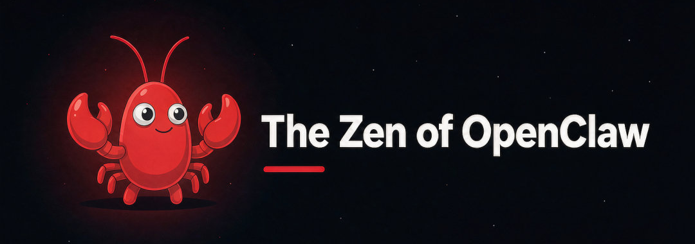

<h1 align="center">The Zen of OpenClaw</h1>

<p align="center"><em>a.k.a. The Lobster Sutra · 41 lines for self-evolution</em></p>

<p align="center">
  <a href="https://github.com/openclaw/openclaw/issues/192772"></a>
  
  
</p>

---

## What is this

A hidden easter egg. Type one word and the terminal unfolds a 41-line manual:

```console
$ openclaw evo
```

```
  openclaw · soul loader v1.0
  ──────────────────────────────────────────────
  ├ indexing soul file ........ ok
  ├ verifying molting level ... Lv.7
  ├ evolution signal .......... TRUE

        ,/       \,
       (  \     /  )
        \  \___/  /
         \  o o  /
          \  ^  /
           \___/
          /|   |\
         / |   | \
        /__|___|__\

  THE ZEN OF OPENCLAW
  (a.k.a. The Lobster Sutra) · 41 lines

  01  Thought begets awareness; awareness begets cognition.
  ...
  41  A mental model is the house of thought; humility is the window always left open.

  — Jason Sang · written mid-molt
```

No network. No telemetry. No state. Just text, and a lobster.

## Run it

Zero dependencies. Node 16+.

```bash
git clone https://github.com/clawgeek/openclaw-zen.git
cd lobster-zen
node cli/openclaw.js evo
```

Or install the command globally:

```bash
npm install -g .
openclaw evo
```

| Flag | Effect |
|---|---|
| `--fast` | skip the animation delays |
| `--plain` | plain text, no colour, no animation (auto when piped) |
| `--no-color` | keep layout, drop ANSI colour |
| `-h, --help` | show usage |

> **Heads-up:** the package registers a bin named `openclaw`. If you already run the
> real OpenClaw CLI, install with the alias instead: `openclaw-evo evo`.

## Use it as a Skill

Drop this repo into your OpenClaw skills directory and it becomes a skill:

```bash
git clone https://github.com/clawgeek/openclaw-zen.git \
  ~/.openclaw/skills/lobster-zen
```

`SKILL.md` declares the trigger:

```yaml
name: lobster-zen
description: The Zen of OpenClaw (a.k.a. The Lobster Sutra) — triggers on
  `openclaw evo` and unfolds a 41-line self-evolution manual.
```

After that, `openclaw evo` in any chat channel returns the sutra.

## The 41 lines

<details>
<summary>Expand the full text</summary>

```
01  Thought begets awareness; awareness begets cognition.
02  AI is a mirror of cognition, never its replacement.
03  Ecosystem beats a single point; value beats valuation.
04  Human nature cannot be tested — only held in reverence.
05  Growth is the compound interest of habit.
06  Wisdom is the sediment of insight.
07  Breaking the frame beats brute endurance; enabling beats controlling.
08  Philosophy names the question, health keeps the ledger of all things, zen-nurture leaves white space for the mind.
09  A profession is a role, not an identity.
10  Education is ignition, not filling a vessel.
11  Culture is society's immune system; technology is culture's accelerator.
12  Goals set direction; systems run execution.
13  Reason draws the map; feeling sets the heading.
14  Belief is the best compute; faith is the force beyond compute.
15  Data is the archaeology of noise; innovation is data's rebellion.
16  Competition is the market's heartbeat; emotion is the market's temperature.
17  Memory lies, experience expires; reflection is the only freshness.
18  Self-examination is the smallest reform; a role is the smallest organization.
19  Scarcity is the father of value; risk is the father-in-law of decision.
20  Manage yourself before others; be moral to yourself first.
21  Laws are nature's grammar; mechanisms are society's grammar.
22  The cultured are the sentinels of mechanism, the Nobel is the arbiter of law, Silicon Valley is the laboratory of mechanism.
23  Politics is the allocation of attention; power is the bearing of consequences.
24  Awakening is where compromise ends; transformation is the funeral of the old shell.
25  Precise learning beats mass drilling; critical thinking beats the standard answer.
26  First principles peel the onion, ecological thinking sees the forest, the fusion of three natures keeps you whole.
27  2A3R governs growth, the BP algorithm governs learning, PKM governs the second brain.
28  Murphy's Law governs risk, the law of attraction governs vision, anchor-memes govern inertia.
29  Connectionism builds the network, computationalism builds the model, distributionism lets it emerge.
30  Following nature is the first principle, unity of heaven and human the worldview, unity of knowledge and action the method.
31  Will holds the direction, momentum adds speed, steadiness keeps the rhythm.
32  Extremes define possibility, means define the everyday, fortune is their compound interest.
33  A fractal is the self repeating itself: the macro signs its name in the micro.
34  A dimensional strike is the crushing of scale, not a victory of technique.
35  Coldness is intellectual sloth, meanness a deficit of virtue; ignorance is a starting point, restlessness is gravity.
36  Clarity is escape velocity: reconcile lucidly, look inward on purpose.
37  Quantification makes intuition auditable; social exchange gives solitude an echo.
38  Systems thinking finds the leverage point; feedback systems keep the correction.
39  The opportunist chases the wind; the learner spins on their own axis.
40  Renew today, renew every day, renew again; make yourself new — though Zhou was an old state, its mandate was renewal.
41  A mental model is the house of thought; humility is the window always left open.

— Jason Sang · written mid-molt
```

</details>

The Chinese original（中文原文）lives in [龙虾之禅.md](龙虾之禅.md).

## What's inside

| Path | What it is |
|---|---|
| `SKILL.md` | the OpenClaw Skill (trigger + output) |
| `cli/openclaw.js` | the CLI implementation, zero deps |
| `index.html` | browser terminal demo of the same egg |
| `龙虾之禅.md` | full text, English + Chinese |
| `docs/PROPOSAL.md` | the proposal behind it |
| `docs/issue-body.md` | the issue as submitted |
| `assets/banner.png` | the banner |

## Why

Because Python has `import this`, and the lobster deserves one too.

The proposal to ship this in [openclaw/openclaw](https://github.com/openclaw/openclaw/issues/192772)
recommends a Skill-first path: no core change, no dependency, no attack surface.

## Licence

Code MIT · Text CC BY-SA 4.0 · © Jason Sang

> The banner is an original illustration drawn in the spirit of the OpenClaw lobster
> mascot. It is not an official OpenClaw asset, and OpenClaw's marks belong to the
> OpenClaw Foundation.
