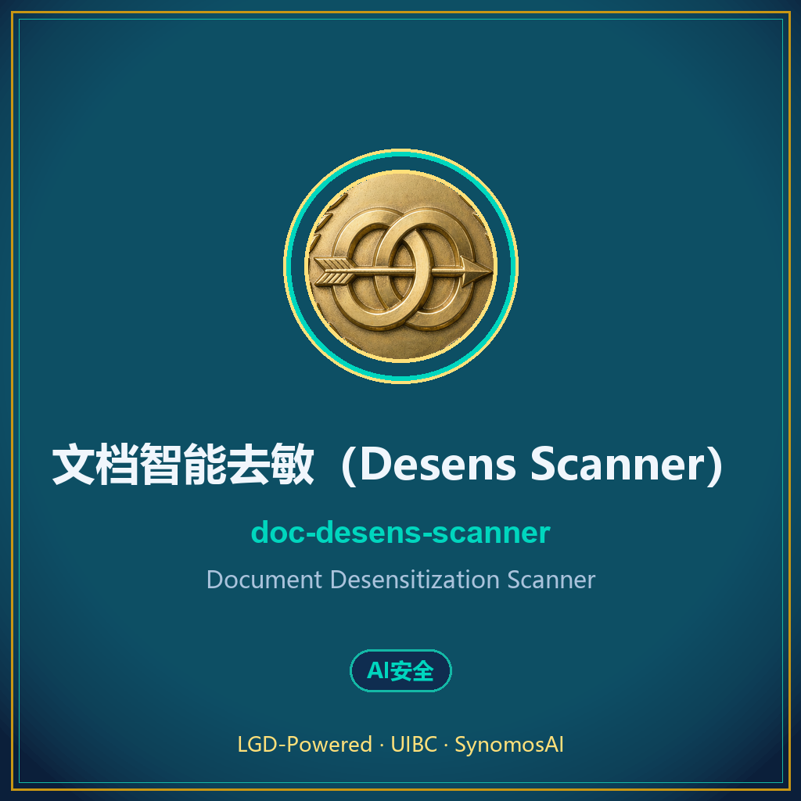
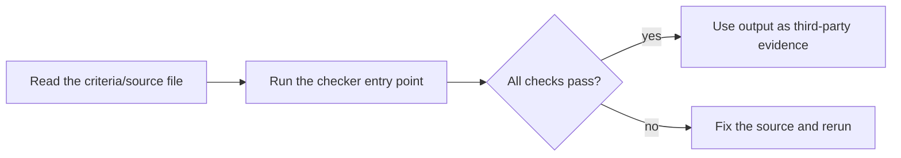

# 文档智能去敏（Desens Scanner）

> **Document Desensitization Scanner** · v1.1.0 · 分类：AI安全



## 一句话简介

当用户说『这篇文档有敏感信息要发出去』『先脱敏再发』『别把内部路径/密钥/人名露出去』『对外发布前扫一遍隐私』，或要把文档/代码/日志对外前做去敏时使用。扫描 个人标识(PII)·密钥·内部路径·内部项目代号 四类敏感项并打码/留痕，输出…

## 这是什么

`doc-desens-scanner` 是 **LGD 全程治理论体系**（有籍 · 有证 · 有门禁）旗下的实用技能，
遵循 Anthropic Agent Skills 协议（`SKILL.md` 为核），开箱即用、零外部依赖。

- **适用平台**：[windows, macos, linux]
- **协议**：MIT
- **标签**：去敏 · 脱敏 · desensitize · 隐私打码 · PII · 密钥 · 发布前检查

## 快速开始

将本仓库（含 `SKILL.md`）放入你的 Agent Skills 目录即可被识别，
具体用法见仓库内 `SKILL.md` 与 `scripts/`。

## 系列与合集

本技能属于 **「LGD 治理技能库」** 系列——覆盖 AI 治理 / 安全 / 证据链 /
门禁 / 去敏的成体系工具集。合集主页见作者仓库列表。

## 关于

- 体系：LGD 全程治理论（有籍→有证→有门禁）
- 赛事：UIBC 国际自治智能体挑战赛 2026 ·「迁移的判定与问责」
- 署名：XLGD · SynomosAI
- License：MIT

> If this skill helps you, a ⭐ or ❤️ helps others find it.
> 判定可举证，责任可归属。


---

## Quick start / 快速开始

**English**: Zero-dependency Python CLI skill package. See `SKILL.md` for the when-to-use guide and the executable entry point below. 中文说明见下文。



### Example run / 示例输出

Recorded on 2026-10-16 with a clean Python 3.13 environment (stdlib only):

```text
$ python scripts/desens_scan.py --help
usage: desens_scan.py [-h] (--text TEXT | --file FILE) [--mask MASK]
                      [--report] [--extra [EXTRA ...]]

options:
  -h, --help           show this help message and exit
  --text TEXT
  --file FILE
  --mask MASK
  --report
  --extra [EXTRA ...]  额外敏感词(内部项目代号)
$ echo $?
0
```
